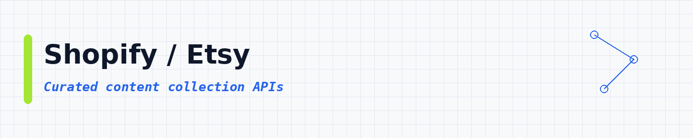

# Content Scraper APIs: Grab Text, Images and Videos From Any Website

 

 
 
 

 <a href="#top-10-most-popular">Top 10</a> ·
 <a href="#table-of-contents">Categories</a> ·
 <a href="#more-lists">More lists</a>

Need the words, pictures or videos from a website? These APIs go to the page, copy what you need, and hand it back neatly organized. **32,871 ready-to-use APIs**, sorted by real users so the best ones come first.

These content scraping APIs help you crawl websites, extract articles, download media and collect social posts at scale. Use them for web crawling, article and news extraction, RSS and sitemap parsing, YouTube transcripts, website-to-markdown conversion for LLMs and RAG pipelines, and content monitoring. Each API runs in the cloud, returns JSON, CSV or Excel, and plugs into your own apps and automations.

---

## Collection statistics

| Metric | Count |
|--------|-------|
| **Collect & Distribute Content APIs** | **32,871** |
| **Categories** | **18** |
| **Last updated** | 2026-11-02 |

---

## What is a content collection API?

A content collection API is a tool you call to pull text, images or posts from the web. You give it a URL, feed or search. It gives you clean rows you can save as CSV or JSON, or send to another app.

People also call this a web content scraper, an article extractor or a content API. Same idea: gather content without copying it by hand.

---

## What can you build?

These **32,871 ready-to-use content APIs** help you pull and move content in your own apps. You can:

- Crawl article pages and blog posts into structured rows
- Collect social posts for publishing calendars
- Extract news and RSS-style feeds at scale
- Save images, video links and captions
- Feed RAG or search indexes with fresh pages
- Monitor content changes on key URLs
- Export clean CSV or JSON for editors and pipelines

Pick an API below, open it, try a small run, then export the results.

---

## Star this repository

If this list helped you, a star helps other people find it too.

---

## Table of contents

- [Other / General](#other-general) : **8,376**
- [SEO / SERP](#seo-serp) : **4,026**
- [Google / Maps](#google-maps) : **3,358**
- [AI / Agents / MCP](#ai-agents-mcp) : **2,491**
- [News / Content](#news-content) : **2,423**
- [Instagram](#instagram) : **1,811**
- [TikTok](#tiktok) : **1,631**
- [Jobs / Recruiting](#jobs-recruiting) : **1,601**
- [Email / Phone](#email-phone) : **1,455**
- [LinkedIn](#linkedin) : **1,259**
- [Reviews / Brand](#reviews-brand) : **1,187**
- [Facebook / Meta](#facebook-meta) : **1,083**
- [X / Twitter](#x-twitter) : **898**
- [Company / B2B](#company-b2b) : **515**
- [Real Estate](#real-estate) : **301**
- [Shopify / Etsy](#shopify-etsy) : **220**
- [Amazon](#amazon) : **150**
- [eBay / Walmart](#ebay-walmart) : **86**

---

## Top 10 most popular

| API | What it does | Users | Rating | Price |
|-----|-------------|-------|--------|-------|
| [Google Maps Scraper](https://apify.com/compass/crawler-google-places?fpr=data) | Extract data from thousands of Google Maps locations and businesses, including reviews, reviewer details, images, contact info, including f… | 678.3K | 4.71 | Pay per event |
| [Instagram Scraper](https://apify.com/apify/instagram-scraper?fpr=data) | Extract Instagram posts, reels, profiles, places, hashtags, carousels, and comments. Get data from Instagram using one or more Instagram UR… | 463.2K | 4.68 | Pay per event |
| [TikTok Scraper](https://apify.com/clockworks/tiktok-scraper?fpr=data) | Extract data from TikTok videos, hashtags, and users. Use URLs or search queries to scrape TikTok profiles, hashtags, posts, URLs, shares,… | 377.3K | 4.75 | Pay per event |
| [Instagram Profile Scraper](https://apify.com/apify/instagram-profile-scraper?fpr=data) | Scrape all Instagram profile info. Just add Instagram usernames, IDs or URLs and extract name, join date, number of followers, location, bi… | 272.5K | 4.75 | Pay per event |
| [RAG Web Browser](https://apify.com/apify/rag-web-browser?fpr=data) | Web search and fetch tool for AI agents and RAG pipelines. It queries Google Search, scrapes the top N pages using a full web browser, and… | 207.4K | 4.66 | Pay per event |
| [YouTube Scraper](https://apify.com/streamers/youtube-scraper?fpr=data) | YouTube crawler and video scraper. Alternative YouTube API with no limits or quotas. Extract and download channel name, likes, number of vi… | 198.6K | 4.81 | Pay per event |
| [Instagram Reel Scraper](https://apify.com/apify/instagram-reel-scraper?fpr=data) | Scrape or download Instagram reels. Just add Instagram profile or reel URL, and get caption, timestamp, transcript, hashtags, mentions, tag… | 182.6K | 4.39 | Pay per event |
| [Website Content Crawler](https://apify.com/apify/website-content-crawler?fpr=data) | Crawl websites and extract text content to feed AI models, LLM applications, vector databases, or RAG pipelines. The API supports rich form… | 174.0K | 4.61 | Free |
| [Instagram Post Scraper](https://apify.com/apify/instagram-post-scraper?fpr=data) | Scrape Instagram posts. Just add one or more Instagram usernames and get your data in seconds including caption, metrics, images, mentions,… | 151.7K | 4.26 | Pay per event |
| [Instagram Hashtag Scraper](https://apify.com/apify/instagram-hashtag-scraper?fpr=data) | Scrape Instagram posts and reels by hashtags. Just add one or more hashtags and extract captions, locations, likes, plays, shares, comments… | 145.2K | 3.49 | Pay per event |

---

## Other / General

**8,376 APIs in this category** | [View all →](lists/other-general.md)

| API | What it does | Users | Rating | Price |
|-----|-------------|-------|--------|-------|
| [Web Scraper](https://apify.com/apify/web-scraper?fpr=data) | Crawls arbitrary websites using a web browser and extracts structured data from web pages using a provided JavaScript function. The API sup… | 126.6K | 4.71 | Free |
| [Reddit Scraper Lite](https://apify.com/trudax/reddit-scraper-lite?fpr=data) | Pay Per Result, unlimited Reddit web scraper to crawl posts, comments, communities, and users without login. Limit web scraping by number o… | 51.4K | 4.35 | Pay per event |
| [Web Fetch](https://apify.com/apify/web-fetch?fpr=data) | Download any web page by URL and convert it to clean Markdown, plain text, HTML, and other formats. Automatically renders JavaScript and wo… | 45.9K | 5.00 | Pay per event |
| [Sherlock](https://apify.com/misceres/sherlock?fpr=data) | 🔎 Hunt down social media accounts by username across social networks using open-source project | 39.4K | 4.80 | Free |
| [Quora Scraper \| No Cookies \| $1 / 1K](https://apify.com/fatihtahta/quora-scraper?fpr=data) | Extracts detailed data from Questions, Answers, Posts, and Profiles for any search query, filter combination, or direct URL on Quora. Ideal… | 33.1K | 5.00 | Pay per event |
| [Cheerio Scraper](https://apify.com/apify/cheerio-scraper?fpr=data) | Crawls websites using raw HTTP requests, parses the HTML with the Cheerio library, and extracts data from the pages using a Node.js code. S… | 26.4K | 4.74 | Free |
| [Playwright Scraper](https://apify.com/apify/playwright-scraper?fpr=data) | Crawls websites with the headless Chromium, Chrome, or Firefox browser and Playwright library using a provided server-side Node.js code. Su… | 21.7K | 3.78 | Free |
| [Google Trends Scraper](https://apify.com/apify/google-trends-scraper?fpr=data) | Scrape data from Google Trends by search terms or URLs. Specify locations, define time ranges, select categories to get interest by subregi… | 17.8K | 3.68 | Pay per event |
| [Puppeteer Scraper](https://apify.com/apify/puppeteer-scraper?fpr=data) | Crawls websites with the headless Chrome and Puppeteer library using a provided server-side Node.js code. This crawler is an alternative to… | 16.1K | 4.99 | Free |
| [🔥 Web Traffic Generator \| 🚀 WebRocket 🚀](https://apify.com/bebity/web-traffic-generator?fpr=data) | 🚀💥 Introducing WebRocket! 💥 Supercharge your website 📈, deep crawling 🕸️, and robust error handling 🤖. Blast off with start URLs 🚀, choose… | 15.5K | 3.56 | Free |
| [小红书数据 API：笔记搜索与评论 \| SocialDataX Xiaohongshu XHS RedNote](https://apify.com/socialdatax/socialdatax-xhs-data-api?fpr=data) | 社媒数据助手 SocialDataX 小红书 / Xiaohongshu / XHS / RedNote API：笔记搜索 note search、图片搜索、评论 comments 与回复、博主资料 user profiles 与作品、用户搜索、搜索词建议、商品搜索与详情、商品… | 11.4K | 5.00 | Pay per event |
| [抖音数据 API：商品、用户、视频与评论 \| Douyin API](https://apify.com/socialdatax/socialdatax-douyin-data-api?fpr=data) | 社媒数据助手 SocialDataX 提供只读抖音 / Douyin data API，支持商品搜索、用户搜索、作品搜索、评论与回复、作品详情、博主信息、博主作品、合集/短剧列表和热榜，并可导出 Dataset、CSV、Excel。 | 10.6K | 5.00 | Pay per event |
| [Bilibili Scraper: Videos, Comments, Danmaku & Creator Uploads](https://apify.com/zhorex/bilibili-scraper?fpr=data) | Bilibili (哔哩哔哩, B站) scraper API for China social media video: search, video details, comment threads, Chinese influencer uploads and creato… | 7.4K | 2.00 | Pay per event |
| [Snapchat Profile Scraper](https://apify.com/argusapi/snapchat-profile-scraper?fpr=data) | Scrape profile data of snapchat accounts, supports scraping private (normal) / public (influencer) / banned / no existing accounts. | 7.2K | 3.46 | Free |
| [Telegram Messages Scraper](https://apify.com/curious_coder/telegram-scraper?fpr=data) | Scrape messages from any telegram group / channel / chats | 7.2K | 2.01 | Free |
| [Reddit Scraper](https://apify.com/automation-lab/reddit-scraper?fpr=data) | Scrape public Reddit search results and subreddit listings, with posts, comments, and profiles available on a best-effort basis. No Reddit… | 7.1K | 4.73 | Pay per event |
| [Discord Username Checker: Bulk Availability](https://apify.com/maged120/discord-username-checker?fpr=data) | Bulk-checks whether Discord usernames are available or already taken. Supports up to 500 usernames per run with concurrent requests and pro… | 6.2K | 4.88 | Pay per event |
| [知乎 / Zhihu API: 搜索、回答文章、评论、用户数据](https://apify.com/socialdatax/socialdatax-zhihu-data-api?fpr=data) | 社媒数据助手 SocialDataX 提供的只读知乎 / Zhihu data API，支持知乎搜索 / Zhihu content search、回答和文章详情、评论 / comments、评论回复 / comment replies、用户资料 / creator profi… | 5.8K | n/a | Pay per event |
| [GIF Scroll Animation](https://apify.com/glenn/gif-scroll-animation?fpr=data) | Free tool to automatically create an animated GIF of any scrolling web page. Useful for testing UX, showcasing your work, and capturing any… | 5.5K | 2.00 | Free |
| [Meta Threads Profile Scraper](https://apify.com/apify/threads-profile-api-scraper?fpr=data) | Scrape Threads profile info. Add one or more Threads usernames and extract number of followers, bio, profile details, URLs, picture URL, fu… | 5.3K | 4.99 | Pay per event |
| [Douyin 抖音 Video Scraper: Metadata + MP4 Downloads](https://apify.com/zen-studio/douyin-video-scraper?fpr=data) | Download Douyin (抖音) MP4s with post captions, engagement counts, music and available creator data. Save covers and slideshow images, or exp… | 5.2K | 5.00 | Pay per event |
| [Telegram Scraper](https://apify.com/tri_angle/telegram-scraper?fpr=data) | Scrape public Telegram channels: the profile, follower count, and bio, plus every message with its date, views, and links. Limit it to the… | 5.0K | 2.81 | Pay per event |
| [OnlyFans Video Downloader \| How to Download OnlyFans Videos](https://apify.com/serpdownloaders/onlyfans-downloader?fpr=data) | Browser extension for saving OnlyFans videos, images, GIFs, and text posts with in-page overlays, bulk gallery scanning, and local-only dow… | 4.8K | 5.00 | Free |
| [Patreon Video Downloader \| How to Download Patreon Videos](https://apify.com/serpdownloaders/patreon-downloader?fpr=data) | Patreon Video Downloader gives creators and teams a dependable way to save Patreon content instantly to your device. Instead of juggling ma… | 4.8K | 5.00 | Free |
| [Fast Website Content Crawler](https://apify.com/6sigmag/fast-website-content-crawler?fpr=data) | A high-performance web scraper that rapidly extracts and analyzes content from multiple websites simultaneously. Perfect for competitive re… | 4.7K | 4.90 | Pay per event |
| [Threads Scraper](https://apify.com/automation-lab/threads-scraper?fpr=data) | Scrape Meta Threads posts, profiles, and search results. No login needed. Extract text, likes, reply counts, reposts, media, and user data. | 3.9K | 4.24 | Pay per event |
| [Similarweb scraper](https://apify.com/curious_coder/similarweb-scraper?fpr=data) | Scrape similarweb to get insights for websites in bulk including website traffic, pages per visit, time spent on website, bounce rate, rank… | 3.6K | 4.49 | Pay per event |
| [(New) Best Website Traffic Generator](https://apify.com/harshmaur/website-traffic-generator?fpr=data) | Draw targeted traffic to your websites, mimic real user behaviour and view their stats on Google analytics. Auto discover links on the page… | 3.5K | 4.98 | Pay per event |
| [Pinterest Scraper](https://apify.com/danielmilevski9/pinterest-crawler?fpr=data) | Our free Pinterest Scraper allows you to get "pins" along with a user's profile. This unofficial Pinterest API is designed to give you more… | 3.4K | 3.19 | Free |
| [Example Code Runner (Playwright)](https://apify.com/apify/example-code-runner-playwright?fpr=data) | Generic API to run code examples from the documentation via "Run on " links. | 3.0K | 4.50 | Free |
| [Pinterest Scraper \| All-In-One](https://apify.com/fatihtahta/pinterest-scraper-search?fpr=data) | Scrape Pinterest profiles, pins and boards into clean JSON. Get titles, descriptions, images/video, creator + board info, links, domains, t… | 2.9K | 5.00 | Pay per event |
| [Clips4Sale Video Downloader](https://apify.com/datavoid/clips4sale-video-downloader?fpr=data) | Download Clips4Sale videos from a URL for offline viewing. | 2.9K | 5.00 | Pay per event |
| [Douyin Comments Scraper](https://apify.com/natanielsantos/douyin-comments-scraper?fpr=data) | Easily scrape Douyin (抖音) comments. Just add a Douyin URL. Get text, user ID, images. timestamp, number of replies and replies content, num… | 2.8K | 4.29 | Pay per event |
| [Loom Video Downloader](https://apify.com/expanditumarca/loom-video-downloader?fpr=data) | Downloads any Loom video with just a link or embed code. Fast, reliable, and supports batch processing to download multiple videos at once.… | 2.8K | 5.00 | Pay per event |
| [Reddit Post Comments Scraper \| Bulk Thread & Reply Export](https://apify.com/clearpath/reddit-post-comments-bulk-scraper?fpr=data) | Scrape Reddit posts with full comment trees. 6 sort orders, Q&A filtering, and deep sub-thread expansion. Bulk URLs, CSV upload, any format. | 2.8K | n/a | Pay per event |
| [Patreon Extractor 🎯 ⭐5.0](https://apify.com/jupri/patreon?fpr=data) | 💫 All-in-One Patreon.com Scraper [v5.0] | 2.8K | 4.95 | Pay per event |
| [Onlyfans profile scraper](https://apify.com/curious_coder/onlyfans-scraper?fpr=data) | Onlyfans data extractor scrapes profiles in bulk with all details including, name, bio, last online, engagement insights, social media urls… | 2.7K | 5.00 | Pay per event |
| [Terabox Fast Video Downloader](https://apify.com/igview-owner/terabox-fast-video-downloader?fpr=data) | Instantly generate direct download links, streaming URLs, and full metadata for any Terabox video or file. Fast, free, and no login require… | 2.7K | 5.00 | Pay per event |
| [Flashscore Tennis Matches](https://apify.com/extractify-labs/flashscore-tennis-matches?fpr=data) | Extract ATP, WTA, ITF & Challenger tennis match listings, set-by-set scores, player rankings, and live data from Flashscore. Singles & doub… | 2.5K | 5.00 | Pay per event |
| [Threads Posts Scraper](https://apify.com/logical_scrapers/threads-post-scraper?fpr=data) | Threads scraper for public posts and replies. Extract Threads posts by URL: caption text, media, like, reply and repost counts, author deta… | 2.2K | 4.48 | Pay per event |

[View all 8,376 in this section →](lists/other-general.md)

## SEO / SERP

**4,026 APIs in this category** | [View all →](lists/seo-serp.md)

| API | What it does | Users | Rating | Price |
|-----|-------------|-------|--------|-------|
| [Search Threads By Keywords](https://apify.com/watcher.data/search-threads-by-keywords?fpr=data) | Fast and reliable scraper for searching posts on Threads by Meta. Perfect for social media monitoring, research, and business intelligence. | 33.4K | 3.44 | Pay per event |
| [Threads Search Scraper](https://apify.com/igview-owner/threads-search-scraper?fpr=data) | Powerful Meta Threads search scraper for posts and users. Filter by keywords or usernames, export structured data for analytics, research,… | 23.6K | 3.46 | Pay per event |
| [Reddit Scraper: Posts, Comments, Search & Subreddits](https://apify.com/harshmaur/reddit-scraper?fpr=data) | Scrape Reddit posts, comments, subreddits, user profiles, and keyword search results: no API key, no rate limits, no login. From $2 per 1,0… | 19.7K | 4.69 | Pay per event |
| [Douyin 抖音 Search Scraper + Video Downloader: 60+ Fields](https://apify.com/zen-studio/douyin-search-scraper?fpr=data) | Search Douyin (抖音) across up to 50 keywords. Export unique posts with available creator usernames, bios, follower counts, engagement, music… | 16.7K | 5.00 | Pay per event |
| [RedNote (Xiaohongshu) Search Scraper: 500 Notes/30s](https://apify.com/zen-studio/rednote-search-scraper?fpr=data) | Extract Xiaohongshu (RedNote / 小红书) search results by keyword. Get author profile, engagement counts (likes, comments, collects), image gal… | 10.5K | 4.03 | Pay per event |
| [Booking Scraper](https://apify.com/voyager/booking-scraper?fpr=data) | Scrape Booking with this hotels scraper and get data about accommodation on Booking.com. You can crawl by keywords or URLs for hotel prices… | 10.3K | 4.54 | Pay per event |
| [Threads Scraper: Posts, Profiles & Search](https://apify.com/futurizerush/meta-threads-scraper?fpr=data) | Threads scraper for public posts and profiles: search posts by keyword or hashtag, collect an account's posts, replies or reposts, find acc… | 8.1K | 4.20 | Pay per event |
| [WeChat Official Account Scraper 公众号 \| Articles & Read Counts](https://apify.com/zen-studio/wechat-official-account-scraper?fpr=data) | Extract WeChat Official Account (公众号) data: search articles and accounts by keyword, pull read counts, likes, shares and comments, resolve… | 7.2K | 5.00 | Pay per event |
| [Weibo Scraper](https://apify.com/sian.agency/weibo-scraper?fpr=data) | Weibo scraper: extract Weibo posts, user profiles, fans, followers, and keyword search results from Sina Weibo. KOL discovery, social graph… | 6.6K | n/a | Pay per event |
| [Douyin 抖音 Product Search Scraper: Price, Sales & Commission](https://apify.com/zen-studio/douyin-product-search-scraper?fpr=data) | Search Douyin Shop (抖音商城) products by keyword and extract price, monthly sales, a 30-day sales trend, positive-review ratio, shop name and… | 5.1K | 5.00 | Pay per event |
| [Reddit Scraper: Lead Finder, Brand Monitor, Mentions & Alerts](https://apify.com/harshmaur/reddit-scraper-pro?fpr=data) | Find leads and track brand mentions on Reddit. Monitor buying-intent phrases like "is there a tool", competitor names and keywords, flag re… | 3.9K | 4.88 | Pay per event |
| [Pinterest Scraper: Pins, Boards, Comments & User Profiles](https://apify.com/epctex/pinterest-scraper?fpr=data) | Scrape Pinterest pins, boards, idea pages, comments, replies and user profiles from URLs or a keyword. Full pins at $3.10 per 1,000, summar… | 3.7K | 5.00 | Pay per event |
| [Google News Scraper](https://apify.com/lhotanova/google-news-scraper?fpr=data) | Scrape Google News by keyword, topic or date range, past the 100-result limit. Get headlines, sources, dates, real publisher URLs and image… | 3.5K | 4.59 | Pay per event |
| [Google News Scraper: Headlines by Keyword](https://apify.com/easyapi/google-news-scraper?fpr=data) | Pull Google News hits by keyword, country and language: headlines, sources, dates and links, up to tens of thousands of articles per run. | 2.8K | 4.26 | Pay per event |
| [Weibo Scraper: Hot Search, Posts, Comments & Creator Feeds](https://apify.com/zhorex/weibo-scraper?fpr=data) | Sina Weibo (微博) scraper API, no login: keyword search, trending posts, hot-search board (微博热搜), comments, user profiles and post details, p… | 2.5K | 1.00 | Pay per event |
| [Telegram Keyword Search Scraper](https://apify.com/lofomachines/telegram-keyword-search-scraper?fpr=data) | The most versatile Telegram scraper. Search message by keyword across all public channels, or scrape any channel's full history by username… | 2.4K | 5.00 | Pay per event |
| [Reddit API Scraper](https://apify.com/comchat/reddit-api-scraper?fpr=data) | Reddit Scraper is a powerful tool that allows you to extract data from Reddit such as posts by keyword. With Reddit Scraper, you can easily… | 2.0K | 3.18 | Pay per event |
| [Reddit Search Scraper: Keyword Monitoring \| $0.99/1K](https://apify.com/clearpath/reddit-search-scraper?fpr=data) | Search Reddit posts and comments by keyword and monitor brand mentions on a schedule, for $0.99 per 1,000 results. Boolean operators, exact… | 1.9K | 1.00 | Pay per event |
| [Similarweb Scraper](https://apify.com/radeance/similarweb-scraper?fpr=data) | Extract website traffic, global rank, country rank, bounce rate, visit duration, and traffic sources from Similarweb. Get detailed insights… | 1.8K | 3.36 | Pay per event |
| [Reddit Scraper & Search API: Posts, Users, Subreddits](https://apify.com/parseforge/reddit-posts-scraper?fpr=data) | Search Reddit and scrape posts, subreddits and users from searches, subreddits or URLs. Filter by date, keywords, score and flair, get only… | 1.6K | 5.00 | Pay per event |
| [🔥 FREE BETA: Douyin 抖音 Scraper, 20 Keywords, No-Watermark MP4](https://apify.com/plutonus/douyin-scraper?fpr=data) | FREE BETA; no provider fee. ≤20 keywords/run; rich public creator/content/engagement data; cross-keyword dedup; eligible No-Watermark MP4 d… | 1.6K | n/a | Free |
| [Google Trends Scraper](https://apify.com/agenscrape/google-trends-scraper?fpr=data) | Extract Google Trends data: related searches (top & rising), geographic interest by region, and interest over time. Supports multiple keywo… | 1.5K | n/a | Pay per event |
| [Pinterest Scraper \| Pins, Boards and Profiles](https://apify.com/silentflow/pinterest-scraper-ppr?fpr=data) | Pay per result Pinterest scraper. Extract pins, boards, users and search results. Pay only for the data you get - $0.002 per pin. 30+ data… | 1.5K | 5.00 | Pay per event |
| [Bilibili Scraper 哔哩哔哩采集器: Videos, Profiles, Comments & Search](https://apify.com/lofomachines/bilibili-scraper?fpr=data) | Bilibili scraper API / 哔哩哔哩(B站)数据采集. Extract videos, creator profiles, stats, tags and comments by keyword or URL. 视频/UP主/评论/搜索数据导出 Excel/C… | 1.5K | n/a | Pay per event |
| [Douyin 抖音 Search Scraper ✅ Free Video Downloader](https://apify.com/atomus/douyin-scraper?fpr=data) | Scrape Douyin (抖音) by keyword or URL: video search with likes, comments and shares; profiles; video detail; comments; danmaku; trends; plus… | 1.4K | 5.00 | Pay per event |
| [Douyin Video Search Scraper](https://apify.com/toolzerhub/douyin-video-search-scraper?fpr=data) | Search public Douyin videos by keyword, with filters for sort order, recency, length, and content type. Every row returns the caption, publ… | 1.3K | n/a | Pay per event |
| [App Store Scraper (from $0.10/1,000 apps) - Apple iOS Data](https://apify.com/epctex/appstore-scraper?fpr=data) | Search the App Store by keyword, or look up apps by App Store ID, bundle ID, or developer ID. First 50 free, then $0.10/1,000 (search) or $… | 1.3K | 4.98 | Pay per event |
| [Douyin Scraper: Search 抖音 Videos, Creators & Downloads](https://apify.com/vulnv/douyin-search-scraper?fpr=data) | Scrape Douyin (抖音) videos by keyword. Export likes, comments, shares, creator profiles, music, hashtags and video tags to JSON/CSV/Excel. O… | 1.2K | n/a | Pay per event |
| [Pornhub Video (Downloader)](https://apify.com/pintxuki/pornhub-video-downloader?fpr=data) | Unofficial Pornhub Scraper to extract video data, tags, views, ratings, categories, performers, channel info, thumbnails, and download URL.… | 1.2K | n/a | Free |
| [Threads Search Scraper](https://apify.com/burbn/threads-search-scraper?fpr=data) | Threads Keyword Search Scraper helps you search Threads by any keyword or phrase, Get post text, post links, timestamps, user details, and… | 1.1K | n/a | Pay per event |
| [Reddit Posts Search Scraper](https://apify.com/vulnv/reddit-posts-search-scraper?fpr=data) | Search and scrape Reddit posts by keyword. Extract detailed post data, comments, scores, timestamps, and metadata for research and analysis. | 999 | 5.00 | Pay per event |
| [Keywords Extractor](https://apify.com/lukaskrivka/keywords-extractor?fpr=data) | Use our free website keyword extractor to crawl any website and extract keyword counts on each page. | 856 | 4.78 | Free |
| [Google Trends Keywords Discovery Tool 📊](https://apify.com/easyapi/google-trends-keywords-discovery-tool?fpr=data) | 🔍 Unlock powerful insights from Google Trends with real-time data extraction. Get comprehensive trending topics, rising queries, and search… | 842 | 5.00 | Pay per event |
| [Broken Link Checker](https://apify.com/jancurn/find-broken-links?fpr=data) | Crawls a website and finds broken links. Unlike other similar SEO analysis tools, the API also reports broken URL #fragments. The results a… | 811 | n/a | Free |
| [Complete SEO Audit Tool: Website Crawler with 0-100 Scores](https://apify.com/smart-digital/complete-seo-audit-tool?fpr=data) | SEO checker, analyzer and website audit tool: crawl a site and get a 0-100 SEO score for every page, plus a site audit report. Technical an… | 796 | 5.00 | Pay per event |
| [Google News Scraper](https://apify.com/automation-lab/google-news-scraper?fpr=data) | Extract Google News articles by keyword or topic: headlines, sources, publication dates, snippets, and URLs. Pure HTTP, no browser or API k… | 770 | n/a | Pay per event |
| [Reddit Search Scraper: Posts by Keyword, Score & Date](https://apify.com/scrapersdelight/reddit-search-scraper?fpr=data) | Search Reddit by keyword: site-wide or inside chosen subreddits: and get posts with real score, upvote ratio, comment count, author, flair,… | 769 | n/a | Pay per event |
| [Google News Scraper Fast & cheap ⭐ (Pay per results) 📰⚡](https://apify.com/scrapestorm/google-news-scraper-fast-cheap-pay-per-results?fpr=data) | Unlock the power of the Google News scraper tool! 📰✨ Effortlessly gather news articles based on your chosen Keyword or topic 🔍. Get key det… | 763 | 3.66 | Pay per event |
| [Google Keyword Planner MCP](https://apify.com/smacient/google-keyword-planner-mcp?fpr=data) | A comprehensive Google Keyword Planner MCP API that provides keyword research, search volume analysis, and location-based targeting using G… | 742 | 4.17 | Pay per event |
| [Google Trends Daily Scraper: Real-Time Trending Keywords API](https://apify.com/vnx0/google-trends-scraper?fpr=data) | Extract real-time trending searches from Google Trends "Trending Now" feed. Get daily trending keywords with traffic scores, news articles,… | 732 | 5.00 | Pay per event |

[View all 4,026 in this section →](lists/seo-serp.md)

## Google / Maps

**3,358 APIs in this category** | [View all →](lists/google-maps.md)

| API | What it does | Users | Rating | Price |
|-----|-------------|-------|--------|-------|
| [Google Maps Scraper](https://apify.com/compass/crawler-google-places?fpr=data) | Extract data from thousands of Google Maps locations and businesses, including reviews, reviewer details, images, contact info, including f… | 678.3K | 4.71 | Pay per event |
| [RAG Web Browser](https://apify.com/apify/rag-web-browser?fpr=data) | Web search and fetch tool for AI agents and RAG pipelines. It queries Google Search, scrapes the top N pages using a full web browser, and… | 207.4K | 4.66 | Pay per event |
| [YouTube Scraper](https://apify.com/streamers/youtube-scraper?fpr=data) | YouTube crawler and video scraper. Alternative YouTube API with no limits or quotas. Extract and download channel name, likes, number of vi… | 198.6K | 4.81 | Pay per event |
| [📩📍 Google Maps Email Extractor](https://apify.com/lukaskrivka/google-maps-with-contact-details?fpr=data) | Extract Google Maps contact details. Scrape websites of Google Maps places for contact details and get email addresses, website, location,… | 93.9K | 4.64 | Pay per event |
| [YouTube Shorts Scraper](https://apify.com/streamers/youtube-shorts-scraper?fpr=data) | Extract YouTube Shorts data from one or multiple YouTube channels. Get video URL, caption, timestamp, likes, dislikes, views and comments c… | 71.8K | 4.35 | Pay per event |
| [Google Maps Reviews Scraper](https://apify.com/compass/Google-Maps-Reviews-Scraper?fpr=data) | Extract all reviews of Google Maps places using place URLs. Get review text, published date, response from owner, review URL, and reviewer'… | 66.9K | 4.86 | Pay per event |
| [Youtube Scraper (Pay Per Result)](https://apify.com/apidojo/youtube-scraper?fpr=data) | Experience unparalleled efficiency and depth with its ultra-fast capabilities in searching, URL, playlist, channel, and profile scraping. I… | 53.3K | 3.29 | Pay per event |
| [Fast YouTube Channel Scraper](https://apify.com/streamers/youtube-channel-scraper?fpr=data) | This alternative YouTube Data API has no limits or quotas. Use it to scrape one or multiple YouTube channels: channel info, URL, total numb… | 28.9K | 4.56 | Pay per event |
| [YouTube Comments Scraper](https://apify.com/streamers/youtube-comments-scraper?fpr=data) | This alternative YouTube Data API has no limits or quotas. Extract YouTube comments data from one or multiple YouTube videos: full comment… | 28.7K | 4.90 | Pay per event |
| [YouTube Video Downloader](https://apify.com/streamers/youtube-video-downloader?fpr=data) | Use YouTube Video Downloader to download YouTube videos in MP4, MP3, avi, and other formats directly to your cloud storage service. Just ad… | 28.4K | 4.26 | Pay per event |
| [Youtube Transcript Scraper](https://apify.com/pintostudio/youtube-transcript-scraper?fpr=data) | Looking for a reliable way to extract transcripts from YouTube videos? 🎥✨ Look no further! The YouTube-Transcript-Scraper has you covered.… | 27.1K | 3.72 | Pay per event |
| [Google Maps Scraper $1/1k places 📍 with emails 📧](https://apify.com/microworlds/crawler-google-places?fpr=data) | Extract data from thousands of Google Maps locations and businesses, including reviews, reviewer details, images, contact info, including f… | 17.8K | 4.26 | Pay per event |
| [YouTube Video Transcript](https://apify.com/starvibe/youtube-video-transcript?fpr=data) | This APIs extracts full transcripts (with timestamps) and metadata from YouTube videos, including title, description, upload date, views, l… | 15.3K | 5.00 | Pay per event |
| [YouTube Transcript & Subtitles Scraper API](https://apify.com/johnvc/YoutubeTranscripts?fpr=data) | Scrape YouTube transcripts, subtitles, and captions in bulk, the cheapest pay-per-video YouTube transcript API on. Callable from any MCP cl… | 9.6K | 4.78 | Pay per event |
| [Youtube Transcripts](https://apify.com/karamelo/youtube-transcripts?fpr=data) | Extract 1 transcript or 1000s of YouTube transcripts fast. Save time & effort. Get accurate structured transcripts or captions in seconds f… | 9.1K | 4.99 | Pay per event |
| [YouTube Transcript Ninja ⚡️🥷⚡](https://apify.com/topaz_sharingan/Youtube-Transcript-Scraper-1?fpr=data) | Extract transcripts from YouTube videos with ease! This API takes a YouTube video URL as input and returns the transcript of the video in t… | 8.3K | 5.00 | Pay per event |
| [Youtube Channel Video Scraper](https://apify.com/grow_media/youtube-channel-video-scraper?fpr=data) | Extract videos from any YouTube channel using handle or ID. Scrape long-form videos and Shorts with sorting by latest, popular, or oldest.… | 6.9K | n/a | Pay per event |
| [Youtube Video Downloader: No Platform Costs! No Proxy Costs!](https://apify.com/epctex/youtube-video-downloader?fpr=data) | Download YouTube videos by URL or ID at any quality from 360p to 4K. Save to 's built-in storage with zero setup, or to your own AWS S3, Go… | 5.5K | 2.16 | Pay per event |
| [Youtube Channel Email Scraper](https://apify.com/dataovercoffee/Youtube-Channel-Business-Email-Scraper?fpr=data) | 🚀🔒 Extract real YouTube channel emails at scale with logged-in accounts & CAPTCHA solving: No BS, Real Emails ✉️✨ | 5.2K | 4.40 | Pay per event |
| [Youtube Transcript Scraper](https://apify.com/topaz_sharingan/Youtube-Transcript-Scraper?fpr=data) | Are you in search of a robust solution for extracting transcripts from YouTube videos? Look no further 😉, YouTube-Transcript-Scraper will m… | 4.9K | 4.88 | Pay per event |
| [YouTube Comments Scraper API: Extract Video Comments Fast](https://apify.com/apidojo/youtube-comments-scraper?fpr=data) | YouTube Comments Scraper, the ultimate solution for extensive YouTube comments data retrieval. With its high-speed scraping abilities, it p… | 4.5K | 4.84 | Pay per event |
| [Youtube Search Api](https://apify.com/grow_media/youtube-search-api?fpr=data) | Search YouTube videos, channels, and playlists using the YouTube Data API. Features comprehensive filtering options, automatic authenticati… | 4.2K | 5.00 | Pay per event |
| [YouTube Search Scraper ($0.5/1000 results)](https://apify.com/api-ninja/youtube-search-scraper?fpr=data) | Extract structured YouTube search results with advanced filtering. Search videos, channels, playlists, shorts, movies, and shows using YouT… | 3.9K | 4.88 | Pay per event |
| [Youtube Transcript Scraper - $0.7 per 1k](https://apify.com/supreme_coder/youtube-transcript-scraper?fpr=data) | Scrape youtube videos and transcripts in bulk from channels, youtube search, playlists, etc. Provides videos details and transcript in diff… | 3.9K | 5.00 | Pay per event |
| [Fast YouTube Channel Scraper API \| Profiles, Subs & Stats](https://apify.com/apidojo/youtube-channel-information-scraper?fpr=data) | Extreme flexibility with search functionalities enables you to retrieve extensive channel information in detail. Not just that but YouTube… | 3.8K | 5.00 | Pay per event |
| [YouTube Full Channel Transcripts Extractor](https://apify.com/karamelo/youtube-full-channel-transcripts-extractor?fpr=data) | With only the channel or playlist link You can extract 1 to 1000s of all the transcripts of a channel, be it videos or shorts or streams/li… | 3.2K | 4.89 | Pay per event |
| [Youtube Channel Scraper](https://apify.com/newbs/Youtube-Channel?fpr=data) | Scrape YouTube channels or keyword searches for video URLs, titles, metrics, transcripts, channel profiles, social links, descriptions and… | 3.1K | 4.33 | Pay per event |
| [Best Youtube Transcripts Scraper](https://apify.com/scrape-creators/best-youtube-transcripts-scraper?fpr=data) | Extract transcripts from YouTube videos. Simply enter video URLs. Get full text, timestamps, and metadata where available. Perfect for rese… | 3.0K | 4.52 | Pay per event |
| [YouTube Transcript Scraper Pro (Captions + AI Fallback)](https://apify.com/codepoetry/youtube-transcript-ai-scraper?fpr=data) | Extract YouTube transcripts at scale without burning through your budget. It starts with free captions whenever they're available, then swi… | 2.7K | 5.00 | Pay per event |
| [📩 Google Maps Email Extractor](https://apify.com/poidata/google-maps-email-extractor?fpr=data) | Quickly collect all business details, including emails, phone numbers, and social media links from Google Maps listings and their websites.… | 2.5K | 1.89 | Pay per event |
| [TikTok \| Instagram \| Facebook \| YouTube Shorts Transcriber](https://apify.com/tictechid/anoxvanzi-Transcriber?fpr=data) | Extract accurate transcripts from Instagram Reels, Facebook Reels, YouTube Shorts, and TikTok videos. Use video URLs to transcribe public c… | 2.5K | 4.06 | Pay per event |
| [Youtube Channel Scraper](https://apify.com/grow_media/youtube-channel-scraper?fpr=data) | Extract comprehensive data from YouTube channels including video stats, channel details, and engagement metrics. Support for multiple chann… | 2.3K | 4.98 | Pay per event |
| [YouTube Video Downloader: MP4 & MP3](https://apify.com/marielise.dev/youtube-video-downloader?fpr=data) | Download YouTube videos and Shorts directly to your device in MP4 or MP3 format. Supports batch downloads, quality selection from 360p to 1… | 2.2K | 4.57 | Pay per event |
| [Enrich Google Maps Dataset with Contacts](https://apify.com/compass/enrich-google-maps-dataset-with-contacts?fpr=data) | Enrich Google Maps Dataset with Contacts. Scrape websites of Google Maps places for contact details and get email addresses, website, locat… | 1.9K | 3.13 | Free |
| [Social Media Hashtag Research](https://apify.com/apify/social-media-hashtag-research?fpr=data) | Extract information about posts across social media with the same hashtag. Get details from Instagram, YouTube, TikTok, and Facebook about… | 1.8K | 4.99 | Free |
| [YouTube Channel Search Scraper](https://apify.com/maximedupre/youtube-channel-search-scraper?fpr=data) | Find public YouTube channels from search terms or public YouTube search-result URLs. Review channel IDs, handles, public metrics, and profi… | 1.7K | 5.00 | Pay per event |
| [Facebook Email Scraper](https://apify.com/perfectscrape/facebook-email-scraper?fpr=data) | Extract emails from Facebook fast and effortlessly! Search by keywords, scrape unlimited Google pages, and filter by domains like Gmail, Ya… | 1.7K | n/a | Free |
| [Video Transcript Scraper: Youtube, X, Facebook, Tiktok, etc.](https://apify.com/invideoiq/video-transcript-scraper?fpr=data) | Scrapes transcripts from online video/audio content on multiple platforms (Youtube, X,..) in any available language. It delivers outputs in… | 1.6K | 4.39 | Pay per event |
| [Youtube Instant Email Scraper](https://apify.com/endspec/youtube-instant-email-scraper?fpr=data) | [Instant response] [Passes most reCAPTCHA] Extract YouTube email addresses from channel ID or handle. | 1.5K | 1.00 | Pay per event |
| [Youtube View Traffic Machine](https://apify.com/bhansalisoft/youtube-view-traffic-machine?fpr=data) | Youtube View Traffic Machine is advance unique pro software that is useful increase YouTube Video View and Watch time. | 1.4K | 3.41 | Pay per event |

[View all 3,358 in this section →](lists/google-maps.md)

## AI / Agents / MCP

**2,491 APIs in this category** | [View all →](lists/ai-agents-mcp.md)

| API | What it does | Users | Rating | Price |
|-----|-------------|-------|--------|-------|
| [Website Content Crawler](https://apify.com/apify/website-content-crawler?fpr=data) | Crawl websites and extract text content to feed AI models, LLM applications, vector databases, or RAG pipelines. The API supports rich form… | 174.0K | 4.61 | Free |
| [AI Web Scraper](https://apify.com/apify/ai-web-scraper?fpr=data) | AI-first web scraper that extracts structured data from any website using natural-language prompts. No programming knowledge required. No h… | 10.1K | 4.86 | Pay per event |
| [Douyin Transcripts Scraper](https://apify.com/apple_yang/douyin-transcripts-scraper?fpr=data) | Extract spoken transcripts from Douyin videos with Douyin Transcripts Scraper. Just enter video URLs to get transcripts. Perfect for conten… | 5.4K | 5.00 | Pay per event |
| [Fast Reddit Scraper ($2/1k): Cheap & Bulk Data](https://apify.com/practicaltools/apify-reddit-api?fpr=data) | The most affordable Reddit scraper on the store. 60% cheaper than the competition. Perfect for training AI models, bulk historical data, an… | 2.4K | 5.00 | Pay per event |
| [PiSA-SR Image Upscaler: AI Image Upscaling & Restoration](https://apify.com/danitn11/pisa-sr-image-upscaler?fpr=data) | Upscale and restore any photo with PiSA-SR AI image upscaling. Sharpen blurry, low-res, and compressed images to a 1: 2 megapixel target in… | 2.1K | n/a | Pay per event |
| [Image Metadata Remover: EXIF, C2PA & AI Label Stripper](https://apify.com/andrew_babo/ai-footprint-remover?fpr=data) | Bulk image metadata remover. Remove EXIF, GPS, IPTC, XMP, ICC, Stable Diffusion prompt chunks, C2PA Content Credentials and the AI-generate… | 1.8K | n/a | Free |
| [WeChat Official Account Scraper: Profiles, Articles & Content](https://apify.com/haketa/wechat-official-account-scraper?fpr=data) | Search WeChat and Weixin Official Accounts, discover publisher profiles, collect publicly indexed account article history, or export articl… | 1.8K | n/a | Pay per event |
| [Douyin Transcript: AI Speech to Text & Subtitles](https://apify.com/lance_api/douyin-transcripts-scraper?fpr=data) | Transcribe public Douyin videos into AI-generated text, timestamped segments, SRT, and WebVTT. Supports short links, share text, batch proc… | 1.7K | n/a | Pay per event |
| [Ai Web Scraper: Extract Data With Ease](https://apify.com/eloquent_mountain/ai-web-scraper-extract-data-with-ease?fpr=data) | Ai Web Scraper enables scraping for everyone, including non-techies! It uses Google's Gemini LLM to scrape websites with natural language c… | 1.5K | 1.02 | Pay per event |
| [Text Scraper (Free)](https://apify.com/karamelo/text-scraper-free?fpr=data) | Website Text Extractor. Extract Text from Webpages and Feed Your LLMs | 1.2K | 4.13 | Free |
| [G2 Reviews Scraper Real-Time (2026)](https://apify.com/zen-studio/g2-reviews-scraper?fpr=data) | Extract G2 product reviews in real-time. Filter by star rating (1-5), sort by recency or helpfulness, search within review text. Structured… | 1.1K | 2.69 | Pay per event |
| [Douban Pro Scraper: Reviews, Discussions & Subject Data](https://apify.com/zhorex/douban-scraper?fpr=data) | Scrape long-form reviews of movies, books and music, short book and music comments with star ratings, and group discussion titles from Doub… | 1.0K | 5.00 | Pay per event |
| [Reddit Posts, Comments & Subreddit Analytics Scraper](https://apify.com/khadinakbar/reddit-posts-comments-scraper?fpr=data) | Scrape public Reddit posts, comments, search results and subreddit stats as structured JSON for research, AI and brand monitoring. No Reddi… | 950 | n/a | Pay per event |
| [Website to Markdown Scraper for AI & LLMs](https://apify.com/quaking_pail/ai-website-content-markdown-scraper?fpr=data) | Crawl a website and get clean Markdown of each page's main content, with URL and title. Ready for LLMs, RAG, vector databases and AI agents… | 946 | 3.49 | Pay per event |
| [Veo3 Video Generator](https://apify.com/powerai/veo3-video-generator?fpr=data) | Generate high-quality videos from text prompts using Google's Veo3 AI model for low price | 822 | n/a | Pay per event |
| [/llms.txt Generator](https://apify.com/jakub.kopecky/llmstxt-generator?fpr=data) | The /llms.txt Generator 🕸️📄 extracts website content to create an llms.txt file for AI apps 🤖✨ like LLM fine-tuning and indexing. Output is… | 813 | 4.97 | Free |
| [Extract-any-webpage-content-for-llm](https://apify.com/ai-developer/extract-any-webpage-content-for-llm?fpr=data) | Fast and easy way to extract data from any webpage and are LLM friendly. The tool lets you easily extract content from any website. Ideal f… | 638 | n/a | Free |
| [FLUX.2 Klein Image Generator (Text-to-Image & Image-to-Image)](https://apify.com/danitn11/flux2-klein-image-generator?fpr=data) | Fast, cheap AI image generator & editor powered by FLUX.2 Klein. Text-to-image and image-to-image in seconds, just $4/1000 images. No GPU o… | 587 | n/a | Pay per event |
| [Website Content Crawler Pro](https://apify.com/datascoutapi/website-content-crawler-pro?fpr=data) | Crawl websites and extract clean, structured content in Markdown, JSON, or plain text for AI models, LLMs, vector DBs, or RAG pipelines. Fa… | 575 | 3.66 | Pay per event |
| [Adobe Stock Scraper](https://apify.com/igolaizola/adobe-stock-scraper?fpr=data) | Extract data from Adobe Stock's vast library of photos, videos, illustrations, vectors, and AI-generated content. This scraper gathers titl… | 566 | 4.46 | Pay per event |
| [Wan 2.2 Image to Video Generator (Lightning)](https://apify.com/danitn11/wan22-lightning-image-to-video?fpr=data) | Turn any image into a smooth AI-generated video with Wan 2.2 A14B Lightning at speed. Results in just 1 minute; no GPU or subscription need… | 562 | n/a | Pay per event |
| [Text to Image Generator](https://apify.com/datastorm/text-to-image?fpr=data) | Transform your text descriptions into stunning images using the power of FLUX AI. This versatile API generates high-quality images from tex… | 556 | 5.00 | Free |
| [Website Image Downloader Pro](https://apify.com/powerful_bachelor/website-image-downloader-pro?fpr=data) | 📸 Website Image Downloader Pro: Extract and download images from any URL! 🚀 Features include image URL extraction, SVG to PNG conversion, d… | 552 | 2.50 | Free |
| [Economic Calendar Data (Investing.com)](https://apify.com/pintostudio/economic-calendar-data-investing-com?fpr=data) | Extract structured economic calendar events (actual, forecast, previous, importance) from Investing.com across 45+ countries. Built for alg… | 490 | 4.06 | Pay per event |
| [PDF Text Extractor: Markdown, OCR & Metadata](https://apify.com/memo23/pdf-text-extractor?fpr=data) | Turn any PDF URL into clean data: full text, LLM-ready Markdown, per-page content, and metadata. Reads scanned PDFs via OCR (23 languages),… | 478 | 5.00 | Pay per event |
| [Rednote Transcript API: AI Video to Text for Developers](https://apify.com/apple_yang/rednote-transcripts-scraper?fpr=data) | Xiaohongshu(Rednote) Transcript API for converting video audio into accurate text using AI. Extract transcripts, spoken content, and metada… | 476 | 5.00 | Pay per event |
| [Reddit Comment Scraper: Export Comments & Replies ($1.5/1k)](https://apify.com/harshmaur/reddit-comments-scraper?fpr=data) | Scrape Reddit comments without the API: every comment and nested reply from any post URL, 'load more comments' expanded automatically. Expo… | 458 | 5.00 | Pay per event |
| [Threads Scraper \| 25 Fields, 4 Modes, No Login, Monitor](https://apify.com/themineworks/threads-scraper?fpr=data) | Scrape Meta Threads (threads.com) posts, profiles, hashtags & search. No login, no cookies. Get text, media, likes, replies & reposts. Pay… | 443 | 5.00 | Pay per event |
| [Website Spell Checker with AI](https://apify.com/oscardz/website-spell-checker?fpr=data) | The Website Spell Checker with AI scans your site for spelling and grammar errors, providing detailed reports with corrections. Export resu… | 381 | n/a | Pay per event |
| [Reddit Scraper](https://apify.com/labrat011/reddit-scraper?fpr=data) | Scrape Reddit posts, comments, search results, and user profiles. Monitor brand mentions, competitors, and product feedback across Reddit.… | 375 | 5.00 | Pay per event |
| [Dynamic Web Scraper](https://apify.com/josejet/dynamic-web-scraper?fpr=data) | Dynamic Web Scraper is an APIs that gathers information online by simulating user browsing behavior on the web. It reduces the time and amo… | 358 | n/a | Pay per event |
| [AI Web Scraper: Powered by Crawl4AI](https://apify.com/raizen/ai-web-scraper?fpr=data) | A blazing-fast AI web scraper powered by Crawl4AI. Perfect for LLMs, AI agents, AI automation, model training, sentiment analysis, and cont… | 357 | 1.00 | Pay per event |
| [AI Image Generator: Text to Image](https://apify.com/akash9078/ai-image-generator?fpr=data) | Generate stunning AI images from text prompts. Create high-quality images using advanced AI models with support for multiple aspect ratios… | 346 | n/a | Pay per event |
| [Audio Transcription: Audio to Text, Speech to Text, SRT](https://apify.com/kaz_kakyo/audio-transcriber?fpr=data) | Transcribe audio/video file URLs to text via API/MCP/schedule. Whisper alternative: speech to text and video to text for meeting recordings… | 346 | n/a | Pay per event |
| [Website Content to Markdown for LLM Training](https://apify.com/easyapi/website-content-to-markdown-for-llm-training?fpr=data) | 🚀 Transform web content into clean, LLM-ready Markdown! 📘 Scrape multiple pages, extract main content, and convert to Markdown format. Perf… | 341 | 5.00 | Pay per event |
| [Firecrawl MCP Server](https://apify.com/agentify/firecrawl-mcp-server?fpr=data) | A Model Context Protocol (MCP) server implementation that integrates with Firecrawl MCP for web scraping capabilities | 316 | n/a | Pay per event |
| [G2 Software Reviews Scraper · Battlecards + Switching Data](https://apify.com/factden/g2-reviews-scraper?fpr=data) | G2.com reviews scraper API: scrape G2 software reviews & ratings for B2B SaaS. 27 fields/review: sub-ratings, pros/cons, NPS, switched-from… | 316 | 5.00 | Pay per event |
| [Patreon Premium Creator & Posts Scraper](https://apify.com/radeance/patreon-scraper?fpr=data) | Instantly access creator data including earnings estimates, membership tiers, posts, subscriber counts, Graphtreon content metrics, and soc… | 310 | 5.00 | Pay per event |
| [🔥 FireScrape AI Website Content Markdown Scraper](https://apify.com/mohamedgb00714/fireScraper-AI-Website-Content-Markdown-Scraper?fpr=data) | Advanced web scraper powered by Crawlee and Puppeteer: extracts website content, converts it to Markdown, and structures it for LLM trainin… | 305 | 1.92 | Free |
| [Whop Content Rewards Scraper \| Clipping Campaign Finder](https://apify.com/tactful_anvil/whop-content-rewards-scraper?fpr=data) | Scrape every Whop Content Rewards campaign: reward per 1K views, budget left, plus daily burn rate, days of budget left and payout per crea… | 280 | n/a | Pay per event |

[View all 2,491 in this section →](lists/ai-agents-mcp.md)

## News / Content

**2,423 APIs in this category** | [View all →](lists/news-content.md)

| API | What it does | Users | Rating | Price |
|-----|-------------|-------|--------|-------|
| [Smart Article Extractor](https://apify.com/lukaskrivka/article-extractor-smart?fpr=data) | 📰 Smart Article Extractor extracts articles from any scientific, academic, or news website with just one click. The extractor crawls the wh… | 7.8K | 4.83 | Free |
| [Fast Speech to Text: Parallel Whisper Transcription](https://apify.com/andrew_babo/fast-speech-to-text?fpr=data) | Transcribes one audio window per run so long videos can be split and transcribed in parallel. Whisper large-v3-turbo on CPU with word times… | 3.1K | n/a | Free |
| [Transfermarkt Scraper](https://apify.com/curious_coder/transfermarkt?fpr=data) | Scrape and extract data from competition, club or player pages, or almost any Transfermarkt page. Download your data as HTML table, JSON, C… | 2.8K | n/a | Pay per event |
| [Google News Scraper (Pay Per Event)](https://apify.com/data_xplorer/google-news-scraper-fast?fpr=data) | Scrape Google News in real time, including images and descriptions. This tool extracts complete structured data: high-resolution visuals, f… | 2.6K | 4.90 | Pay per event |
| [Dun & Bradstreet Scraper](https://apify.com/epctex/dnb-scraper?fpr=data) | Effortlessly extract valuable company information, financial projections, industry insights, and more from the extensive Dun & Bradstreet c… | 2.1K | 5.00 | Pay per event |
| [Google Scholar Scraper](https://apify.com/marco.gullo/google-scholar-scraper?fpr=data) | Scrape publication details from scholar.google.com. Add your query, time range, and optionally document type (PDF or HTML only). Extract in… | 2.0K | 4.98 | Free |
| [Sogou WeChat Article Search Scraper](https://apify.com/automation-lab/sogou-wechat-article-search-scraper?fpr=data) | 🔎 Search public WeChat Official Account articles on Sogou and extract titles, snippets, accounts, dates, images, and result links. | 1.3K | n/a | Pay per event |
| [Bing Search Result Scraper](https://apify.com/curious_coder/bing-search-scraper?fpr=data) | Bing Search Result Scraper extracts organic and paid results, ads, Related, People Also Ask, News, Videos and Images Answers. Supports all… | 1.1K | n/a | Free |
| [Super Fast Google News Scraper (pay per result)](https://apify.com/aymorato/super-fast-google-news-scraper-pay-per-result?fpr=data) | Efficiently extract direct links to the latest Google News articles from the past 24 hours. | 1.0K | n/a | Free |
| [Article Text Extractor](https://apify.com/mtrunkat/article-text-extractor?fpr=data) | Simply extracts article texts and other meta info from the given URL. Uses which is a NodeJS implementation of | 957 | 1.02 | Free |
| [RSS / XML Scraper](https://apify.com/jupri/rss-xml-scraper?fpr=data) | 💫 Scrape RSS / XML / Sitemap or other XML | 943 | 4.70 | Free |
| [Yahoo Finance: Full stock info, news, cheapest, real-time](https://apify.com/architjn/yahoo-finance?fpr=data) | 🟢 $0.90/1000 results 🟢 Effortlessly fetch comprehensive financial data, historical prices, news, and analytics for any stock ticker from Ya… | 922 | 4.68 | Pay per event |
| [Video Transcript](https://apify.com/agentx/video-transcript?fpr=data) | Video Transcript is a universal video-to-text API for automation. Submit one supported public URL or an audio/video upload up to 8 GB; rece… | 886 | 4.07 | Pay per event |
| [Articles Extractor](https://apify.com/web.harvester/articles-extractor?fpr=data) | The Article Extractor is an enterprise-grade web scraping solution designed specifically for extracting structured data from news articles,… | 765 | 5.00 | Pay per event |
| [Substack Scraper](https://apify.com/automation-lab/substack-scraper?fpr=data) | Scrape Substack newsletters: posts, comments, publication metadata. Full archive depth with no caps. Export to JSON, CSV, Excel, or connect… | 738 | n/a | Pay per event |
| [IndiaMart Scraper](https://apify.com/natanielsantos/indiamart-scraper?fpr=data) | Scrape product data from indiamart.com with this tool. You can use it to extract title, price, images, description, and more. Download your… | 647 | n/a | Pay per event |
| [WeChat Official Account Scraper: Articles, Accounts & Search](https://apify.com/sian.agency/wechat-official-account-data-scraper?fpr=data) | Extract WeChat Official Account data into clean datasets: article content & detail, account profiles & registration info, today's & histori… | 630 | 5.00 | Pay per event |
| [Google News Scraper](https://apify.com/epctex/google-news-scraper?fpr=data) | Unlock timely news insights with our Google News data retrieval tool. Get the latest news on any news at any time, and more. Effortless and… | 618 | 5.00 | Free |
| [Medium Scraper](https://apify.com/moving_beacon-owner1/medium-scraper?fpr=data) | Scrapes Medium articles from user feeds, publications, tags, or custom feed URLs. Extracts article metadata, content, categories, word coun… | 602 | n/a | Pay per event |
| [Fast News Scraper](https://apify.com/timgreen/fast-news-scraper?fpr=data) | Extract full article text and metadata from popular news sites like The New York Times, AP News, Reuters, CNBC, NPR, and Wired. Scrape thou… | 548 | 1.02 | Free |
| [Olx India Scraper](https://apify.com/natanielsantos/olx-india-scraper?fpr=data) | Scrape ads data from olx.in with this powerful tool. You can use it to extract title, price, images, description, and more. Download your d… | 507 | n/a | Pay per event |
| [Kickstarter Scraper](https://apify.com/qbie/kickstarter-scraper?fpr=data) | Search Kickstarter projects based on your selected criteria and get structured data on matching projects. Download your data as HTML table,… | 447 | 2.00 | Free |
| [Website Content Crawler \| Markdown for RAG](https://apify.com/xtech/news-source-crawler?fpr=data) | Turn public news, blog, and documentation pages into clean Markdown or plain text. Discover pages through sitemaps and feeds, or extract kn… | 445 | 4.76 | Pay per event |
| [Tesco UK & Ireland Scraper](https://apify.com/radeance/tesco-scraper?fpr=data) | Extract product details like UPC / GTIN, price, competitor price, category, availability, promotions, nutrition, and images from Tesco UK &… | 444 | 4.52 | Pay per event |
| [Udemy Courses Scraper](https://apify.com/natanielsantos/udemy-courses-scraper?fpr=data) | Scrape data from thousands of courses available on udemy.com. Extract description, price, rating, created date, image and more. Download yo… | 419 | 4.92 | Pay per event |
| [Yahoo Finance Scraper: yfinance Alternative, Financials & News](https://apify.com/benthepythondev/yahoo-finance-scraper?fpr=data) | One record and one charge per ticker from Yahoo Finance: live quote, valuation and fundamentals, financial statements, holders, analyst tar… | 405 | n/a | Pay per event |
| [Video To Text](https://apify.com/truefetch/video-to-text?fpr=data) | Video To Text turns one public video URL or media upload up to 8 GB into readable text for notes, captions, interviews, and content reuse.… | 363 | 4.37 | Pay per event |
| [Toutiao Scraper 📰](https://apify.com/natanielsantos/toutiao-scraper?fpr=data) | Easily scrape articles and videos from Toutiao (头条), a popular Chinese news and information content platform. | 345 | n/a | Pay per event |
| [Podcast Transcription Scraper: Speech to Text, Audio to Text](https://apify.com/steadyfetch/media-transcriber?fpr=data) | Audio & video transcription: never charged for a link we can't reach, can't decode, or that has no speech. Any audio or video URL to text,… | 341 | n/a | Pay per event |
| [Recipes Scraper](https://apify.com/web.harvester/recipes-scraper?fpr=data) | Powerful scraper can collect recipes from many websites, including popular ones like Cookpad, Allrecipes, Foodnetwork, Tasty, and many more… | 336 | 5.00 | Pay per event |
| [Latest & Breaking Fundraising News, Headlines, Stories Scraper](https://apify.com/complex_intricate_networks/startup-funding-scraper?fpr=data) | Extract VC deal flow, startup funding rounds, valuations, and lead investor details from Crunchbase and TechCrunch. Download structured JSO… | 331 | 5.00 | Pay per event |
| [Medium Scraper](https://apify.com/ivanvs/medium-scraper?fpr=data) | Scrape data such as authors, titles, applause, responses and publication dates from the Medium blogging platform. Download listings data in… | 328 | 4.00 | Free |
| [Zhihu Scraper (知乎) \| Search, Answers, Comments & Profiles](https://apify.com/zen-studio/zhihu-scraper?fpr=data) | Search Zhihu and collect answers, articles, comments, replies, creator profiles and trending questions. Export structured JSON, CSV or Exce… | 322 | n/a | Pay per event |
| [Substack Scraper \| All-In-One](https://apify.com/fatihtahta/substack-scraper?fpr=data) | Get full articles, user profiles, and search results with All-in-One Substack Scraper. Extract rich data including titles, bios, subscriber… | 283 | n/a | Pay per event |
| [Loom Scraper \| 🎥Downloader & 📄 Transcript](https://apify.com/dz_omar/loom-video-scraper?fpr=data) | 🎥 Advanced Loom scraper that extracts & downloads videos, transcripts, and metadata from individual videos and entire 🗂️folders. Supports b… | 279 | 4.68 | Pay per event |
| [Indonews Aggregator](https://apify.com/nadpra/indonews?fpr=data) | Automatically crawls, enriches, and summarizes news articles (artikel berita) from major Indonesian media outlets: Detik, Kompas, CNN, Beri… | 272 | 5.00 | Pay per event |
| [Scraper for Yahoo Finance Data: Quotes, Fundamentals & Options](https://apify.com/memo23/yahoo-finance-scraper?fpr=data) | Scrape public Yahoo Finance data: live quotes with 60+ fields, historical OHLCV, financial statements, analyst ratings, options chains, new… | 272 | 5.00 | Pay per event |
| [Ultimate News API](https://apify.com/glitch_404/Ultimate-News-Scraper?fpr=data) | Scrape up to 10000 news articles from over 4500 news sources in less than 20 minutes, news from over 20 categories, e.g., Crypto news, Worl… | 262 | 1.00 | Free |
| [Google News Realtime Scraper](https://apify.com/devisty/google-news?fpr=data) | Provide real-time news and articles sourced from Google News | 259 | n/a | Pay per event |
| [Loom Video Scraper](https://apify.com/automation-architech/loom-video-scraper?fpr=data) | Input a Loom URL 🔗 Get the transcript 🗣️ | 257 | 1.00 | Pay per event |

[View all 2,423 in this section →](lists/news-content.md)

## Instagram

**1,811 APIs in this category** | [View all →](lists/instagram.md)

| API | What it does | Users | Rating | Price |
|-----|-------------|-------|--------|-------|
| [Instagram Scraper](https://apify.com/apify/instagram-scraper?fpr=data) | Extract Instagram posts, reels, profiles, places, hashtags, carousels, and comments. Get data from Instagram using one or more Instagram UR… | 463.2K | 4.68 | Pay per event |
| [Instagram Profile Scraper](https://apify.com/apify/instagram-profile-scraper?fpr=data) | Scrape all Instagram profile info. Just add Instagram usernames, IDs or URLs and extract name, join date, number of followers, location, bi… | 272.5K | 4.75 | Pay per event |
| [Instagram Reel Scraper](https://apify.com/apify/instagram-reel-scraper?fpr=data) | Scrape or download Instagram reels. Just add Instagram profile or reel URL, and get caption, timestamp, transcript, hashtags, mentions, tag… | 182.6K | 4.39 | Pay per event |
| [Instagram Post Scraper](https://apify.com/apify/instagram-post-scraper?fpr=data) | Scrape Instagram posts. Just add one or more Instagram usernames and get your data in seconds including caption, metrics, images, mentions,… | 151.7K | 4.26 | Pay per event |
| [Instagram Hashtag Scraper](https://apify.com/apify/instagram-hashtag-scraper?fpr=data) | Scrape Instagram posts and reels by hashtags. Just add one or more hashtags and extract captions, locations, likes, plays, shares, comments… | 145.2K | 3.49 | Pay per event |
| [Instagram Comments Scraper](https://apify.com/apify/instagram-comment-scraper?fpr=data) | Scrape Instagram comments from posts or reels. Just add one or more Instagram post URLs to get comment text, post and comment IDs, replies,… | 67.2K | 4.38 | Pay per event |
| [Facebook Ads Library Scraper](https://apify.com/apify/facebook-ads-scraper?fpr=data) | Extract advertising data from Facebook, Instagram, WhatsApp, Threads. Get ads, publishers, prices, reach estimates, impressions, links, ima… | 49.3K | 3.99 | Pay per event |
| [Instagram Search Scraper](https://apify.com/apify/instagram-search-scraper?fpr=data) | Scrape Instagram search results: places, businesses, locations, users, popular reels, and hashtags. Add a keyword and extract search result… | 39.7K | 4.84 | Pay per event |
| [Instagram API Scraper](https://apify.com/apify/instagram-api-scraper?fpr=data) | Scrape and download Instagram posts, profiles, places, hashtags, photos without login. Supports search keywords and URL lists. Download you… | 19.6K | 3.00 | Pay per event |
| [Instagram Followers/Following Scraper \| No Login \| No Cookies](https://apify.com/scraping_solutions/instagram-scraper-followers-following-no-cookies?fpr=data) | Download Instagram followers or following from any public account. No login, no cookies required. Supports multiple usernames, auto-paginat… | 19.1K | 4.83 | Pay per event |
| [Instagram Followers Count Scraper](https://apify.com/apify/instagram-followers-count-scraper?fpr=data) | Scrape the number of followers & follows from any Instagram profile. Schedule the scraper to run regularly to monitor how the numbers chang… | 16.6K | 4.83 | Pay per event |
| [Instagram Profile Scraper (Bio & Posts)](https://apify.com/coderx/instagram-profile-scraper-bio-posts?fpr=data) | Instagram Profile Insights Scraper is a lightweight tool that collects detailed public data from a list of Instagram usernames. It fetches… | 13.3K | 5.00 | Pay per event |
| [Instagram Mentions Scraper](https://apify.com/apify/instagram-tagged-scraper?fpr=data) | Extract data from tagged posts and mentions on Instagram. Just add one or more Instagram usernames and get post text, hashtags, mentions, c… | 11.5K | 5.00 | Pay per event |
| [Instagram Scraper (Pay Per Result)](https://apify.com/apidojo/instagram-scraper?fpr=data) | Famous for its blazing-fast speed and completeness, it offers rapid and efficient scraping of many URLs such as; location, audio, tag, and… | 10.3K | 4.70 | Pay per event |
| [Instagram Posts Scraper: Posts & Reels, No Login, $0.30/1K](https://apify.com/sones/instagram-posts-scraper-lowcost?fpr=data) | Instagram scraper for posts and Reels of any public profile, no login. Captions, likes, comment and view counts, carousels, tagged users, c… | 9.9K | 4.83 | Pay per event |
| [Fast Instagram Profile Posts Scraper 🚀](https://apify.com/instagram-scraper/fast-instagram-post-scraper?fpr=data) | Instagram Post Scraper. Post data: hashtags, comment_count, like_count, usertags, images, videos, shortcode and etc. Scrape Instagram Posts… | 8.1K | 4.72 | Pay per event |
| [Instagram Email Scraper](https://apify.com/bhansalisoft/instagram-email-scraper?fpr=data) | Instagram Email Scraper[𝗖𝗵𝗲𝗮𝗽𝗲𝘀𝘁 𝗣𝗿𝗶𝗰𝗲] efficiently extracts email addresses from Instagram profiles based on custom keywords. Ideal for in… | 6.8K | 1.83 | Pay per event |
| [Instagram Followers Scraper (No Cookie)](https://apify.com/datadoping/instagram-followers-scraper?fpr=data) | Extract Instagram profile followers in bulk without requiring login, session ID, or cookies. This API provides complete API support, and se… | 6.6K | 4.50 | Pay per event |
| [Export Instagram Comments and Posts](https://apify.com/apify/export-instagram-comments-posts?fpr=data) | Scrape Instagram posts and their comments in one run. Add a username and get post details: caption, likes, tagged users, timestamp, and com… | 6.2K | 3.73 | Free |
| [🔔 Instagram Following Scraper](https://apify.com/louisdeconinck/instagram-following-scraper?fpr=data) | 🚀 Instantly scrape who any Instagram user follows: no login needed. Just drop a profile URL, get thousands of “Following” users in seconds.… | 6.1K | 3.95 | Pay per event |
| [Instagram Hashtag Analytics Scraper](https://apify.com/apify/instagram-hashtag-analytics-scraper?fpr=data) | Extract detailed Instagram hashtag metrics fast. Get total post count, posts per day, top and latest posts, related hashtags (literal and s… | 5.6K | 4.08 | Pay per event |
| [Instagram Followers and Following Scraper](https://apify.com/apify/instagram-followers-following-scraper?fpr=data) | Scrape Instagram followers' names. Just add Instagram profile and extract followers' username, name, profile picture URL, private or public… | 5.4K | 4.79 | Pay per event |
| [Instagram Post & Reel Details Scraper · No Login](https://apify.com/data-slayer/instagram-post-details?fpr=data) | Get full details from any Instagram post or Reel by URL: no login. 128 fields: likes, comments, views, shares, saves, reposts, captions, au… | 5.1K | 5.00 | Pay per event |
| [Instagram Like Bot](https://apify.com/dead00/instagram-like-bot?fpr=data) | Automatically like Instagram posts and reels in bulk. Just paste the post URLs, set a delay, and let the bot handle the rest: with built-in… | 5.1K | 3.10 | Pay per event |
| [Instagram Profile & Email Scraper: Instagram Keyword Search](https://apify.com/afanasenko/instagram-profile-scraper?fpr=data) | Instagram profile scraper, hashtag scraper, email extractor: followers and following lists, post likers and commenters, similar-account and… | 4.5K | 2.54 | Pay per event |
| [Instagram Hashtag Scraper](https://apify.com/apidojo/instagram-hashtag-scraper?fpr=data) | Best posts & reels hashtag scraper! $0.016 / hashtag gets you 60 items FREE, then $0.0004 / additional item. No authentication, no proxy ne… | 4.4K | 3.39 | Pay per event |
| [💬 Instagram Comments Scraper (No Login)](https://apify.com/louisdeconinck/instagram-comments-scraper?fpr=data) | Scrape all comments from any Instagram post in seconds. No login required. Get text, likes, timestamps, and usernames: even from large post… | 4.4K | 4.46 | Pay per event |
| [Instagram Email Phone Scraper: No Cookies](https://apify.com/devil_port369-owner/instagram-email-phone-scraper-pay-per-result?fpr=data) | Scrape Instagram email, phone number, bio, and business data from any public profile: no login or cookies needed. Includes optional real-ti… | 4.2K | 4.00 | Pay per event |
| [Instagram Transcript Scraper: Instagram Reels Transcript API](https://apify.com/steadyfetch/instagram-reel-transcript-scraper?fpr=data) | Instagram reel transcripts: a creator's reels as text: full speech-to-text, the first-3s hook, language and timestamps, one row per reel wi… | 4.1K | n/a | Pay per event |
| [Instagram Reels Search & Trend Discovery · No Login](https://apify.com/data-slayer/instagram-search-reels?fpr=data) | Search Instagram Reels by keyword and discover trending content: no login, no cookies. Get play counts, likes, comments, shares, video URLs… | 3.9K | 5.00 | Pay per event |
| [Instagram Transcript API & Profile Scraper: AI Video to Text](https://apify.com/apple_yang/instagram-transcripts-scraper?fpr=data) | Instagram Reels Transcript API for converting video audio into structured text using AI. Extract transcripts, timestamped segments, media U… | 3.6K | 4.50 | Pay per event |
| [Instagram Following Scraper (No Cookie)](https://apify.com/datadoping/instagram-following-scraper?fpr=data) | Extract Instagram profile following in bulk without requiring login, session ID, or cookies. This API provides complete API support, and se… | 3.6K | 3.39 | Pay per event |
| [Instagram Followers List Scraper](https://apify.com/coderx/instagram-followers-list-scraper?fpr=data) | Easily scrape followers from public Instagram profiles. This tool automatically collects the full list of followers from any public Instagr… | 3.6K | 4.91 | Pay per event |
| [Instagram AI Transcript Extractor](https://apify.com/sian.agency/instagram-ai-transcript-extractor?fpr=data) | Instagram Reel transcript extractor. Address by Reel URL, bulk list or whole channel. Returns AI transcription with speaker diarization, wo… | 3.5K | 2.27 | Pay per event |
| [🔥 Instagram Profile Scraper API](https://apify.com/coderx/instagram-profile-scraper-api?fpr=data) | Instagram Profile Insights Scraper is a fast and lightweight tool for extracting rich public data from Instagram usernames. It retrieves pr… | 3.4K | 4.96 | Pay per event |
| [Fast Instagram Comments Scraper API: No Duplicates](https://apify.com/apidojo/instagram-comments-scraper-api?fpr=data) | The fastest and cheapest Instagram Comments Scraper: extract comments & replies at 100-200 comments/sec for just $0.0075 per post (15 FREE)… | 3.4K | 3.82 | Pay per event |
| [Instagram Profiles Scraper PPR](https://apify.com/danek/instagram-profiles-scraper-ppr?fpr=data) | Scrap all necessary data from Instagram Profile in no-time. No need for a Instagram account. | 3.4K | 4.38 | Pay per event |
| [Instagram Reels Scraper from any keyword: No Login: No cookie](https://apify.com/patient_discovery/instagram-search-reels?fpr=data) | The Instagram Reels Keyword Scraper is a no cookie data extraction tool. It retrieves rich metadata from Reels based on keyword searches, i… | 3.2K | 4.17 | Pay per event |
| [Instagram Comments Scraper](https://apify.com/scrapesmith/instagram-comments-scraper?fpr=data) | ⚡ Instagram Comments Scraper: Extract comments, usernames, likes, replies & timestamps from any public post or reel. Bulk scraping, no logi… | 3.2K | 3.98 | Pay per event |
| [🔥Instagram Profile Posts Scraper](https://apify.com/instagram-scraper/instagram-profile-posts-scraper?fpr=data) | Instagram Profile Post Scraper. Post data: hashtags, comment_count, like_count, view_count, shortcode and etc. Scrape Instagram Posts with… | 3.2K | 5.00 | Pay per event |

[View all 1,811 in this section →](lists/instagram.md)

## TikTok

**1,631 APIs in this category** | [View all →](lists/tiktok.md)

| API | What it does | Users | Rating | Price |
|-----|-------------|-------|--------|-------|
| [TikTok Scraper](https://apify.com/clockworks/tiktok-scraper?fpr=data) | Extract data from TikTok videos, hashtags, and users. Use URLs or search queries to scrape TikTok profiles, hashtags, posts, URLs, shares,… | 377.3K | 4.75 | Pay per event |
| [TikTok Search Scraper: Keywords, Hashtags, Creators](https://apify.com/xmolodtsov/tiktok-search-scraper?fpr=data) | Scrape TikTok search results by keyword or hashtag and discover creators. Pay only per result. Views, likes, comments, shares, bookmarks, c… | 79.0K | 5.00 | Pay per event |
| [TikTok Profile Scraper](https://apify.com/clockworks/tiktok-profile-scraper?fpr=data) | Extract data from TikTok profiles and videos they post. Get TikTok profile data, URLs, numbers of shares, followers, comments, hearts, vide… | 62.1K | 4.73 | Pay per event |
| [TikTok Data Extractor](https://apify.com/clockworks/free-tiktok-scraper?fpr=data) | Extract data about videos, users, and channels based on hashtags or scrape full user profiles including posts, total likes, name, nickname,… | 60.8K | 4.82 | Pay per event |
| [Advanced Search TikTok API (free-watermark videos)](https://apify.com/novi/advanced-search-tiktok-api?fpr=data) | TikTok Search Scraper: Explore, discover, and analyze TikTok content with ease. Gain valuable insights and optimize your marketing efforts.… | 56.7K | 4.68 | Pay per event |
| [TikTok Comments Scraper](https://apify.com/clockworks/tiktok-comments-scraper?fpr=data) | Extract TikTok comments. Just add a TikTok URL and get TikTok video and profile data: comments, URLs, numbers of shares, followers, hashtag… | 51.7K | 4.73 | Pay per event |
| [TikTok Profile Scraper (Private & Public)](https://apify.com/abe/tiktok-profile-scraper?fpr=data) | Scrapes basic profile info for a TikTok page for a given username(s), both private & public. Info returned includes counts for followers, f… | 24.6K | 4.60 | Pay per event |
| [TikTok Video Scraper](https://apify.com/clockworks/tiktok-video-scraper?fpr=data) | Extract data from chosen tiktoks. Just add a TikTok URL and get TikTok video and profile data: URLs, numbers of shares, followers, hashtags… | 20.4K | 4.60 | Pay per event |
| [TikTok Hashtag Scraper](https://apify.com/clockworks/tiktok-hashtag-scraper?fpr=data) | Scrape TikTok hashtag data. Just add one or more hashtags and extract TikTok videos with that hashtag: URLs, likes, country of creation, vi… | 20.3K | 4.92 | Pay per event |
| [Tiktok Scraper (Pay Per Result)](https://apify.com/apidojo/tiktok-scraper?fpr=data) | Extract TikTok profiles, videos, hashtags, comments at 600 posts/sec. No proxy, 98% success rate. Scrape music, locations & user data with… | 13.4K | 4.36 | Pay per event |
| [TikTok Followers Scraper](https://apify.com/clockworks/tiktok-followers-scraper?fpr=data) | Scrape TikTok followers and following profiles from any account. Input a profile name, and get detailed lists of followers and following pr… | 13.1K | 4.72 | Pay per event |
| [Tiktok Profile Scraper (Pay Per Result)](https://apify.com/apidojo/tiktok-profile-scraper?fpr=data) | Scrape TikTok user profiles at 425 posts/sec with 98% success, no proxy needed. Get followers, bio, badges, full video history & engagement… | 6.2K | 4.42 | Pay per event |
| [Full TikTok API Scraper](https://apify.com/scraptik/tiktok-api?fpr=data) | ’s LOWEST-COST TikTok Scraper ($0.002/request). Access the TikTok mobile API for user, posts, sounds, search, comments, followers, and more… | 5.6K | 4.44 | Pay per event |
| [TikTok User Search Scraper](https://apify.com/clockworks/tiktok-user-search-scraper?fpr=data) | Extract data about users based on TikTok user search. You'll get full user profiles, including name, nickname, signature, number of followe… | 5.3K | 4.64 | Pay per event |
| [Douyin 抖音 Scraper](https://apify.com/natanielsantos/douyin-scraper?fpr=data) | This powerful tool enables you to extract data from Douyin (抖音), the Chinese version of TikTok. Use it to scrape post data, like URLs, numb… | 5.1K | 3.81 | Pay per event |
| [Tiktok Comments Scraper (Pay Per Result)](https://apify.com/apidojo/tiktok-comments-scraper?fpr=data) | Extract TikTok comments at 100: 200 comments/second. No proxy required. 98% success rate. Scrape text, likes, replies, and user data with s… | 4.3K | 4.95 | Pay per event |
| [Tiktok User Profile API](https://apify.com/novi/tiktok-user-info-api?fpr=data) | Get infomation a TikTok profile/user with fast API. Gain access to TikTok user information with remarkable speed and efficiency through our… | 4.2K | 4.07 | Pay per event |
| [TikTok User Profile Scraper](https://apify.com/xtdata/tiktok-user-information-scraper?fpr=data) | TikTok Profile Scraper: Extract profile data by username, user ID, or URL. Real-time, authentic data. No pre-built databases. Perfect for m… | 3.5K | 5.00 | Pay per event |
| [TikTok Trends Scraper](https://apify.com/clockworks/tiktok-trends-scraper?fpr=data) | Scrape TikTok Trends data. Just add one or more channels and the scraper will extract related videos, posts, authors, music, and channel in… | 3.4K | 4.78 | Pay per event |
| [Best Tiktok Following Scraper](https://apify.com/scrape-creators/best-tiktok-following-scraper?fpr=data) | Extract the list of TikTok accounts a user is following, including their usernames, bios, follower counts, and more. Just enter one or more… | 3.1K | 4.90 | Pay per event |
| [Tiktok Shop Scraper](https://apify.com/pratikdani/tiktok-shop-scraper?fpr=data) | This API automates TikTok Shop data extraction, gathering product details, pricing, sales, and competitor insights. Scrape crucial e-commer… | 3.0K | 4.58 | Pay per event |
| [Best Tiktok Transcripts Scraper](https://apify.com/scrape-creators/best-tiktok-transcripts-scraper?fpr=data) | Extract spoken transcripts from TikTok videos (where available) with Best TikTok Transcripts Scraper. Just enter video URLs to get transcri… | 2.8K | 4.78 | Pay per event |
| [TikTok Location Scraper](https://apify.com/apidojo/tiktok-location-scraper?fpr=data) | The fastest and cheapest TikTok Location Scraper: extract geo-tagged posts at 400: 600 posts/sec for just $0.30 per 1,000 posts. Retrieve a… | 2.7K | 5.00 | Pay per event |
| [Tiktok Shop Search Scraper ✅](https://apify.com/pratikdani/tiktok-shop-search-scraper?fpr=data) | This API scrapes TikTok Shop search results for detailed product data, including titles, prices, sellers, ratings, descriptions, and media… | 2.6K | 3.64 | Pay per event |
| [TikTok Sound Scraper](https://apify.com/clockworks/tiktok-sound-scraper?fpr=data) | Scrape TikTok videos with a chosen sound. Just add one or more sound URLs and extract tiktoks that have it: URLs, likes, country of creatio… | 2.5K | 5.00 | Pay per event |
| [TikTok Shop Scraper [NO COOKIES] ✅](https://apify.com/unseenuser/TikTok-Shop-Scraper?fpr=data) | Extract product data, reviews, seller info, creator related sites, and GMV/sales estimates from TikTok Shop at scale. Filter by category, pric… | 2.5K | 5.00 | Pay per event |
| [Fast TikTok API (free-watermark videos)](https://apify.com/novi/fast-tiktok-api?fpr=data) | Fastest TikTok API for Trend, Hashtag, Search, Music, User, Comment. Real-time, authentic data. No pre-built databases. Provides no-waterma… | 2.3K | 4.88 | Pay per event |
| [Tiktok Search Scraper](https://apify.com/epctex/tiktok-search-scraper?fpr=data) | Unleash the power of data extraction with our advanced TikTok Search Scraper. Gather videos, hashtags, posts, URLs, share numbers, follower… | 2.3K | 5.00 | Pay per event |
| [TikTok Posts Scraper](https://apify.com/scrapeforge/tiktok-posts?fpr=data) | Scrape TikTok posts, video metadata, and engagement data from profiles, hashtags, or keyword searches. Fast bulk extraction with sorting, d… | 2.2K | 5.00 | Pay per event |
| [TikTok Trends](https://apify.com/data_xplorer/tiktok-trends?fpr=data) | 🏆 BEST TIKTOK TRENDS SCRAPER, Scrape TikTok trending hashtags, viral videos, and top creators from Creative Center. Get rankings, views, en… | 2.1K | 5.00 | Pay per event |
| [TikTok User Scraper](https://apify.com/apidojo/tiktok-user-scraper?fpr=data) | Scrape TikTok users at 425/sec with 98% success: no proxy needed. Extract usernames, bios, followers, verification, engagement & account st… | 1.8K | 5.00 | Pay per event |
| [TikTok Profile Videos API](https://apify.com/novi/tiktok-user-api?fpr=data) | Scrape TikTok Profile feeds with NO watermarks! Get video URLs, descriptions, music, stats, and more. Extract data by username, URL, or Use… | 1.6K | 1.00 | Pay per event |
| [Best Tiktok Followers Scraper](https://apify.com/scrape-creators/best-tiktok-followers-scraper?fpr=data) | Scrape the followers of any public TikTok account. Get usernames, profile URLs, bios, follower counts, and more. Just enter one or more Tik… | 1.6K | 4.50 | Pay per event |
| [Tiktok Creative Center Scraper](https://apify.com/doliz/tiktok-creative-center-scraper?fpr=data) | Scrape TikTok Creative Center Top Ads and trends in one API. Search ads by brand or product keyword, extract ad analytics, keyframes, perce… | 1.5K | 5.00 | Pay per event |
| [Fast TikTok Scraper API \| Influencer Data & Analytics API](https://apify.com/apidojo/tiktok-scraper-api?fpr=data) | TikTok Scraper API: fast TikTok data extraction for videos, profiles, hashtags, music, locations and search. 200 posts/sec, 98% success rat… | 1.4K | 5.00 | Pay per event |
| [TikTok Trends Scraper](https://apify.com/automation-lab/tiktok-trends-scraper?fpr=data) | Scrape ranked TikTok Creative Center hashtags plus live videos, sounds, and creators surfaced by TikTok Explore, with metrics when TikTok p… | 1.4K | n/a | Pay per event |
| [TikTok Ads Scraper](https://apify.com/lexis-solutions/tiktok-ads-scraper?fpr=data) | Find and scrape current and past ads on TikTok. Get video URL, dates and locations, impressions, and more. Download and analyze data from t… | 1.4K | 4.92 | Pay per event |
| [TikTok Shop Scraper](https://apify.com/sian.agency/tiktok-shop-scraper?fpr=data) | TikTok Shop scraper: product listings, prices, ratings, sellers, and search results across US, UK, Singapore, Malaysia, Philippines, Thaila… | 1.4K | n/a | Pay per event |
| [TikTok Profile Scraper: Followers, Bio & Score](https://apify.com/khadinakbar/tiktok-profile-scraper?fpr=data) | Vet TikTok creators in one run: each username becomes one row with followers, hearts, videos, bio link, verification and a 0: 80 Influencer… | 1.2K | n/a | Pay per event |
| [Best Tiktok Ai Transcript Extractor](https://apify.com/sian.agency/best-tiktok-ai-transcript-extractor?fpr=data) | TikTok transcript and metadata extractor. Returns AI transcription with SRT and VTT subtitles, timestamped segments and speaker diarization… | 1.2K | 5.00 | Pay per event |

[View all 1,631 in this section →](lists/tiktok.md)

## Jobs / Recruiting

**1,601 APIs in this category** | [View all →](lists/jobs-recruiting.md)

| API | What it does | Users | Rating | Price |
|-----|-------------|-------|--------|-------|
| [Naukri Job Scraper 💰 Just $0.27/1k: Salary, Skills & Detail](https://apify.com/blackfalcondata/naukri-jobs-feed?fpr=data) | Naukri Job Scraper for naukri.com: India's largest job board (500K+ listings). Salary, walk-in contacts, skills, company profiles, full des… | 5.9K | 5.00 | Pay per event |
| [Indeed jobs scraper](https://apify.com/curious_coder/indeed-scraper?fpr=data) | This is an actively maintained indeed scraper which can extract job postings and hiring company details at scale from any indeed search res… | 5.2K | 4.85 | Pay per event |
| [Google Jobs Scraper](https://apify.com/johnvc/Google-Jobs-Scraper?fpr=data) | The most advanced Google Jobs Scraper available! Built with enterprise-grade flexibility, lightning-fast performance, and comprehensive cus… | 4.5K | 4.55 | Pay per event |
| [Wellfound Jobs Scraper](https://apify.com/orgupdate/wellfound-jobs-scraper?fpr=data) | The latest and most advanced Wellfound, Angel list Jobs Scraper. Our Wellfound, Angel list Jobs Scraper extracts real-time job postings at… | 2.4K | 5.00 | Pay per event |
| [StepStone Job Scraper [Only $1💰] Keyword/URL Search + Emails](https://apify.com/memo23/stepstone-search-cheerio-ppr?fpr=data) | 💰 $1/1,000 results. StepStone job scraper: keyword & listing search on StepStone Germany, Austria & Belgium, or drop in any job link for on… | 1.8K | 5.00 | Pay per event |
| [Glassdoor Jobs Scraper](https://apify.com/orgupdate/glassdoor-jobs-scraper?fpr=data) | The latest and most advanced Glassdoor Jobs Scraper. Our Glassdoor Jobs Scraper extracts real-time job postings at scale from all over the… | 1.6K | n/a | Pay per event |
| [Upwork Job Extractor ⚡](https://apify.com/flash_mage/upwork?fpr=data) | upwork job extractor ⚡\| 0.001 \| fast, cheap, cost-effective, reliable, up-to-date, and highly stable data scraping service, optimized for… | 1.5K | 4.87 | Pay per event |
| [🔥 Indeed Jobs Scraper API/Keyword or URL/No Login · Emails](https://apify.com/memo23/apify-indeed-cheerio-ppr?fpr=data) | Indeed jobs + company-leads scraper: search by keyword or URL. Returns salaries, GPS, full descriptions, the resolved external/ATS apply UR… | 1.3K | 4.51 | Pay per event |
| [Naukrigulf Job Scraper: Gulf Job Board](https://apify.com/blackfalcondata/naukrigulf-scraper?fpr=data) | Scrape naukrigulf.com: 13 markets across the Gulf and wider MENA, from UAE and Saudi Arabia to Egypt and Lebanon. Title, company, location… | 971 | 5.00 | Pay per event |
| [🔥 Indeed Jobs Scraper Salary/60 Countries/No Login (/w EMAILS)](https://apify.com/memo23/apify-indeed-cheerio?fpr=data) | $0.90/1K Keyword or URL, Salary, 60 Countries, No Login, bypassing the 25-per-page limit. Get parsed salary (min/max + currency), company r… | 568 | 4.99 | Pay per event |
| [Google Jobs Scraper API: Pay Per Result](https://apify.com/johnvc/google-jobs-scraper---pay-per-result?fpr=data) | The most advanced Google Jobs Scraper available! Built with enterprise-grade flexibility, lightning-fast performance, and comprehensive cus… | 527 | 5.00 | Pay per event |
| [Company Career Page Scraper](https://apify.com/piotrv1001/company-career-page-scraper?fpr=data) | Give it any company URL: it finds the career page, detects the ATS and pulls every open role from the source: Greenhouse, Lever, Ashby, Wor… | 470 | n/a | Pay per event |
| [Docling](https://apify.com/vancura/docling?fpr=data) | Docling document parser & converter: Convert documents into structured data without complexity. This API leverages the powerful Docling lib… | 453 | 5.00 | Free |
| [Ziprecruiter Jobs Scraper](https://apify.com/orgupdate/ziprecruiter-jobs-scraper?fpr=data) | The latest and most advanced Ziprecruiter Jobs Scraper. Our Ziprecruiter extracts real-time job postings at scale from all over the world.… | 446 | n/a | Pay per event |
| [XING Data Extractor](https://apify.com/epctex/xing-scraper?fpr=data) | Unleash the power of advanced scraping to gather comprehensive data on companies, jobs, profiles, communities, and groups from XING. Extrac… | 410 | 5.00 | Pay per event |
| [🔥 Welcome To The Jungle Jobs Scraper](https://apify.com/bebity/welcome-to-the-jungle-jobs-scraper?fpr=data) | ℹ️ Retrieve jobs, articles, & organizations from "Welcome to the Jungle" using this API. Precision meets ease in this modern data tool. Per… | 406 | 5.00 | Pay per event |
| [Indeed Jobs Scraper](https://apify.com/orgupdate/indeed-jobs-scraper?fpr=data) | The latest and most advanced Indeed Job Scraper. Our Indeed Jobs Scraper extracts real-time job postings at scale from all over the world.… | 401 | n/a | Pay per event |
| [🔥 Indeed [From $0.7💰] Jobs Scraper (Search by keywords)](https://apify.com/memo23/apify-indeed-cheerio-keywords-ppr?fpr=data) | [From💰$0.7/1K] Search Indeed by keyword, country and filters: no URL needed. Returns salary, company rating, full description, the resolved… | 347 | 4.78 | Pay per event |
| [Decision Maker Name & Email Extractor](https://apify.com/dominic-quaiser/decision-maker-name-email-extractor?fpr=data) | An API that crawls a website to identify key decision‑maker names and job titles, then uses NER‑powered matching to extract and pair their… | 332 | 1.00 | Pay per event |
| [Naukri Job Scraper](https://apify.com/louisdeconinck/naukri-job-scraper?fpr=data) | Unlock the power of Naukri.com with our advanced web scraper! Effortlessly extract comprehensive job listings, including titles, descriptio… | 324 | 3.50 | Pay per event |
| [India Jobs Feed: Naukri, Internshala, Instahyre, CutShort, Apna](https://apify.com/getascraper/india-job-inventory-feed?fpr=data) | Pull India jobs from Naukri, Internshala, Instahyre, CutShort, Apna, Shine, WorkIndia, Hirist and Wellfound (India roles) into one feed. Ge… | 309 | n/a | Pay per event |
| [Workable Jobs Scraper](https://apify.com/novus/workable-jobs-scraper?fpr=data) | The jobs web scraper is a powerful tool for developers looking to integrate and enrich their platforms with real-time job data. Export job… | 307 | 1.00 | Free |
| [Glassdoor Scraper](https://apify.com/radeance/glassdoor-jobs-scraper?fpr=data) | Extract Glassdoor job posts including salary, skills, experience, direct apply url, company socials and ratings. Search with custom keyword… | 267 | 4.68 | Pay per event |
| [Instahyre Jobs Scraper \| 14 Fields, Monitor Mode, No Login](https://apify.com/themineworks/instahyre-jobs-scraper?fpr=data) | Scrape Instahyre's public India tech job-search feed: title, company profile, skills and location. No login, no cookies, pay per job. Full… | 244 | n/a | Pay per event |
| [Hacker News Scraper](https://apify.com/gentle_cloud/hacker-news-scraper?fpr=data) | Scrape Hacker News stories, comments, and user data. Supports top/new/best/ask/show/job story feeds and full-text keyword search via the Al… | 231 | n/a | Pay per event |
| [Indeed Comprehensive Crawler](https://apify.com/memo23/apify-indeed?fpr=data) | The most comprehensive Indeed crawler Extract every field Indeed exposes: salary, job type, benefits, company rating & reviews, hiring insi… | 220 | 5.00 | Pay per event |
| [Apna.co Scraper: India Jobs Feed with Salaries & Posted Dates](https://apify.com/getascraper/apna-co-scraper?fpr=data) | Apna.co scraper for India jobs: search any role and city, get title, company, pay range, location, work tags and stable IDs. Optional job-p… | 214 | 4.00 | Pay per event |
| [Glassdoor + ZipRecruiter](https://apify.com/canadesk/glassdoor-ziprecruiter?fpr=data) | Find Glassdoor and ZipRecruiter jobs by role and location. Collect companies, salaries, posting dates, job links and available descriptions. | 213 | n/a | Pay per event |
| [Hacker News Data Scraper](https://apify.com/epctex/hackernews-scraper?fpr=data) | Extract Y Combinator's Hacker News based on any search criteria. Crawl the front page, Show HN, Ask HN, news, job listings, and historical… | 199 | 5.00 | Pay per event |
| [Monster Jobs Scraper](https://apify.com/orgupdate/monster-jobs-scraper?fpr=data) | The latest and most advanced Monster Job Scraper. Our Monster Job Scraper extracts real-time job postings at scale from all over the world.… | 195 | 1.00 | Pay per event |
| [StepStone Group Job Scraper: 18 Portals: Totaljobs, CWJobs](https://apify.com/blackfalcondata/stepstone-jobs-feed?fpr=data) | Scrape all 18 StepStone Group portals: stepstone.de/at/be/nl · totaljobs.com · cwjobs.co.uk · jobsite.co.uk & 12 more UK & EU brands · full… | 190 | 5.00 | Pay per event |
| [AI Scraper](https://apify.com/dz_omar/ai-lead-extractor?fpr=data) | Extract information from websites using intelligent AI 🤖from contact details to custom data fields, summaries, and creative content 🌐. Auto… | 187 | 4.24 | Pay per event |
| [Arbeitsagentur Job Scraper [💰$0.45]: German Federal Jobs](https://apify.com/blackfalcondata/arbeitsagentur-jobs-feed?fpr=data) | 💰 from $0.45 per 1,000 jobs. Scrape arbeitsagentur.de: Germany's official public employment portal with 1M+ live listings from the Bundesag… | 179 | 5.00 | Pay per event |
| [IIMJobs Jobs Scraper: MBA, Finance & Management Jobs India](https://apify.com/data_daemon/iimjobs-jobs-scraper?fpr=data) | Scrape IIMJobs jobs in India: MBA, finance, consulting, CA/CFA and management roles by keyword, city, experience and date, or export the wh… | 178 | n/a | Pay per event |
| [On3 Recruit Scraper](https://apify.com/erikhiggy96/on3-recruit-scraper?fpr=data) | Scrape and download American college football recruits information from all industries including On3, 247Sports, ESPN, and Rivals. Supports… | 176 | n/a | Free |
| [OnlineJobs.ph Scraper](https://apify.com/inatanli/onlinejobs-ph-scraper?fpr=data) | Extract job postings from OnlineJobs.ph: the largest marketplace for hiring Filipino virtual assistants and remote workers. Search by keywo… | 160 | n/a | Pay per event |
| [Upwork Jobs Scraper](https://apify.com/orgupdate/upwork-jobs-scraper?fpr=data) | The latest and most advanced Upwork Jobs Scraper. Our Upwork Jobs Scraper extracts real-time job postings at scale from all over the world.… | 146 | 2.71 | Pay per event |
| [We Work Remotely Jobs Scraper](https://apify.com/inlifeprojects/weworkremotely-jobs-scraper?fpr=data) | Scrape remote job listings from We Work Remotely using their official public RSS feeds. Filter by category (programming, devops, design, pr… | 145 | n/a | Pay per event |
| [Greenhouse](https://apify.com/dlandberg/greenhouse?fpr=data) | Scrape jobs posted from companies that use Greenhouse as their applicant tracking software. Easily get content, salary ranges, location, an… | 144 | n/a | Pay per event |
| [Naukrigulf Jobs Scraper 🌟](https://apify.com/easyapi/naukrigulf-jobs-scraper?fpr=data) | A powerful web scraper for extracting detailed job listings from Naukrigulf.com. Collect comprehensive job data including titles, descripti… | 144 | n/a | Pay per event |

[View all 1,601 in this section →](lists/jobs-recruiting.md)

## Email / Phone

**1,455 APIs in this category** | [View all →](lists/email-phone.md)

| API | What it does | Users | Rating | Price |
|-----|-------------|-------|--------|-------|
| [Telegram Phone Number Lookup](https://apify.com/akula.marketing/Telegram-Get-Phone-Info?fpr=data) | Look up Telegram accounts by phone number. Get username, profile photo, premium status, and account details for lead verification and OSINT. | 4.6K | 4.94 | Pay per event |
| [Whatsapp Profiles Scraper](https://apify.com/inutil_labs/wscrp-free?fpr=data) | Scrape the Whatsapp network and fetch profile info of any user, including: Profile picture, About status, or check if it's a Whatsapp for B… | 4.4K | 5.00 | Free |
| [Email OSINT Lookup: Find Accounts, Breaches & Identity](https://apify.com/s-r/apifyosintemail?fpr=data) | Email OSINT for investigators, fraud and security teams: check which of 133 platforms an address is registered on, get the name and profile… | 3.4K | 4.31 | Pay per event |
| [Telegram Channel Scraper](https://apify.com/danielmilevski9/telegram-channel-scraper?fpr=data) | Telegram channel Scraper for getting public messages without login, phone number, or Telegram app. In the message supported forward and tel… | 2.8K | 3.00 | Free |
| [Content Checker](https://apify.com/jakubbalada/content-checker?fpr=data) | Monitor a website or web page for content changes. Automatically saves before and after screenshots and sends an email notification when co… | 2.2K | 4.89 | Free |
| [Dark Web Scraper](https://apify.com/epctex/darkweb-scraper?fpr=data) | Extract publicly exposed data, including crypto wallets, API keys, emails, phone numbers, and more from publicly accessible Tor (.onion) si… | 1.9K | 5.00 | Pay per event |
| [Website Email Scraper: All Contacts](https://apify.com/thenetaji/website-email-scraper?fpr=data) | The API crawls a website and returns one evidence-rich record per URL supplied: emails, phone numbers, social profiles, and addresses, each… | 1.9K | 4.86 | Pay per event |
| [Email Domain Scraper: Extract Emails From Websites by Domain](https://apify.com/s-r/free-email-domain-scraper?fpr=data) | Enter up to 10 company domains or website URLs and get the email addresses published for each one: one row per address with its domain, rea… | 1.9K | 5.00 | Pay per event |
| [Extended GPT Scraper](https://apify.com/drobnikj/extended-gpt-scraper?fpr=data) | Extract data from any website and feed it into GPT via the OpenAI API. Use ChatGPT to proofread content, analyze sentiment, summarize revie… | 1.6K | 4.84 | Free |
| [Snapchat Email Scraper](https://apify.com/easyapi/snapchat-email-scraper?fpr=data) | 🚀 Effortlessly scrape email addresses from Snapchat profiles! 👻 Find Snapchat users matching your keywords and specific email domains. Perf… | 1.3K | 1.00 | Pay per event |
| [Telegram Profile](https://apify.com/truefetch/telegram-profile?fpr=data) | Telegram profile scraper for resolving up to 1,000 usernames, @handles, t.me URLs, accessible invites, or phone numbers into 41-field spars… | 1.3K | 4.87 | Pay per event |
| [Website Email & Contact Scraper](https://apify.com/maximedupre/website-emails-scraper?fpr=data) | Find public contact emails on websites from URLs or company details. Get one unique, normalized email per row with its source page, plus ph… | 1.3K | 5.00 | Pay per event |
| [Telegram Channel Content & Media Scraper](https://apify.com/webfinity/telegram-channel-content-media-scraper-v2?fpr=data) | Download photos, videos and posts from any public Telegram channel. Pick only photos, videos, audio or files, get size, resolution and dura… | 1.2K | 5.00 | Pay per event |
| [Clutch.co Scraper: Agencies, Reviews, Emails + AI Insights](https://apify.com/memo23/apify-clutch-cheerio?fpr=data) | Clutch.co scraper for B2B lead gen: agency profiles with 30+ fields, reviews, hourly rates, employee counts, contact emails and buyer leads… | 1.2K | 4.60 | Pay per event |
| [Website Email & Contact Extractor: Phones, Pay Per Result](https://apify.com/delicious_zebu/contact-info-scraper-pay-per-result?fpr=data) | Extract emails from websites: crawl a site page by page and get every email address, phone number and social media link (14 platforms), plu… | 1.2K | 4.09 | Pay per event |
| [WhatsApp Number Validator: Bulk Check 10K per Run](https://apify.com/clearpath/whatsapp-phone-number-validator-api?fpr=data) | Check if phone numbers have WhatsApp. Validate up to 10,000 numbers per run from CSV, Excel, or direct input. Yes/no result per number. Cle… | 1.1K | 3.49 | Pay per event |
| [Telegram Info Scraper](https://apify.com/agentx/telegram-info-scraper?fpr=data) | Telegram info scraper for resolving up to 1,000 usernames, @handles, t.me URLs, accessible invites, or phone numbers into 41-field sparse u… | 1.1K | 5.00 | Pay per event |
| [Domain Contact Scraper: Email, Phone & Social Extractor](https://apify.com/emastra/website-contact-scraper?fpr=data) | Extract public emails, phone numbers, WhatsApp numbers, and social profiles from websites. Priority-first crawling returns one clean, conso… | 1.1K | 5.00 | Pay per event |
| [Find Mobile Phones of Decision Makers](https://apify.com/parvenu/mobile-phone-enrichment?fpr=data) | Find mobile phones for decision makers for $.20 / cell phone | 1.1K | 5.00 | Pay per event |
| [Telegram Number Validator: Bulk Check](https://apify.com/clearpath/telegram-phone-number-validator?fpr=data) | Bulk verify phone numbers for active Telegram accounts. Check 1,000-10,000 numbers per run. Upload CSV or Excel files, get instant yes/no r… | 1.1K | 5.00 | Pay per event |
| [Threads Full Scraper: Posts, Profiles & Replies \| No Login](https://apify.com/pro100chok/threads-scraper-usage?fpr=data) | All-in-one Meta Threads.net scraper: search posts by keyword, extract user profiles with followers, and collect reply threads. Full engagem… | 1.0K | 4.89 | Pay per event |
| [Email Extractor](https://apify.com/gordian/email-extractor?fpr=data) | Find and extract email addresses from any website in seconds. This API will crawl entire websites and return all emails after validation. E… | 1.0K | 1.12 | Pay per event |
| [Contact Info Scraper](https://apify.com/delicious_zebu/contact-info-scraper?fpr=data) | Crawl any website and get one deduplicated row per company: emails with deliverability checks (MX, role mailbox), validated phone numbers,… | 1.0K | 5.00 | Pay per event |
| [Business Address Finder: Company HQ Address From Any Domain](https://apify.com/s-r/free-addresses-scraper---find-hq-addresses-from-any-domain?fpr=data) | Turn a list of company domains into structured business addresses: company name, street with number, city, state or province, postal code a… | 983 | 5.00 | Pay per event |
| [Advanced Product Hunt Scraper](https://apify.com/danpoletaev/product-hunt-scraper?fpr=data) | Scrape product hunt "Top Products Launching Today" section. API crawls products and extracts information about the product: title, descript… | 878 | 1.00 | Free |
| [SKOOL \| Members/Groups \| Discovery Search \| Scraper (PPE)](https://apify.com/memo23/skool-members-scraper?fpr=data) | No login needed for public Skool communities: export members: name, bio, location, social links, join date. Roster, admins and member searc… | 791 | 3.98 | Pay per event |
| [Website Contact Extractor](https://apify.com/betterdevsscrape/contact-details-extractor?fpr=data) | The cheapest contact scraper on. Extract emails, phone numbers, company names, addresses & 25+ social profiles at $0.001/page: 50% less tha… | 745 | 5.00 | Pay per event |
| [ThomasNet Suppliers Real-Time Scraper (2026)](https://apify.com/zen-studio/thomasnet-suppliers-scraper?fpr=data) | Extract 70+ ThomasNet supplier fields: phone numbers, company data, products, locations and certifications, plus the emails suppliers publi… | 717 | 4.54 | Pay per event |
| [Email Scraper](https://apify.com/ib4ngz/email-scraper?fpr=data) | This API scrapes email addresses from a list of provided URLs. It recursively crawls pages, extracts unique emails, and stores them in a da… | 685 | n/a | Pay per event |
| [Social & Email Scraper](https://apify.com/lead.gen.labs/social-email-scraper?fpr=data) | Empower your data quest! The Social & Email Scraper APIs: your precision-driven solution for effortlessly extracting vital contact details… | 675 | 1.11 | Free |
| [WhatsApp Number Filter Pro](https://apify.com/wilcode/whatsapp-number-filter-pro?fpr=data) | Quickly verify and filter valid WhatsApp registered phone numbers in bulk | 613 | 4.98 | Free |
| [Pagesjaunes Scraper](https://apify.com/saswave/pagesjaunes-scraper?fpr=data) | $0.8 / 1000 results. Non official French Yellow page scraper. Pagesjaunes.fr scraper. Extract non protected, public available informations… | 605 | 5.00 | Pay per event |
| [WhatsApp Messages Scraper](https://apify.com/extremescrapes/whatsapp-messages-scraper?fpr=data) | Scrape and monitor WhatsApp group or private chat messages in real time. Scan the QR code to connect and start collecting structured WhatsA… | 558 | 3.95 | Free |
| [✅ WhatsApp Number #️⃣ Validator ✅](https://apify.com/thinkerpro/whatsapp-number-validator?fpr=data) | ✅ This tool validates whether a phone number is registered on WhatsApp. It is essential for marketing campaigns and other communication str… | 522 | 4.13 | Pay per event |
| [Whatsapp Scraper Profile Bulk, CSV, SpreadSheet or Input file](https://apify.com/antonio_cesar/whatsapp-scraper-profile-bulk?fpr=data) | Whatsapp Bulk Scraper Profile send your spreadsheet or CSV file and scrape | 511 | n/a | Pay per event |
| [Telegram Channels Scraper: Messages, Contacts & Leads](https://apify.com/khadinakbar/telegram-channel-scraper?fpr=data) | Scrape public Telegram channel messages with every email and link in each post pulled out for you, plus views, reactions and media. Schedul… | 484 | n/a | Pay per event |
| [Crunchbase: 200K Company DB, Funding, Investors & News ($8/1k)](https://apify.com/memo23/crunchbase-scraper?fpr=data) | Crunchbase four ways: live company scrape (Cloudflare handled), the Instant Database of 200K+ profiles served in seconds, 19,000+ VC firms… | 475 | 5.00 | Pay per event |
| [$1.5/1K 🔥 Rumble Scraper PRO (Videos, Channels & Search)](https://apify.com/azzouzana/rumble-all-inclusive-scraper?fpr=data) | 🚀 Extract videos information (revenue included), channels (socials, stats, emails..), playlists details & top search results from Rumble us… | 451 | 3.84 | Pay per event |
| [Contact Details Scraper](https://apify.com/poidata/contact-details-scraper?fpr=data) | 🔥💰 $1.25 / 1K results 💰🔥 Contact Details Scraper extracts public emails, phone numbers, social profiles, company details, and named contact… | 446 | n/a | Pay per event |
| [Telegram Profile Scraper](https://apify.com/brilliant_gum/telegram-profile-scraper?fpr=data) | Extract 80+ fields from any Telegram account by username, @handle, t.me link, or phone number. Users, bots, channels, groups. Includes trus… | 431 | 1.00 | Pay per event |

[View all 1,455 in this section →](lists/email-phone.md)

## LinkedIn

**1,259 APIs in this category** | [View all →](lists/linkedin.md)

| API | What it does | Users | Rating | Price |
|-----|-------------|-------|--------|-------|
| [LinkedIn Profile Scraper + Email (No Cookies)](https://apify.com/harvestapi/linkedin-profile-scraper?fpr=data) | Extract detailed information from LinkedIn profiles in bulk, including complete work experience, education history, skills and more. No coo… | 91.6K | 4.64 | Pay per event |
| [Contact Details Scraper](https://apify.com/vdrmota/contact-info-scraper?fpr=data) | Email extractor and lead scraper to extract and download emails, phone numbers, Facebook, Twitter, LinkedIn, Instagram, Threads, Snapchat,… | 66.4K | 4.23 | Pay per event |
| [LinkedIn Profile Search Scraper (No Cookies) Find all people](https://apify.com/harvestapi/linkedin-profile-search?fpr=data) | Search for LinkedIn profiles with filters and extract detailed profile information, including work experience, education history, location,… | 54.0K | 4.40 | Pay per event |
| [LinkedIn Profile Posts Scraper (No Cookies)](https://apify.com/harvestapi/linkedin-profile-posts?fpr=data) | Extract posts from LinkedIn profiles, including content, media, engagement, reactions, comments, and more. No cookies or account required. | 45.9K | 4.40 | Pay per event |
| [LinkedIn Company Employees Scraper (No Cookies)](https://apify.com/harvestapi/linkedin-company-employees?fpr=data) | Extract all LinkedIn Company employees with filters and detailed profile information, including complete work experience, and more. No cook… | 41.9K | 4.02 | Pay per event |
| [Linkedin Post Search Scraper (No Cookies)](https://apify.com/harvestapi/linkedin-post-search?fpr=data) | Search LinkedIn Posts with advanced filters by target profiles or companies. No cookies or account required. | 40.0K | 4.95 | Pay per event |
| [LinkedIn Company Details Scraper (No Cookies)](https://apify.com/harvestapi/linkedin-company?fpr=data) | Extract detailed information from LinkedIn Companies such as company name, address, phone numbers, website, employee count, and more. Find… | 31.2K | 4.86 | Pay per event |
| [Profile Details Scraper for LinkedIn + EMAIL (No Cookies)](https://apify.com/apimaestro/linkedin-profile-detail?fpr=data) | Scrape comprehensive LinkedIn profile data including work experience, education history, certifications, and location details. Get structur… | 30.3K | 4.71 | Pay per event |
| [Profile Posts Scraper for LinkedIn [No Cookies]](https://apify.com/apimaestro/linkedin-profile-posts?fpr=data) | Scrape LinkedIn posts data for a given LinkedIn profile including post content, reactions, comments count, and media attachments | 23.7K | 4.84 | Pay per event |
| [🍏 Leads Finder: Email 📧 + Mobile Number 📞​](https://apify.com/microworlds/leads-finder?fpr=data) | ✅ Cheap alternative to Apollo, ZoomInfo & Lusha. ✅ Get business emails, LinkedIn profiles, company details etc.. With verified email 📧 and… | 23.2K | 2.85 | Pay per event |
| [Linkedin Post Scraper ✅ No cookies](https://apify.com/supreme_coder/linkedin-post?fpr=data) | Scrape unlimited Linkedin posts without risking your Linkedin account. Live data, Super fast scraping at affordable cost. High success rate | 17.7K | 4.05 | Pay per event |
| [Posts Search Scraper for LinkedIn \| No Cookies](https://apify.com/apimaestro/linkedin-posts-search-scraper-no-cookies?fpr=data) | Scrape LinkedIn posts by keyword without login. Get post content, reactions, author details, and media. Sort by relevance or date. Perfect… | 17.3K | 4.71 | Pay per event |
| [LinkedIn Company Posts Scraper (No Cookies)](https://apify.com/harvestapi/linkedin-company-posts?fpr=data) | Extract posts from LinkedIn companies including content, media, engagement, reactions, comments and more. No cookies or account required. C… | 16.5K | 4.97 | Pay per event |
| [LinkedIn Company Search Scraper (No Cookies)](https://apify.com/harvestapi/linkedin-company-search?fpr=data) | Search for LinkedIn companies with filters and extract detailed company information. No cookies or account required. Fast and reliable API | 13.0K | 4.39 | Pay per event |
| [Profile Details Batch Scraper for LinkedIn + EMAIL (No Cookies)](https://apify.com/apimaestro/linkedin-profile-batch-scraper-no-cookies-required?fpr=data) | (no cookies need) Extract In Bulk comprehensive LinkedIn profile data including work experience, education history, certifications, and loc… | 12.2K | 4.38 | Pay per event |
| [Company Employees Scraper for LinkedIn \| No Cookies](https://apify.com/apimaestro/linkedin-company-employees-scraper-no-cookies?fpr=data) | Extract LinkedIn company employees without sharing your cookies or account. Get structured data including profile details, job titles, and… | 11.8K | 2.92 | Pay per event |
| [🔥Bulk Linkedin Company Profile Scraper (No Cookies)](https://apify.com/dev_fusion/Linkedin-Company-Scraper?fpr=data) | The LinkedIn Company Scraper API efficiently extracts comprehensive company information from LinkedIn, including names, industries, website… | 11.2K | 4.49 | Pay per event |
| [LinkedIn Profile Search By Name scraper (No Cookies)](https://apify.com/harvestapi/linkedin-profile-search-by-name?fpr=data) | Search for LinkedIn profiles by name with filters and extract detailed profile information, including work experience, education history, l… | 10.7K | 4.45 | Pay per event |
| [LinkedIn Post Comments Scraper (No Cookies)](https://apify.com/harvestapi/linkedin-post-comments?fpr=data) | Extract LinkedIn post comments or comment replies in bulk, as well as comment social activities such as the number of likes and reactions.… | 10.5K | 4.78 | Pay per event |
| [Linkedin post scraper](https://apify.com/curious_coder/linkedin-post-search-scraper?fpr=data) | Scrape linkedin posts or updates from linkedin post search results. Supports advanced linkedin search filters. Extract posts from any linke… | 10.4K | 4.66 | Pay per event |
| [Linkedin Profile Scraper ✅ No cookie](https://apify.com/supreme_coder/linkedin-profile-scraper?fpr=data) | Scrape Linkedin profiles without risking your Linkedin account. Live data | 9.5K | 4.86 | Pay per event |
| [Company Posts Scraper for LinkedIn: No Cookies](https://apify.com/apimaestro/linkedin-company-posts?fpr=data) | Extract public posts and activity from companies including post content, reactions, comments count, and media attachments | 9.1K | 4.99 | Pay per event |
| [Social Media Finder](https://apify.com/tri_angle/social-media-finder?fpr=data) | Search for public social media profiles related to given names or nicknames. Find profile handles and URLs across 13 popular social media p… | 9.1K | 4.57 | Pay per event |
| [Linkedin Sales Navigator Scraper](https://apify.com/curious_coder/linkedin-sales-navigator-search-scraper?fpr=data) | Scrape Linkedin sales navigator search results, lists, new results, profiles to extract social media urls, company website, positions | 9.0K | 4.41 | Pay per event |
| [LinkedIn Post Reactions Scraper (No Cookies)](https://apify.com/harvestapi/linkedin-post-reactions?fpr=data) | Extract reactions of LinkedIn posts or comments, such as likes, appreciations, etc. No cookies or account required. | 6.2K | 4.98 | Pay per event |
| [Post Comments & Engagements Scraper for LinkedIn \| No Cookies](https://apify.com/apimaestro/linkedin-post-comments-replies-engagements-scraper-no-cookies?fpr=data) | Scrape in Batch all LinkedIn post related data including comments, stats,, reactions, replies and media attachments | 6.2K | 4.98 | Pay per event |
| [Company Detail Scraper for LinkedIn (No Cookies)](https://apify.com/apimaestro/linkedin-company-detail?fpr=data) | Extract detailed LinkedIn company data instantly. Get company overview, employee count, locations, funding info, and more. Perfect for mark… | 6.0K | 2.96 | Pay per event |
| [Linkedin profile scraper](https://apify.com/curious_coder/linkedin-profile-scraper?fpr=data) | Scrape linkedin profile urls and get complete profile details including basic info, position history, skills, company details, bio, locatio… | 5.9K | 1.78 | Pay per event |
| [Linkedin Profile Scraper with Email & Company Data (No Cookie)](https://apify.com/datadoping/linkedin-profile-scraper?fpr=data) | For just $3 per 1,000 profiles, LinkedIn Profile with Email & Company Data and get complete lead information, including verified emails, us… | 5.6K | 3.45 | Pay per event |
| [LinkedIn Company URL: Mass Profile Finder](https://apify.com/anchor/LinkedIn-company-url-finder?fpr=data) | Search for LinkedIn company pages based on a company name. Upload a CSV list of company names, and get their LinkedIn company URLs via API… | 5.4K | 4.84 | Pay per event |
| [LinkedIn Email Finder ⚡ Find Emails for LinkedIn Profiles](https://apify.com/vulnv/linkedin-email-finder?fpr=data) | LinkedIn email finder: paste profile URLs, get business email addresses back. Bulk lookups, JSON or CSV export, pay per email found. Works… | 5.4K | 5.00 | Pay per event |
| [Jobs Scraper for LinkedIn: No Cookies](https://apify.com/apimaestro/linkedin-jobs-scraper-api?fpr=data) | Extract LinkedIn jobs data including description, titles, company info, application details... Features advanced filtering by location, exp… | 5.3K | 3.73 | Pay per event |
| [Email & Phone Finder ✅ Apollo \| LinkedIn \| b2b \| leads](https://apify.com/peakydev/leads-scraper?fpr=data) | Upload a CSV or Excel file and get back the email address and phone number for every person we can match. Only matches are returned and cha… | 4.2K | 4.38 | Pay per event |
| [LinkedIn People URL: Mass Profile Finder](https://apify.com/anchor/LinkedIn-people-finder?fpr=data) | Search for LinkedIn pages of people based on their names. Upload a CSV of person names, and get their LinkedIn URLs via API or manual expor… | 4.2K | 4.79 | Pay per event |
| [LinkedIn People Search Scraper](https://apify.com/powerai/linkedin-peoples-search-scraper?fpr=data) | Extract professional profiles from LinkedIn with detailed metadata including names, titles, companies, and direct URLs. Perfect for talent… | 4.0K | 1.00 | Pay per event |
| [LinkedIn Ads Scraper](https://apify.com/silva95gustavo/linkedin-ad-library-scraper?fpr=data) | Extract ads of any format from LinkedIn Ad Library. Gain access to ad details, ad copy, media URL, call-to-action buttons and more. Dive de… | 3.8K | 5.00 | Pay per event |
| [Mass Profile Posts Scraper for LinkedIn \| No Cookies](https://apify.com/apimaestro/linkedin-batch-profile-posts-scraper?fpr=data) | Scrape in Batch LinkedIn posts from LinkedIn profiles including post content, reactions, comments count, and media attachments | 3.6K | 4.61 | Pay per event |
| [LinkedIn People Search: Company, Title, Industry, No Login](https://apify.com/memo23/linkedin-people-search?fpr=data) | Search LinkedIn people by keyword, job title, company, school, location, industry, seniority and function: no login, no ban risk. Get name,… | 3.2K | 5.00 | Pay per event |
| [Linkedin Sales Navigator Scraper](https://apify.com/bestscrapers/linkedin-sales-navigator-scraper?fpr=data) | A powerful tool designed to extract detailed lead information from a Sales Navigator URL: without the need for cookies or login. | 3.1K | 3.46 | Pay per event |
| [Linkedin people search scraper](https://apify.com/curious_coder/linkedin-people-search-scraper?fpr=data) | Scrape search results from linkedin people search. Perform search on linkedin and pass the resulting url from address bar to this API to sc… | 3.1K | 4.66 | Free |

[View all 1,259 in this section →](lists/linkedin.md)

## Reviews / Brand

**1,187 APIs in this category** | [View all →](lists/reviews-brand.md)

| API | What it does | Users | Rating | Price |
|-----|-------------|-------|--------|-------|
| [Reddit Scraper \| Enterprise Grade](https://apify.com/fatihtahta/reddit-scraper-search-fast?fpr=data) | Extract Reddit posts and full comment threads from searches, subreddits, user pages, and direct post URLs. Built for enterprise-grade speed… | 78.0K | 4.10 | Pay per event |
| [Tripadvisor Reviews Scraper](https://apify.com/maxcopell/tripadvisor-reviews?fpr=data) | Get and download reviews for chosen places on Tripadvisor. Extract the review text, URL, rating, date of travel, published date, basic revi… | 10.7K | 4.95 | Pay per event |
| [Xiaohongshu Comments Scraper: Reply Threads (RedNote)](https://apify.com/zen-studio/rednote-comments-scraper?fpr=data) | Extract every Xiaohongshu (RedNote) comment with nested reply threads, author profile, avatar URL, IP city, like counts, attached pictures,… | 9.7K | n/a | Pay per event |
| [Douyin 抖音 Profile Scraper: 博主 Followers, Posts & Hashtags](https://apify.com/zen-studio/douyin-profile-scraper?fpr=data) | Export Douyin (抖音) creator followers, total likes, bio and public IP region. Process up to 25 profiles per run. Choose profile-only results… | 7.4K | 5.00 | Pay per event |
| [RedNote Xiaohongshu Scraper: Posts, Comments, Profiles, Video](https://apify.com/zhorex/rednote-xiaohongshu-scraper?fpr=data) | Scrape RedNote (Xiaohongshu) posts, comments, profiles and video: six modes in one API. Chinese social media and user generated content at… | 2.1K | 5.00 | Pay per event |
| [Sherlock Username Recon](https://apify.com/datacach/userrecon?fpr=data) | Scan 400+ social networks for any username in minutes. Returns confirmed profile URLs with platform categories and metadata. Built for OSIN… | 897 | 5.00 | Pay per event |
| [Fast App Store Reviews Scraper API \| iOS Reviews & Ratings](https://apify.com/theagents/appstore-reviews?fpr=data) | Lightning-fast App Store review scraper that fetches up to 200 reviews per second across multiple countries. Extract valuable user feedback… | 877 | 3.53 | Pay per event |
| [Capterra Scraper](https://apify.com/epctex/capterra-scraper?fpr=data) | Extract valuable data from the Capterra software database with our Capterra Scraper. Gather product information, related products, insights… | 868 | 3.39 | Pay per event |
| [G2 Product Reviews Scraper](https://apify.com/powerai/g2-product-reviews-scraper?fpr=data) | Scrape product reviews and customer feedback from G2 for software products using our API wrapper service | 777 | 1.68 | Pay per event |
| [Goodreads Scraper](https://apify.com/epctex/goodreads-scraper?fpr=data) | Scrape goodreads.com for data on millions of books. Crawl book details for images, ISBN, author, description, title, buy links, number of r… | 721 | 5.00 | Pay per event |
| [Threads User Posts Scraper](https://apify.com/apibox/threads-user-posts-scraper?fpr=data) | Extract User Posts from Threads, including captions, media, tags, mentions, and metrics such as likes, comments, and quotes. Easily collect… | 671 | 2.35 | Free |
| [Yelp Reviews Scraper](https://apify.com/delicious_zebu/yelp-reviews-scraper?fpr=data) | Scrape Yelp reviews from any business URL: rating, full text, date, photos, reviewer name, location and Elite status, useful/funny/cool vot… | 587 | 4.69 | Pay per event |
| [App Store Reviews Scraper](https://apify.com/easyapi/app-store-reviews-scraper?fpr=data) | App Store Reviews Scraper is a valuable tool for collecting and analyzing user reviews from the App Store. With customizable options and de… | 548 | 1.24 | Pay per event |
| [Temu Scraper (Products, Categories & Home Feed)](https://apify.com/hypebridge/temu-scraper?fpr=data) | Scrape Temu products, prices, ratings, review counts, images, video, SKU options, specifications and category taxonomy. Product, category a… | 530 | n/a | Pay per event |
| [Google Ads Transparency Leads Scraper [Download assets]](https://apify.com/memo23/google-ad-transparency-scraper-cheerio?fpr=data) | Google Ads Transparency Center scraper: every ad an advertiser ran, by region, format and date, with variations, landing domains and previe… | 500 | 5.00 | Pay per event |
| [Парсер отзывов 2ГИС \| 2GIS Reviews Scraper (2026)](https://apify.com/zen-studio/2gis-reviews-scraper?fpr=data) | Парсер отзывов 2ГИС: текст, рейтинг, автор, дата, фото, ответ бизнеса. Выгрузка в JSON/CSV/Excel. 7 фильтров: тональность, дата, тема, ключ… | 476 | 5.00 | Pay per event |
| [Meesho Reviews Scraper 🛍️](https://apify.com/easyapi/meesho-reviews-scraper?fpr=data) | Extract detailed product reviews from Meesho.com, including ratings, comments, review images, and author information. Perfect for market re… | 433 | 5.00 | Pay per event |
| [Pinterest Scraper: Pins, Boards, Profiles, Search & Comments](https://apify.com/memo23/pinterest-scraper?fpr=data) | Pinterest Scraper: pull pins, boards, profiles, search results and ideas hubs in one API. Get images, video, descriptions, links, engagemen… | 411 | 5.00 | Pay per event |
| [Unlimited Trustpilot Reviews Scraper](https://apify.com/saswave/unlimited-trustpilot-reviews-scraper?fpr=data) | $0.2 / 1000 results in 20 seconds, no proxies. Trustpilot reviews scraper handles requests at scale for faster output return and results. U… | 385 | 5.00 | Pay per event |
| [Alibaba Scraper](https://apify.com/lexis-solutions/alibaba-scraper?fpr=data) | The Alibaba Scraper is an efficient web crawling tool designed to scrape Alibaba, extracting product information, prices, and reviews. This… | 375 | 2.00 | Pay per event |
| [Reddit Comments Search Scraper](https://apify.com/easyapi/reddit-comments-search-scraper?fpr=data) | Search and extract Reddit comments with advanced filtering options. Get detailed metadata including comment content, author info, post cont… | 357 | 5.00 | Pay per event |
| [Snapchat User Stories Scraper](https://apify.com/easyapi/snapchat-user-stories-scraper?fpr=data) | Scrape Snapchat user stories effortlessly. Extract story details including media URLs, creation time, and preview images from any public Sn… | 342 | n/a | Pay per event |
| [👽 Reddit Scraper: Posts, Comments & Subreddits](https://apify.com/renzomacar/reddit-scraper?fpr=data) | Scrape Reddit posts, comments & full threads with built-in sentiment scoring: no login, no API key, no rate limits. Pull titles, authors, s… | 334 | n/a | Pay per event |
| [Threads User Posts Scraper](https://apify.com/futurizerush/threads-user-posts-scraper?fpr=data) | Collect public Threads posts from user profiles without login. Save post text, media URLs, engagement metrics, public view counts when avai… | 329 | 5.00 | Pay per event |
| [Telegram Post Scraper · Media downloader, stats & metadata](https://apify.com/arachnetix/tg-post-stats?fpr=data) | Paste any public Telegram-message URLs: the API will pull text, hashtags, mentions, full reaction stats, photos, voice messages and short v… | 308 | n/a | Pay per event |
| [Reddit Comments Scraper](https://apify.com/easyapi/reddit-comments-scraper?fpr=data) | Extract Reddit comments with their complete thread structure, including nested replies, user information, and engagement metrics. Perfect f… | 288 | 5.00 | Pay per event |
| [Telegram Info Scraper](https://apify.com/maximedupre/telegram-info-scraper?fpr=data) | Get public Telegram profile data from usernames, @handles, t.me links, channels, groups, and bots. Export Telegram IDs, titles, bios, membe… | 288 | n/a | Pay per event |
| [Fast Yelp Reviews Scraper API \| Extract Review Text & Ratings](https://apify.com/theagents/yelp-reviews?fpr=data) | Transform Yelp reviews into actionable insights with our high-performance scraper. Access detailed customer feedback, ratings, and reviewer… | 283 | 4.63 | Pay per event |
| [Apple App Store Review Scraper](https://apify.com/scraped/apple-app-store-review-scraper?fpr=data) | Scrape reviews for apps on the Apple App Store | 257 | 5.00 | Pay per event |
| [Flipkart Reviews Scraper ⭐](https://apify.com/shahidirfan/flipkart-reviews-scraper?fpr=data) | Instantly extract detailed product reviews, ratings, and customer feedback from Flipkart. Perfect for sentiment analysis, market research,… | 254 | 5.00 | Pay per event |
| [Stocktwits Scraper](https://apify.com/automation-lab/stocktwits-scraper?fpr=data) | Extract stock and crypto messages, bullish/bearish sentiment, trending symbols, and user posts from Stocktwits. Monitor market mood for any… | 240 | n/a | Pay per event |
| [Bluesky Scraper \| Enterprise Grade](https://apify.com/fatihtahta/All-In-One-Bluesky-Scraper?fpr=data) | Extract Bluesky posts and full comment threads from searches, subreddits, user pages, and direct post URLs. Built for enterprise-grade spee… | 238 | 5.00 | Pay per event |
| [Truth Social Scraper](https://apify.com/louisdeconinck/truth-social-scraper?fpr=data) | The Truth Social Scraper is your go-to tool for extracting data from Truth Social profiles. Ideal for monitoring updates, conducting sentim… | 236 | 5.00 | Free |
| [Telegram Channel Scraper: Posts, Views & Engagement](https://apify.com/viralanalyzer/telegram-channel-scraper?fpr=data) | Extract posts, view counts, subscriber numbers, and engagement metrics from public Telegram channels. Pure HTTP via t.me/s/ public preview:… | 230 | 4.82 | Pay per event |
| [Zomato Restaurant Reviews Scraper 🍽️](https://apify.com/easyapi/zomato-restaurant-reviews-scraper?fpr=data) | Scrape restaurant reviews from Zomato.com. Extract detailed review data including ratings, review text, user information, and more. Perfect… | 224 | 5.00 | Pay per event |
| [Yelp Reviews Scraper ($0.5/1000 results)](https://apify.com/api-ninja/yelp-reviews-scraper?fpr=data) | 🍎 Scrape Yelp customer reviews from business URLs or IDs with sorting, rating filters, pagination, and resilient API retries. | 215 | 5.00 | Pay per event |
| [Threads Post Scraper](https://apify.com/trantus/threads-post-scraper?fpr=data) | Scrape any public Threads post, including full media, text, mentions, links, and all nested comments. Supports multiple URLs, raw JSON mode… | 213 | 5.00 | Pay per event |
| [Threads Profile Media Downloader](https://apify.com/igview-owner/threads-user-media-scraper?fpr=data) | Extract public Threads user posts in bulk, including videos, images, captions and engagement stats. Perfect for content research, influence… | 205 | n/a | Pay per event |
| [Mercadolibre Reviews Scraper](https://apify.com/saswave/mercadolibre-reviews-scraper?fpr=data) | $0.6 / 1000 results, no proxies needed. A fast and reliable scraper that extracts customer reviews from any MercadoLibre website domain nam… | 181 | 5.00 | Pay per event |
| [Flipkart Review Scraper](https://apify.com/easyapi/flipkart-review-scraper?fpr=data) | Scrape detailed product reviews from Flipkart, including ratings, comments, user info, helpful votes, and product attributes. Perfect for m… | 174 | 5.00 | Pay per event |

[View all 1,187 in this section →](lists/reviews-brand.md)

## Facebook / Meta

**1,083 APIs in this category** | [View all →](lists/facebook-meta.md)

| API | What it does | Users | Rating | Price |
|-----|-------------|-------|--------|-------|
| [Facebook Posts Scraper](https://apify.com/apify/facebook-posts-scraper?fpr=data) | Extract posts, videos, and engagement metrics from Facebook pages. Get text captions, reactions, video transcripts, images, external links,… | 135.6K | 4.67 | Pay per event |
| [Facebook Search Posts](https://apify.com/scrapeforge/facebook-search-posts?fpr=data) | Search Facebook posts, pages, groups, people, videos and events by keyword. Returns detailed data including reactions breakdown, media URLs… | 85.1K | 3.66 | Pay per event |
| [Facebook Pages Scraper](https://apify.com/apify/facebook-pages-scraper?fpr=data) | Extract basic data from multiple Facebook Pages or Profiles. Extract Facebook page details, website, email, address, messenger, likes, foll… | 73.4K | 4.67 | Pay per event |
| [Facebook Search Scraper](https://apify.com/danek/facebook-search-ppr?fpr=data) | Scrap Facebook search results fast and easy. It is designed to be fast and efficient, so it can extract a large number of results for low p… | 69.4K | 4.13 | Pay per event |
| [Facebook Comments Scraper](https://apify.com/apify/facebook-comments-scraper?fpr=data) | Extract data from hundreds of Facebook comments from one or multiple Facebook posts. Get comment text, timestamp, likes count and basic com… | 68.1K | 4.75 | Pay per event |
| [Facebook Ad Library Scraper](https://apify.com/curious_coder/facebook-ads-library-scraper?fpr=data) | Scrape ads from facebook ads library search results and facebook pages. Cost: $0.75 per 1K ads | 49.6K | 4.80 | Pay per event |
| [Facebook Groups Scraper](https://apify.com/apify/facebook-groups-scraper?fpr=data) | Extract data from one or multiple public Facebook groups. Get group and post URLs, post text, comments, timestamp, likes and comments count… | 46.5K | 4.90 | Pay per event |
| [Facebook Search API (No Cookies)](https://apify.com/mina_safwat/facebook-search-actor?fpr=data) | If you want to search on Facebook at a large scale, this is the best tool available, offering the best accuracy and price. | 27.5K | n/a | Pay per event |
| [Facebook Search Scraper: People, Pages, Posts & More](https://apify.com/memo23/facebook-search-scraper?fpr=data) | The most complete Facebook search: people, pages, places, events, posts, videos and top: in one API, no login and no cookies. Get names, UR… | 25.4K | 5.00 | Pay per event |
| [Facebook Posts Search](https://apify.com/scraper_one/facebook-posts-search?fpr=data) | ✨ Search for Facebook posts using keywords or hashtags. Retrieve post URLs, content, publication dates, author details, and engagement metr… | 25.3K | 4.22 | Pay per event |
| [Facebook Search Scraper](https://apify.com/silentflow/facebook-search-scraper?fpr=data) | Search Facebook by keyword and export posts, pages, places, events and people as clean structured data. Get text, author, reactions breakdo… | 23.7K | n/a | Pay per event |
| [Facebook Search Scraper](https://apify.com/apify/facebook-search-scraper?fpr=data) | Scrape Facebook search results: posts, pages, profiles and reels. Add a keyword and extract search results like pages details, profile info… | 20.2K | 4.96 | Pay per event |
| [Facebook Comments Pay per comment (PPR)](https://apify.com/expected_knight/facebook-comments-pay-per-comment?fpr=data) | Pull the comments from any Facebook post in a structured format. | 17.2K | n/a | Pay per event |
| [Facebook Followers & Following Scraper](https://apify.com/apify/facebook-followers-following-scraper?fpr=data) | Extract data from Facebook pages and profiles about its followers and profiles it follows. Just enter the URL, and you'll get data such as… | 17.0K | 4.73 | Pay per event |
| [Facebook Search Scraper](https://apify.com/igview-owner/facebook-old-posts-search?fpr=data) | Search Facebook posts in seconds. Find viral posts, photos and videos by keyword, date range and engagement: perfect for research, content… | 13.8K | 4.83 | Pay per event |
| [Facebook Marketplace Scraper](https://apify.com/apify/facebook-marketplace-scraper?fpr=data) | Extract data from one or multiple Facebook Marketplace listings. Scrape data on apartments, whole categories, items for sale, prices, locat… | 12.1K | 3.91 | Pay per event |
| [Facebook Reels Scraper](https://apify.com/apify/facebook-reels-scraper?fpr=data) | Extract data from hundreds of Facebook reels from one or multiple Facebook pages and profiles. Get reel URL, text, page or profile URL, tim… | 10.3K | 2.81 | Pay per event |
| [Facebook Likes and Reactions Scraper](https://apify.com/apify/facebook-likes-scraper?fpr=data) | Extract Facebook likes data from one or multiple Facebook posts. Get post URL, reaction type (like, love, care, sad, angry, laugh), and bas… | 10.0K | 4.57 | Pay per event |
| [Facebook Post Search Scraper](https://apify.com/powerai/facebook-post-search-scraper?fpr=data) | Extract Facebook posts by keyword with advanced filters, supporting auto-pagination and up to 5000 results per run. Ideal for social media… | 8.0K | 5.00 | Pay per event |
| [Facebook Page Contact Info Scraper](https://apify.com/apify/facebook-page-contact-information?fpr=data) | Get Facebook pages addresses, email, likes, website, check-ins, and phone information | 6.9K | 4.97 | Pay per event |
| [Facebook URL to ID](https://apify.com/apify/facebook-url-to-id?fpr=data) | Scraping any Facebook URL as data object with internal Facebook ID and metadata if-when available. | 6.4K | 4.99 | Free |
| [Facebook marketplace scraper](https://apify.com/curious_coder/facebook-marketplace?fpr=data) | Scrape facebook marketplace listings from search URLs or using filters and get complete details including seller info. ✅ Option to get only… | 5.7K | 4.92 | Pay per event |
| [Facebook Photos Scraper](https://apify.com/apify/facebook-photos-scraper?fpr=data) | Extract data from one or multiple Facebook images. Get image ID, Facebook photo URL, image URL, OCR text, and more. Download the data in JS… | 5.2K | 4.74 | Pay per event |
| [Facebook Hashtag Scraper](https://apify.com/apify/facebook-hashtag-scraper?fpr=data) | Extract data from hundreds of Facebook posts using one or multiple hashtags. Get post text&URL, time of posting, basic poster info, image&v… | 5.1K | 4.17 | Pay per event |
| [Facebook Groups Post & Comments: No cookies require](https://apify.com/thedoor/facebook-group-post-scraper?fpr=data) | ⚡1.5$ Facebook Group & Post Comments Scraper. Process 100+ public group URLs in parallel High Speed and extract post text, authors, timesta… | 5.0K | 4.48 | Pay per event |
| [Facebook Ads Library Scraper](https://apify.com/automation-lab/facebook-ads-library?fpr=data) | Scrape Facebook / Meta Ad Library for competitor ad monitoring. Search by keyword, Page URL, pasted Ads Library URL, country, status, and m… | 4.8K | 4.46 | Pay per event |
| [Facebook Events Scraper](https://apify.com/apify/facebook-events-scraper?fpr=data) | Facebook Events Scraper extracts data such as event name, location, description or number of users who are interested. You can use URLs of… | 4.5K | 4.97 | Pay per event |
| [Facebook (Meta) Ads Library Scraper](https://apify.com/igolaizola/facebook-ad-library-scraper?fpr=data) | Extract powerful ad insights from Meta's Facebook Ads Library. Scrape comprehensive data including IDs, ad text, images, links, and page de… | 4.4K | 3.91 | Pay per event |
| [Facebook page scraper](https://apify.com/curious_coder/facebook-profile-scraper?fpr=data) | Scrape facebook page and profiles in bulk and get important details such as email, social media urls, website and contact info. | 4.0K | 3.16 | Pay per event |
| [Facebook Reviews Scraper](https://apify.com/apify/facebook-reviews-scraper?fpr=data) | Extract data from hundreds of Facebook reviews from one or multiple Facebook pages. Get review text, timestamp, review URL, likes and comme… | 3.9K | 4.62 | Pay per event |
| [Meta (Facebook) Ad Library Scraper: Fast & Reliable](https://apify.com/whoareyouanas/meta-ad-scraper?fpr=data) | Scrape Meta ads in seconds: no fluff, just instant access to the ad data and insights you need. Get detailed ad information including title… | 3.7K | 4.97 | Pay per event |
| [Facebook posts scraper: Group, Page, Search](https://apify.com/curious_coder/facebook-post-scraper?fpr=data) | Scrape facebook posts from profiles, pages, groups and search results. Get complete details such as author details, post text, attachments,… | 3.6K | 3.06 | Pay per event |
| [Facebook Profile & Posts Scraper](https://apify.com/cleansyntax/facebook-profile-posts-scraper?fpr=data) | Fetch public Facebook profile data with one tool. Collect profile posts, get profile details by page ID/URL, or get a profile ID from a URL. | 3.4K | 4.96 | Pay per event |
| [Facebook Profile Scraper (Private & Public)](https://apify.com/igolaizola/facebook-profile-scraper?fpr=data) | Facebook scraper for profile posts, comments, media, links, engagement totals, and date-filtered monitoring. Run anonymously for public con… | 3.4K | 3.00 | Pay per event |
| [Facebook Groups Search Scraper](https://apify.com/easyapi/facebook-groups-search-scraper?fpr=data) | Find Facebook groups by keyword and export name, URL, member count and post frequency for community research and outreach lists. | 2.5K | 1.83 | Pay per event |
| [Facebook Email Scraper](https://apify.com/bhansalisoft/facebook-email-scraper?fpr=data) | Facebook Email Scraper and Extractor to find available emails by keyword, location and domain. Extract Facebook data for lead research. | 2.3K | 5.00 | Pay per event |
| [Facebook Public Group Posts & Comments [Only $1.5💰] NO COOKIES](https://apify.com/memo23/facebook-public-group-posts-scraper?fpr=data) | [Only $1.5💰] Scrape Facebook public group posts and comments: text, dates, media URLs, author info, engagement metrics (likes/shares) and f… | 2.3K | 5.00 | Pay per event |
| [Facebook Search Scraper](https://apify.com/alien_force/facebook-search-scraper?fpr=data) | Powerful Facebook search that scrapes and searches posts, pages, and profiles by keyword. Get detailed info like author, engagement metrics… | 2.2K | 5.00 | Pay per event |
| [Facebook group member scraper](https://apify.com/curious_coder/facebook-group-member-scraper?fpr=data) | Scrape facebook group members of any group with all available information | 2.1K | 2.47 | Pay per event |
| [Facebook Pages Posts PPR](https://apify.com/danek/facebook-pages-posts-ppr?fpr=data) | Scrap Facebook pages posts fast and easy. It is designed to be fast and efficient, so it can extract a large number of results for low pric… | 2.1K | 2.29 | Pay per event |

[View all 1,083 in this section →](lists/facebook-meta.md)

## X / Twitter

**898 APIs in this category** | [View all →](lists/x-twitter.md)

| API | What it does | Users | Rating | Price |
|-----|-------------|-------|--------|-------|
| [Tweet Scraper V2: X Scraper / Twitter Scraper / X.com Scraper](https://apify.com/apidojo/tweet-scraper?fpr=data) | Lightning-fast search, URL, list, and profile scraping, with customizable filters. At $0.40 per 1000 tweets, and 30-80 tweets per second, i… | 128.8K | 3.86 | Pay per event |
| [Twitter (X.com) Scraper Unlimited: No Limits](https://apify.com/apidojo/twitter-scraper-lite?fpr=data) | Introducing Twitter Scraper Unlimited, the most comprehensive Twitter data extraction solution available. Our enterprise-grade scraper offe… | 58.1K | 4.76 | Pay per event |
| [Tweet Scraper\|$0.18/1K Tweets \| Pay-Per Result \| No Rate Limits](https://apify.com/kaitoeasyapi/twitter-x-data-tweet-scraper-pay-per-result-cheapest?fpr=data) | Only $0.18/1000 tweets for Twitter scraping, 100% reliability, swift data retrieval.This incredible low price is almost too good to be true… | 40.0K | 4.33 | Pay per event |
| [Fast Twitter (X) User Scraper API \| Extract Profiles, Followers](https://apify.com/apidojo/twitter-user-scraper?fpr=data) | Introducing Twitter (X) User Scraper, the ultimate solution for direct user extraction from Twitter (X). It offers blazing speed and compre… | 10.2K | 4.44 | Pay per event |
| [X (Twitter) Tweet Scraper \| $0.00015/Tweet \| Pay-Per-Result](https://apify.com/xquik/x-tweet-scraper?fpr=data) | Twitter scraper & X scraper for tweets, replies, profiles, lists & search from $0.00015 per delivered tweet on every plan. Use it as a Twit… | 8.3K | 4.67 | Pay per event |
| [Twitter Scraper](https://apify.com/danek/twitter-scraper?fpr=data) | Scrap Twitter fast and easy. It is designed to be fast and efficient, so it can extract a large number of post for low price. | 8.3K | 4.43 | Pay per event |
| [Twitter (X.com) Tweets & Profiles Scraper](https://apify.com/web.harvester/twitter-scraper?fpr=data) | Extract tweets and full profile data from any Twitter (X.com) account with our powerful scraper. Search profiles, scrape tweets with replie… | 7.9K | 4.56 | Pay per event |
| [Twitter (X.com) Search Scraper](https://apify.com/web.harvester/easy-twitter-search-scraper?fpr=data) | Easily extract tweets from Twitter (X.com) search results with our powerful Twitter Search Scraper. Get full tweet data, including text, en… | 6.2K | 4.74 | Pay per event |
| [Twitter (X) Follower Scraper \| $0.1 / 1K \| Email\| No Rate Limit](https://apify.com/kaitoeasyapi/premium-x-follower-scraper-following-data?fpr=data) | $0.1 per 1000 twitter followers/following! The most affordable X data scraper. Get instant access to follower & following lists. Trusted by… | 6.2K | 3.77 | Pay per event |
| [Twitter Profile Scraper: All X Tweets by Date Range](https://apify.com/delicious_zebu/advanced-x-twitter-profile-scraper?fpr=data) | Scrape all tweets from any Twitter (X) profile, not just the recent ones. Date-range search captures the full history, with rich per-tweet… | 6.0K | 5.00 | Pay per event |
| [Twitter Tweets Scraper](https://apify.com/gentle_cloud/twitter-tweets-scraper?fpr=data) | Enter the X URL to quickly collect the latest tweet data. Based on the X search interface, with countless quantity and time constraints, th… | 4.9K | 4.97 | Pay per event |
| [X Tweet Scraper \| $0.15/1K Tweets \| Pay-Per-Result](https://apify.com/scrape.badger/twitter-tweets-scraper?fpr=data) | Scrape X/Twitter tweets for just $0.15 per 1,000 results. Advanced search with 40+ filters, batch tweet lookup, replies, retweeters, favori… | 3.7K | 3.56 | Pay per event |
| [Twitter Profile Scraper](https://apify.com/epctex/twitter-profile-scraper?fpr=data) | Scrape any Twitter profile of any user. Extract tweets, replies, favorites, retweets, conversation threads and many more without any limit.… | 3.7K | 4.22 | Free |
| [X (Twitter) Advanced Search Scraper 𝕏](https://apify.com/api-ninja/x-twitter-advanced-search?fpr=data) | Advanced X (Twitter) post search with 50+ filters: content, users, geo, time, engagement, media. Dual modes: simple queries or structured f… | 3.6K | 4.89 | Pay per event |
| [Twitter Profile Scraper: Get Profile Tweets + Their Replies](https://apify.com/apidojo/twitter-profile-scraper?fpr=data) | Extract tweets, replies & engagement data from Twitter profiles. $0.016 per profile includes 40 tweets FREE. Get likes, retweets, views & m… | 3.3K | 3.38 | Pay per event |
| [X (Twitter) Profile Posts Scraper](https://apify.com/scraper_one/x-profile-posts-scraper?fpr=data) | Extract posts published by specified X (Twitter) profiles. Retrieve URLs, IDs, content, publication dates, text and engagement metrics. Ide… | 3.3K | 4.34 | Pay per event |
| [X.com Twitter API Scraper](https://apify.com/xtdata/twitter-x-scraper?fpr=data) | Scrape Twitter (X) data efficiently with this powerful APIs. Real-time, authentic data. No pre-built databases. Extract tweets, user profil… | 3.1K | 3.45 | Pay per event |
| [X (Twitter) Posts Search](https://apify.com/scraper_one/x-posts-search?fpr=data) | ✨ Search for X (formerly Twitter) posts using keywords or hashtags. Retrieve post URLs, content, publication dates, author details, and eng… | 2.9K | 5.00 | Pay per event |
| [X (Twitter) Post Replies Scraper](https://apify.com/scraper_one/x-post-replies-scraper?fpr=data) | Extract replies/comments from X posts (tweets) provided as input URLs. Retrieve comment text, author, timestamp, reactions, and more. Ideal… | 2.7K | 3.33 | Pay per event |
| [Twitter followers scraper](https://apify.com/curious_coder/twitter-scraper?fpr=data) | Scrape followers, following and subscriptions list of any twitter profile | 2.7K | 1.16 | Pay per event |
| [Email OSINT Checker: Account Finder & Reverse Lookup](https://apify.com/ntriqpro/email-osint-search?fpr=data) | Looks an email up on 210+ sites (Twitter/X, Spotify, Pinterest, Adobe, Dropbox and more) and lists where it is registered. Silent: no passw… | 2.3K | 5.00 | Pay per event |
| [Scweet Twitter/X Scraper](https://apify.com/altimis/scweet?fpr=data) | Scrape X (Twitter) tweets and follower lists. Search by keywords, hashtags, users, dates. Export JSON/CSV/XLSX. From $0.30/1k rows. Free pl… | 2.3K | 4.85 | Pay per event |
| [Twitter Trends Scraper](https://apify.com/karamelo/twitter-trends-scraper?fpr=data) | Scrape the top trends for each data point spanning 8 time periods from live... to... 3 days about trending tweets and hashtags and topics o… | 1.8K | 5.00 | Pay per event |
| [Twitter/X Scraper: Tweets, Profiles & Search](https://apify.com/automation-lab/twitter-scraper?fpr=data) | Twitter scraper and X scraper for profiles, tweets, timelines, search, followers, and following. Profiles/timelines work without login; sea… | 1.4K | 5.00 | Pay per event |
| [X (Twitter) Profile Scraper: Users & Tweets](https://apify.com/logical_scrapers/x-twitter-user-profile-tweets-scraper?fpr=data) | [$0.00169/profile] Twitter scraper for public profiles and tweets, no login: follower counts, bio and the latest tweets with likes, replies… | 1.4K | 5.00 | Pay per event |
| [Search X By Keywords](https://apify.com/watcher.data/search-x-by-keywords?fpr=data) | Fast and reliable scraper for searching tweets and users on X (Twitter). Supports multiple output formats (JSON, CSV, Excel), advanced filt… | 1.3K | 4.00 | Pay per event |
| [X Twitter](https://apify.com/canadesk/x-twitter?fpr=data) | Collect Tweets and Usernames from X.com (Twitter). It's fast and costs little! | 1.2K | 1.00 | Free |
| [Fast Twitter List Scraper API \| Extract Tweets & Members](https://apify.com/apidojo/twitter-list-scraper?fpr=data) | Discover the Twitter (X) List Scraper you've been looking for! Find the ultimate tool for extracting Tweets List from X / Twitter! It offer… | 1.1K | 5.00 | Pay per event |
| [Twitter Search Scraper](https://apify.com/epctex/twitter-search-scraper?fpr=data) | Scrape any keyword or hashtag from Twitter. Extract tweets, replies, favorites, retweets, and conversation threads without limit. Gather us… | 1.1K | 5.00 | Free |
| [Twitter Tweet Reply Scrape \| $0.25/1K Tweets \| Pay-Per Result](https://apify.com/kaitoeasyapi/twitter-reply?fpr=data) | 🚀 Instantly scrape Twitter/X replies & conversations with Pay only $0.25/1K tweets. Get complete reply chains, user info & engagement metri… | 1.1K | 1.85 | Pay per event |
| [X (Twitter) Followers Scraper ($0.25/1000 results)](https://apify.com/api-ninja/x-twitter-followers-scraper?fpr=data) | 🔥 Scrape X(Twitter) followers, following, related sites, list members, list followers, and community members. Get structured Twitter user data… | 1.0K | 3.82 | Pay per event |
| [Twitter Advanced Search Scraper: Export X Tweets & Media](https://apify.com/delicious_zebu/ultimate-x-twitter-advanced-search-scraper?fpr=data) | Search X (Twitter) and export tweets without logging in. Filter by keyword, hashtag, user, engagement, media, language and date range, and… | 978 | 4.97 | Pay per event |
| [X / Twitter Scraper: 42 Fields Per Post](https://apify.com/parseforge/x-com-scraper?fpr=data) | Scrapes tweets from X.com (formerly Twitter) using GraphQL API without authentication. Supports direct URLs, user timelines, and search fil… | 949 | 5.00 | Pay per event |
| [X (Twitter) Media Downloader](https://apify.com/mikolabs/x-twitter-media-downloader?fpr=data) | Download high-quality images, videos, and GIFs from X/Twitter: including tweets, replies, quote tweets, threads, and public profiles in hig… | 928 | 5.00 | Pay per event |
| [Twitter (X) Profiles and Tweets Scraper](https://apify.com/memo23/apify-twitter-profile-scraper?fpr=data) | This API allows you to scrape Twitter/X profiles, extract tweets, key metrics, metadata and gather insights such as tweet content, engageme… | 894 | 4.00 | Pay per event |
| [Twitter comments scraper](https://apify.com/curious_coder/twitter-replies-scraper?fpr=data) | Scrape twitter comments and users from given tweet url. Useful to DM to people who might be interested in your product or service. | 867 | 4.84 | Free |
| [Twitter Posts Scraper](https://apify.com/pratikdani/twitter-posts-scraper?fpr=data) | The **Twitter Posts Scraper** extracts detailed information from any public Twitter post. Simply provide the URL, and the scraper will gath… | 860 | 1.00 | Pay per event |
| [X (Twitter) Replies Scraper \| $0.00015/Reply \| Pay-Per-Result](https://apify.com/xquik/x-reply-scraper?fpr=data) | Twitter replies scraper for X replies, comments & whole conversations from $0.00015 per delivered reply. Read Twitter replies without an ac… | 825 | 5.00 | Pay per event |
| [Tweet(X)/Twitter scraper\|$0.05/1K\| Pay-Per Result v2](https://apify.com/fastcrawler/tweet-x-twitter-scraper-0-05-1k-pay-per-result-v2?fpr=data) | Need a no-code, online Twitter (X)/Tweet scraper? Get real-time data for just $0.1 per 1K results with our pay-per-result model: no hidden… | 791 | 4.75 | Pay per event |
| [Twitter Profile Ppr](https://apify.com/danek/twitter-profile-ppr?fpr=data) | Scrap Twitter profiles fast and easy. It is designed to be fast and efficient, so it can extract a large number of profiles for low price. | 775 | 4.97 | Pay per event |

[View all 898 in this section →](lists/x-twitter.md)

## Company / B2B

**515 APIs in this category** | [View all →](lists/company-b2b.md)

| API | What it does | Users | Rating | Price |
|-----|-------------|-------|--------|-------|
| [Similarweb Scraper](https://apify.com/tri_angle/similarweb-scraper?fpr=data) | A simple but powerful scraper for similarweb.com. Retrieve website popularity information and get it in a JSON/XML/CSV/Excel/HTML table for… | 5.0K | 4.59 | Pay per event |
| [Google Ads Scraper](https://apify.com/lexis-solutions/google-ads-scraper?fpr=data) | [From $0.77/ 1,000+Usage] Scrape any company's current & past Google ads: faster than any competitor with unique extra fields they don't ha… | 2.3K | 4.87 | Pay per event |
| [Zoominfo Scraper](https://apify.com/ecomscrape/zoominfo-company-scraper?fpr=data) | Zoominfo Scraper extracts detailed company data from Zoominfo, providing structured formats like JSON for reports, spreadsheets,.. It suppo… | 738 | 1.97 | Free |
| [Brazil Company Registry Data & CNPJ Lookup: Receita Federal](https://apify.com/jungle_synthesizer/brazil-cnpj-receita-federal-crawler?fpr=data) | Business registry data for Brazilian companies (CNPJ) from Receita Federal's open registry. Company registry lookup by state, CNAE industry… | 337 | 5.00 | Pay per event |
| [Advanced Clutch.co Scrapper](https://apify.com/scrapeverse/advanced-clutch-co-scrapper?fpr=data) | Get most detailed response from this Advanced Clutch.co Scrapper. That automates data extraction process for Clutch.co company data. Just a… | 329 | 4.00 | Pay per event |
| [Handelsregister API](https://apify.com/radeance/handelsregister-api?fpr=data) | Access valuable key company data from the German Commercial Register in realtime from Handelsregister.de: shareholders, executives, address… | 266 | 5.00 | Pay per event |
| [Sales Navigator Company Search Scraper ⚡ No Cookies ✅](https://apify.com/pratikdani/sales-navigator-company-search-scraper-no-cookies?fpr=data) | Unleash powerful sales insights! This tool scrapes Sales Navigator Company Search results effortlessly. Get data without cookies, saving yo… | 223 | 1.00 | Pay per event |
| [Startup Funding Rounds Tracker: Recently Funded Companies](https://apify.com/datahyena/company-funding-rounds?fpr=data) | Track new startup funding rounds as they are announced. Each record has the company, amount, round stage, date, and investors, as one row p… | 220 | 4.59 | Pay per event |
| [🚀Company Details Scraper](https://apify.com/tech_gear/company-details-scraper?fpr=data) | ✅Extract detailed company data.✅Access organizational structure, technologies, employees, funding events, and more.✅Get comprehensive insig… | 219 | 5.00 | Free |
| [Dealroom Scraper](https://apify.com/saswave/dealroom-scraper?fpr=data) | $2.5 / 1000 results. Dealroom company scraper. Collect data from companies using their url / domain name. Dealroom web crawler extract data… | 171 | 5.00 | Pay per event |
| [Wealth Management Scraper (Saad Belcaid)Market (Saad Belcaid)](https://apify.com/belcaidsaad/wealth-management-scraper-saad-belcaid-market-saad-belcaid?fpr=data) | Scrape IAPD for the supply side (wealth management firms, advisors etc) | 111 | n/a | Free |
| [💰Company Funding Details Scraper](https://apify.com/tech_gear/company-funding-details?fpr=data) | ✅Extract detailed company funding information.✅Access funding events, revenue, total funding, and investors. | 107 | 1.00 | Free |
| [Yahoo Finance Scraper](https://apify.com/harvest/yahoo-finance-scraper?fpr=data) | This APIs scrapes financial data from [Yahoo Finance]( It can retrieve stock prices, company details, historical data, and more. The extrac… | 91 | 5.00 | Free |
| [Simply Wall Street Scraper](https://apify.com/saswave/simply-wall-street-scraper?fpr=data) | Extract data about a public traded company with simplywall.st scraper. Get stock ticker information. PE, PB, PS, FCF, Employees, Insiders b… | 87 | 5.00 | Pay per event |
| [Crunchbase Company Organization Scraper](https://apify.com/saswave/crunchbase-company-organization-scraper?fpr=data) | $4 / 1000 results. Extract rich, structured company data from Crunchbase organization profiles. Ideal for market research, lead generation,… | 84 | n/a | Pay per event |
| [PitchBook Companies Scraper](https://apify.com/mdataset/pitchbook-realtime-scraper?fpr=data) | PitchBook API gives you access to rich company information, including business details, financial history, deals, competitors, and research… | 84 | n/a | Pay per event |
| [North Data Scraper: EU Company Data, Officers & Financials](https://apify.com/memo23/northdata-scraper?fpr=data) | Turn any company name into structured European registry data. North Data scraper pulls register number, registrar, LEI, address, officers w… | 76 | n/a | Pay per event |
| [German Company Financials & Annual Reports: Bundesanzeiger](https://apify.com/jungle_synthesizer/bundesanzeiger-crawler?fpr=data) | Company financials database for German corporate filings from bundesanzeiger.de. Search 1.5M+ entities for Jahresabschluss and Bilanzen: an… | 75 | 1.00 | Pay per event |
| [Pappers.fr Company Scraper: French B2B Lists by NAF & SIREN](https://apify.com/epicscrapers/pappers-scraper?fpr=data) | Export French companies from Pappers.fr by NAF code, département, postcode, headcount, revenue or creation date: SIREN, head office address… | 73 | 2.98 | Pay per event |
| [Company Funding Activities](https://apify.com/pratikdani/company-funding-activities?fpr=data) | Get complete funding information of a company | 68 | n/a | Pay per event |
| [Acquire.com Scraper](https://apify.com/lexis-solutions/acquire-scraper?fpr=data) | Extract public startup listings from Acquire.com: get financial performance, customer metrics, company overviews, and acquisition details.… | 66 | 5.00 | Pay per event |
| [PitchBook Scraper](https://apify.com/mdataset/pitchbook-scraper?fpr=data) | PitchBook API gives you access to rich company information, including business details, financial history, deals, competitors, and research… | 63 | 1.00 | Pay per event |
| [Security Breach Scraper (Saad Belcaid)](https://apify.com/belcaidsaad/security-breach-scraper-saad-belcaid?fpr=data) | A company can hide budget, hide priorities, but cannot hide a HIPAA breach once it hits that portal. So this scraper turns a public complia… | 52 | n/a | Free |
| [ASX Announcements Scraper: Australian Company Disclosures](https://apify.com/nexgendata/asx-company-announcements?fpr=data) | Collect ASX company announcements and filings as clean JSON: track Australian Securities Exchange disclosures by ticker, company or date: h… | 47 | n/a | Pay per event |
| [Social Media Finder by Name: Profiles Across 3000+ Sites](https://apify.com/ntriqpro/social-media-finder-by-name?fpr=data) | Enter a person's name and get their public social media profiles. The name becomes ranked username candidates, each checked against 3000+ s… | 42 | n/a | Pay per event |
| [North Data Scraper \| 2$/1k](https://apify.com/trev0n/northdata-scraper?fpr=data) | Company registry data for 26 European countries: register number and court, LEI, EU ID, status, address, industry codes, officers with role… | 40 | n/a | Pay per event |
| [EPA Demand Scraper, companies in violation, nationwide](https://apify.com/belcaidsaad/epa-demand-scraper?fpr=data) | Every U.S. company currently in EPA violation across all four programs, into one dataset. The only filter is volume. | 36 | n/a | Free |
| [SEC EDGAR Filing Scraper (8-K and 10-K Reports)](https://apify.com/scraped/sec-edgar-filing-scraper-8-k-and-10-k-reports?fpr=data) | This scraper fetches 8-K and 10-K filings from the SEC's EDGAR system using a company's ticker symbol. | 36 | n/a | Pay per event |
| [Pinterest Ads Library Scraper](https://apify.com/saswave/pinterest-ads-library-scraper?fpr=data) | Extract ads from pinterest ads library. Collect post content, comments, shares, publication date. Allow to get domain and company name of t… | 30 | n/a | Pay per event |
| [NSE India Company Announcements Scraper](https://apify.com/nexgendata/nse-bse-announcements?fpr=data) | Live corporate announcements & regulatory filings from India's NSE (National Stock Exchange): dividends, results, board meetings, allotment… | 28 | 1.00 | Pay per event |
| [Pitchbook Investor Scraper](https://apify.com/pratikdani/pitchbook-investor-scraper?fpr=data) | Scrapes detailed company information from PitchBook company profile pages including social media presence, financial details, competitors,… | 26 | n/a | Pay per event |
| [Fundraising Scraper: Startup Funding Rounds Tracker](https://apify.com/trovevault/startup-funding-rounds-tracker?fpr=data) | Track recent startup funding rounds. Export company names, announcement dates, funding amounts, round stages, investors, categories, and re… | 25 | n/a | Pay per event |
| [SEC EDGAR Filing Scraper](https://apify.com/scraped/edgar-filing-data-scraper-sec-company-filings?fpr=data) | Scrapes and extracts recent SEC EDGAR filings for public companies, focusing on financial reports and key documents from the last 30 days | 25 | n/a | Pay per event |
| [Google Ads Transparency Scraper: Competitor Ads & PPC Copy](https://apify.com/madeingermany/google-ads-scraper?fpr=data) | Scrape any company's current & past Google ads: 2× faster than any competitor with unique extra fields they don't have. made | 24 | 5.00 | Pay per event |
| [North Data Company & Register Extractor](https://apify.com/xtracto/northdata-companies-scraper?fpr=data) | Extract German/EU public-register (Handelsregister) data from northdata.com: company name, register number & court, address, officers, foun… | 22 | n/a | Pay per event |
| [Pitchbook General Scraper](https://apify.com/pratikdani/pitchbook-general-scraper?fpr=data) | PitchBook General Profile Scraper API scrapes detailed company/limited partner/investor and other pages information from PitchBook profile… | 22 | n/a | Pay per event |
| [📅 Earnings Calendar & Dividend Dates: US, UK & Germany](https://apify.com/inexhaustible_glass/earnings-dividend-calendar?fpr=data) | Know when every company reports earnings & pays dividends. USA full earnings/dividend/IPO/split calendar (Nasdaq) + UK (FTSE) & Germany (DA… | 20 | n/a | Pay per event |
| [Investment Adviser Data & RIA List: SEC Form ADV, IAPD](https://apify.com/jungle_synthesizer/sec-form-adv-iapd-crawler?fpr=data) | Build a registered investment adviser (RIA) list from SEC IAPD by CRD, firm name, state, or full sweep. Investment advisor data includes id… | 18 | n/a | Pay per event |
| [Flight Delay & Cancellation Tracker](https://apify.com/scrapemint/flight-delay-tracker?fpr=data) | Track flight delays, cancellations, and diversions from FlightAware. Input flight number, airport, or route. Returns scheduled vs actual ti… | 16 | 5.00 | Pay per event |
| [SEC EDGAR Filings API: Official Source, No API Key](https://apify.com/nexgendata/sec-edgar-filings-api?fpr=data) | Official U.S. SEC EDGAR filings in one API. Pick a filing type: Form D, Form 4 insider trades, 8-K, 13F holdings, 13D/G, S-1/IPO, ADV, NPOR… | 16 | n/a | Pay per event |

[View all 515 in this section →](lists/company-b2b.md)

## Real Estate

**301 APIs in this category** | [View all →](lists/real-estate.md)

| API | What it does | Users | Rating | Price |
|-----|-------------|-------|--------|-------|
| [Propertyfinder Scraper](https://apify.com/dhrumil/propertyfinder-scraper?fpr=data) | Scrape Propertyfinder.ae to crawl millions of sale/rent real estate properties from UAE Our real estate scraper also lets you monitor speci… | 1.5K | 3.74 | Pay per event |
| [Rightmove Scraper](https://apify.com/dhrumil/rightmove-scraper?fpr=data) | Scrape rightmove.co.uk to crawl millions of sale/rent real estate properties from United Kingdom. Our real estate scraper also lets you mon… | 1.3K | 5.00 | Pay per event |
| [Dubai Property Owner Contact & Unit Number Finder](https://apify.com/webcrawlerr/dubai-property-crawler?fpr=data) | Extract comprehensive Dubai property data with 100% accuracy. Get verified owner contact details, unit numbers, permit info, and complete p… | 1.0K | n/a | Pay per event |
| [Apartments.com Scraper 🏡](https://apify.com/epctex/apartments-scraper?fpr=data) | Scrape Apartments.com to crawl millions of real estate properties nationwide. Specify any US location and extract data on all available pro… | 1.0K | 5.00 | Free |
| [Airbnb Scraper](https://apify.com/onidivo/airbnb-scraper?fpr=data) | Crawl the Airbnb site and extract data about rentals. Scrape rental details for any location with many filters. Download and use the data i… | 962 | 3.48 | Free |
| [Realtor.com [$1.5💰] [Download All Agents] [No 3K Limit]](https://apify.com/memo23/realtor-search-cheerio?fpr=data) | 💰$1.50 per 1,000 results. Effortlessly scrape real estate data from Realtor.com, including property listings AND agent profiles. Extract pr… | 712 | 5.00 | Pay per event |
| [Zillow Agents \| Search \| Detail pages \| with Email Scraper](https://apify.com/memo23/apify-zillow-agents-cheerio?fpr=data) | Unlock the power of Zillow with automated agent profile scraping: gather key insights and data on real estate agents effortlessly. | 661 | 5.00 | Pay per event |
| [Australian Property Listings Web Scraper](https://apify.com/scrapemind/AusScraper?fpr=data) | Extract detailed property listings data from Australia including sold, rent and buy listings with full property details, agent information,… | 471 | 5.00 | Pay per event |
| [LoopNet Search By Urls & Keywords \| Details \| Agents \| Contacts](https://apify.com/memo23/apify-loopnet-search-cheerio?fpr=data) | Unlock valuable commercial property data from LoopNet. Extract detailed listings and agents insights for smarter real estate decisions. | 409 | 4.97 | Pay per event |
| [ZILLOW \| Bypass Limit of 500 \| Search \|Agent \| with Email](https://apify.com/memo23/zillow-cheerio-scraper?fpr=data) | Unleash the full power of Zillow data: no limits, no restrictions. Comprehensive scraping for any search URL, delivering complete property… | 390 | 4.99 | Pay per event |
| [Realtor.ca API Canada \| Search \| Page Details \| Agents Scraper](https://apify.com/memo23/realtor-canada-search-cheerio?fpr=data) | Scrape detailed information about real estate agents in Canada, including their contact information, organizations, and more. | 263 | 5.00 | Pay per event |
| [Apartments [/w EMAILS] US and Canada \| Search \| Property](https://apify.com/memo23/apify-apartments-cheerio?fpr=data) | Effortlessly scrape comprehensive property data from Apartments.com, including detailed listing info, rental pricing, amenities, and high-q… | 182 | 4.99 | Pay per event |
| [Airbnb Listing Details Scraper](https://apify.com/cirkit/airbnb-details-scraper?fpr=data) | Paste any Airbnb /rooms/<id> URL and get every PDP field: photos, amenities, host info, ratings, house rules, location, pricing, and more.… | 171 | 3.70 | Pay per event |
| [HouseSigma.com \| Search \| Detail(s) \| Agent(s) [/w EMAILS]](https://apify.com/memo23/apify-housesigma-cheerio?fpr=data) | Unlock Canada’s real estate market with the HouseSigma Scraper! Extract detailed property listings, historical sales, and market trends eff… | 154 | 5.00 | Pay per event |
| [Kleinanzeigen.de Scraper (Richest output)](https://apify.com/memo23/kleinanzeigen-search-cheerio?fpr=data) | Extract detailed listings from Kleinanzeigen.de, saving you time by automating data collection for property, product, and service ads. It h… | 151 | 5.00 | Pay per event |
| [Streeteasy.com Scraper](https://apify.com/memo23/apify-streeteasy-cheerio?fpr=data) | Unlock the NYC real estate market with instant access to detailed property data, pricing trends, and neighborhood insights. Our StreetEasy… | 143 | 5.00 | Pay per event |
| [Airbnb Properties details by location search in USD](https://apify.com/surendra/airbnb-actor?fpr=data) | Effortlessly find Airbnb property details for any location with our web scraper. Input your desired location and access comprehensive infor… | 120 | n/a | Pay per event |
| [Redfin.com \| Search \| Details with Email \| Agent(s) \| Scraper](https://apify.com/memo23/apify-redfin-cheerio?fpr=data) | Redfin scraper: search by URL or keyword, property details, agents & emails across sale, sold and rental. Every listing carries price histo… | 120 | 5.00 | Pay per event |
| [Airbnb Email Scraper](https://apify.com/moving_beacon-owner1/my-actor-11?fpr=data) | Effortlessly extract property links, validate URLs, and retrieve email addresses from Airbnb pages. This tool automates data collection for… | 114 | n/a | Pay per event |
| [Zillow Property Managers/Owners Scraper · Emails](https://apify.com/memo23/apify-zillow-property-managers-cheerio?fpr=data) | Effortlessly gather detailed insights on Zillow property managers: streamline your data collection and make informed decisions. | 111 | 5.00 | Pay per event |
| [Imovelweb Scraper \| $1.5 / 1k \| Fast & Reliable](https://apify.com/fatihtahta/imovelweb-scraper?fpr=data) | Extract structured Brazil property listings from Imovelweb Imoveis with pricing, locations, seller details, media assets, and contact data.… | 110 | 5.00 | Pay per event |
| [Zillow Agent Reviews Scraper](https://apify.com/zillowscraper/zillow-agent-reviews-scraper?fpr=data) | Fetch Zillow agent reviews with ratings, feedback, and client comments. Useful for reputation monitoring, realtor comparisons, and real est… | 110 | n/a | Pay per event |
| [MakeMyTrip Hotel Details Scraper](https://apify.com/ecomscrape/makemytrip-hotel-details-scraper?fpr=data) | Advanced MakeMyTrip hotel scraper that extracts detailed property information including room details, pricing, images, videos, user-generat… | 99 | n/a | Free |
| [Land.com Search [Bypass Limits][PPE] · Emails](https://apify.com/memo23/land-search-cheerio-ppr?fpr=data) | Unlock the full potential of Land.com with this powerful scraper! Efficiently extract detailed property listings, including prices, acreage… | 97 | 5.00 | Pay per event |
| [Cheap & Fast Zillow Search Scraper](https://apify.com/saswave/cheap-fast-zillow-search-scraper?fpr=data) | $0.8 / 1000 results. Zillow website scraper. Advanced cheap & fast scraper. Extract home listing informations. Collect home price listing,… | 75 | n/a | Pay per event |
| [Apartments.com $1.3💰 [US + Canada w/ EMAILS] Search \| Property](https://apify.com/memo23/apartments-cheerio-ppe?fpr=data) | Apartments.com scraper: US + Canada, with leasing-office EMAILS, walk/transit scores, and full property details. Only $1.3/1k items, cheape… | 74 | 5.00 | Pay per event |
| [Booking.com Hotel Photos Scraper](https://apify.com/powerai/booking-hotel-photos-scraper?fpr=data) | Export Booking.com property gallery URLs in one run: photo IDs and image links for listings, creatives, and content ops. | 67 | n/a | Pay per event |
| [Furnishedfinder.com Scraper (/w EMAILS)](https://apify.com/memo23/furnishedfinder-scraper-cheerio?fpr=data) | The FurnishedFinder Scraper is your ultimate solution for streamlined rental searches, helping you extract detailed property data like amen… | 67 | 4.99 | Pay per event |
| [Redfin Scraper: Listings + Agent Database (Email & Phone)](https://apify.com/memo23/apify-redfin-cheerio-ppe?fpr=data) | Redfin scraper with an instant agent database: 11,400+ agents, all 50 states, email + phone + deal stats, uncapped. Filter by State/City/Br… | 62 | 5.00 | Pay per event |
| [Land.com Scraper](https://apify.com/memo23/land-search-cheerio?fpr=data) | Unlock the full potential of Land.com with this powerful scraper! Efficiently extract detailed property listings, including prices, acreage… | 61 | 5.00 | Pay per event |
| [US Rental Listings & Real Estate Data API: Apartments, Houses](https://apify.com/housingfeed/rental-listings-api?fpr=data) | Real estate data API for US rentals: 950,000+ property listings (apartments, houses, rooms for rent) verified in the last 30 days, with pho… | 57 | 5.00 | Pay per event |
| [Realtor.ca [Only $1] Scraper: Listings + Agent Database (Phone)](https://apify.com/memo23/realtor-canada-search-cheerio-ppe?fpr=data) | [Only $1/1k] Realtor.ca scraper with an instant agent database: pull 72,000+ Canadian agents by Province/City/Brokerage (phone + brokerage… | 56 | 5.00 | Pay per event |
| [Rightmove Sold House Properties Scraper](https://apify.com/dhrumil/rightmove-sold-house-properties-scraper?fpr=data) | Scrape rightmove.co.uk to crawl millions of sold house properties from United Kingdom. Our real estate scraper also lets you monitor specif… | 56 | 5.00 | Pay per event |
| [Rightmove Commercial Scraper](https://apify.com/dhrumil/rightmove-commercial-scraper?fpr=data) | Scrape rightmove.co.uk to crawl millions of sale/rent real estate commercial properties from United Kingdom. Our real estate scraper also l… | 53 | 5.00 | Free |
| [VRBO Reviews Scraper](https://apify.com/powerai/vrbo-reviews-scraper?fpr=data) | Scrape property reviews from VRBO.com by providing a property listing URL, with automatic pagination and comprehensive review data extracti… | 51 | n/a | Pay per event |
| [Fotocasa Property Search Scraper](https://apify.com/stealth_mode/fotocasa-property-search-scraper?fpr=data) | Efficiently scrape property listings from Fotocasa.es, Spain's leading real estate platform. Extract comprehensive data including prices, f… | 50 | n/a | Pay per event |
| [Kyero.com \| Only $1.5 \| Search \| Detail(s) \| Agent(s) \| Scraper](https://apify.com/memo23/kyero-cheerio?fpr=data) | Effortlessly extract detailed property data from Kyero.com with our advanced scraper. Whether you're analyzing the market or searching for… | 50 | 5.00 | Pay per event |
| [Aqarmap Scraper ($0.75 / 1K) · Emails](https://apify.com/memo23/agarmap-cheerio?fpr=data) | This scraper extracts detailed Egyptian real estate data, including property listings (for sale/rent) and individual property details. It c… | 49 | 5.00 | Pay per event |
| [Rightmove Agents Scraper](https://apify.com/dhrumil/rightmove-agents-scraper?fpr=data) | Scrape rightmove.co.uk to crawl millions of real estate agents from United Kingdom. You can provide multiple search result listings to scra… | 49 | 5.00 | Free |
| [Property Deed & Lien Records Search: Recorder of Deeds](https://apify.com/shelvick/property-deed-records?fpr=data) | Search US property deed and lien records: deed search by name (LLC, company, person), grantor grantee search, mortgage lookup by address wh… | 48 | n/a | Pay per event |

[View all 301 in this section →](lists/real-estate.md)

## Shopify / Etsy

**220 APIs in this category** | [View all →](lists/shopify-etsy.md)

| API | What it does | Users | Rating | Price |
|-----|-------------|-------|--------|-------|
| [Shopify Scraper: Products, Prices, Stock & Inventory](https://apify.com/autofacts/shopify?fpr=data) | A Shopify product scraper for any public Shopify store: every variant's price, SKU and stock status, with barcodes, real inventory counts,… | 2.4K | 4.19 | Pay per event |
| [Shopify Scraper](https://apify.com/pocesar/shopify-scraper?fpr=data) | Automate monitoring prices on the most popular solution for building online stores and selling products online. Crawl arbitrary Shopify-pow… | 2.4K | 1.00 | Free |
| [Etsy Product Search Scraper](https://apify.com/getdataforme/etsy-product-search-scraper?fpr=data) | Use this Crawler if you want to look for a specific product name instead of looking for a category. For example I want to buy phone then si… | 665 | 5.00 | Pay per event |
| [Shopify Product Scraper](https://apify.com/webdatalabs/shopify-product-scraper?fpr=data) | Extract full product catalogues from any Shopify store with a public products.json feed: titles, prices, compare-at prices, discounts, pric… | 414 | 5.00 | Pay per event |
| [Etsy Product Scraper](https://apify.com/saswave/etsy-product-scraper?fpr=data) | Etsy scraper extract product details, descriptions, images, seller info, and more. Start from search url or product direct url. | 389 | n/a | Pay per event |
| [Etsy Search Scraper 2026](https://apify.com/devcake/etsy-search-scraper?fpr=data) | Scrape Etsy products by keyword, and by image. Extract listings with prices, ratings, images, and full product details including descriptio… | 327 | n/a | Pay per event |
| [ETSY Crawler 🛒 ⭐5.0](https://apify.com/jupri/etsy-scraper?fpr=data) | 💫 All-in-One ETSY.com Scraper | 256 | 1.33 | Free |
| [Etsy Scraper Pro: Sale Prices & Discount Depth](https://apify.com/webdatalabs/etsy-scraper-pro?fpr=data) | Scrape Etsy search, category and market pages and get the struck-through original price on every discounted listing, so you can compute rea… | 230 | 3.83 | Pay per event |
| [Shopify Product Scraper: Extract Product Data via JSON API](https://apify.com/linen_snack/shopify-product-scraper-extract-product-data-via-json-api?fpr=data) | Effortlessly scrape comprehensive product data (titles, descriptions, prices, variants, images, SKUs, inventory & more) from any Shopify st… | 196 | n/a | Pay per event |
| [Etsy Reviews Scraper](https://apify.com/easyapi/etsy-reviews-scraper?fpr=data) | Scrape Etsy product reviews effortlessly. Extract detailed review data including ratings, text, reviewer info, dates and more. Perfect for… | 154 | n/a | Pay per event |
| [Shopify Email Scraper: Advanced, Cheapest & Reliable 📧🛒](https://apify.com/contactminerlabs/shopify-email-scraper-advanced-cheapest-reliable?fpr=data) | 🔍 **Scrape Bulk Shopify Emails** Enter your search parameters to collect Shopify store contact emails, along with store name, website URL,… | 122 | n/a | Pay per event |
| [BuiltWith Domain Scraper: Tech Stack & Hosting Data](https://apify.com/oneary/builtwith-domain-scraper?fpr=data) | Reverse-engineer technology adoption: find websites using specific technologies like Shopify, WordPress, or Stripe. Perfect for competitive… | 103 | n/a | Pay per event |
| [Etsy Shop Products Crawler](https://apify.com/getdataforme/etsy-shop-products-crawler?fpr=data) | It allows users to extract detailed product information from a specified Etsy shop, facilitating market analysis and product comparisons. | 94 | n/a | Pay per event |
| [Shopify Products Scraper](https://apify.com/bumble/shopify?fpr=data) | Automate monitoring prices on Shopify, the most popular platform for building online stores and selling products. Crawl arbitrary Shopify-p… | 78 | n/a | Free |
| [Shopify Products Scraper: Automate Product Extraction](https://apify.com/dainty_screw/shopify-products-scraper?fpr=data) | Automate monitoring prices on the most popular solution for building online stores and selling products online. Crawl arbitrary Shopify-pow… | 72 | 5.00 | Pay per event |
| [Etsy Reviews Scraper: Buyer Feedback & Seller Replies](https://apify.com/astravalabs/etsy-reviews-scraper?fpr=data) | Export buyer reviews from up to 50 Etsy shops per run. Get ratings, full text, buyer names, dates, photos, reviewed listings, seller replie… | 69 | n/a | Pay per event |
| [Shopify Store Competitor](https://apify.com/pintostudio/shopify-store-competitor?fpr=data) | Find and rank the top competitors and similar stores for any Shopify or e-commerce website in seconds. Get competitor domains, traffic rank… | 66 | n/a | Pay per event |
| [Etsy Store Scraper](https://apify.com/yesintelligent/etsy-store-scraper?fpr=data) | Scrapes product data from Etsy stores, including titles, prices, images, ratings, and reviews. Uses residential proxies to bypass anti-bot… | 53 | n/a | Pay per event |
| [Etsy Shop & Seller Scraper: Find Shops by Niche (Bulk)](https://apify.com/yumitori/etsy-shop-finder?fpr=data) | Etsy shop & seller scraper: bulk-list every shop in a niche with sales, listings, location, rating & URL. Query-splitting beats Etsy's ~12k… | 48 | n/a | Pay per event |
| [B&H Product Scraper & Monitor](https://apify.com/krazee_kaushik/b-h-product-scraper?fpr=data) | 📸 Scrape B&H products with complete specifications, prices, reviews, images, weight & stock. ⚡ Build your catalog once, then use Monitor Mo… | 45 | n/a | Pay per event |
| [Shopify Store Leads Scraper: Emails, Apps & Store Size](https://apify.com/vonsensey/shopify-store-leads-scraper?fpr=data) | Find and qualify Shopify stores. Each lead carries the contact email, socials, country, currency, product and collection counts, theme, ins… | 36 | n/a | Pay per event |
| [Shopify App Reviews Scraper](https://apify.com/fetch_cat/shopify-app-reviews-scraper?fpr=data) | Export public Shopify App Store reviews, star ratings, merchant feedback and visible developer replies. Filter by rating and export JSON, C… | 35 | 5.00 | Pay per event |
| [Shopify Products Scraper](https://apify.com/pintostudio/shopify-products-scraper?fpr=data) | Scrape any Shopify store's full product catalog in seconds: titles, prices, variants, images, tags and descriptions: via the store's own pu… | 34 | 5.00 | Pay per event |
| [Free Domain Technology Stack Scanner: Website CMS & CDN Detect](https://apify.com/s-r/free-domain-technology-stack-scanner?fpr=data) | Detect the complete technology stack of any website. Identifies ecommerce platforms (Shopify, WooCommerce, Magento), CMS (WordPress, Conten… | 31 | n/a | Pay per event |
| [Etsy Product Review](https://apify.com/pintostudio/etsy-product-review?fpr=data) | This API retrieves detailed reviews for a specific Etsy product listing. It provides valuable insights, including the average rating, total… | 28 | n/a | Pay per event |
| [Shopify Scraper (GraphQL)](https://apify.com/runexes/actor-shopify-scraper?fpr=data) | An APIs that crawls Shopify stores via `sitemap.xml` and fetches product data using the Storefront GraphQL API. Optimized for speed and cos… | 17 | n/a | Free |
| [Shopify Products Scraper](https://apify.com/parseforge/shopify-stores-scraper?fpr=data) | Scrapes product data from any public Shopify storefront. Feed it store, collection, or product URLs and get back a flat row per product wit… | 16 | n/a | Pay per event |
| [Shopify App Store Scraper](https://apify.com/pamitvn/shopify-app-store-actor?fpr=data) | Crawl the Shopify App Store to extract app details, search rankings, category rankings, and autocomplete suggestions. Uses PlaywrightCrawle… | 15 | n/a | Pay per event |
| [Etsy Listings Scraper: Price, Shop & Badges](https://apify.com/usestring/etsy-listings?fpr=data) | Scrape Etsy search results into structured rows: listing ID and URL, title, numeric price with its currency code, shop name, shop rating an… | 14 | n/a | Pay per event |
| [Etsy Shop Sales & Listing Competitor Monitor](https://apify.com/feeng/etsy-competitor-pulse?fpr=data) | 🛍️ Track Etsy competitor listing launches, price moves, and public shop growth signals with history, structured views, and RSS fallback. | 10 | n/a | Pay per event |
| [Shopify Price Tracker](https://apify.com/unanimous_venus/shopify-price-tracker?fpr=data) | Monitor Shopify product prices in real-time, get smart alerts on price changes, and never miss a deal again. Perfect for dropshippers, stor… | 10 | 5.00 | Pay per event |
| [Etsy Shop Scraper](https://apify.com/xtracto/etsy-shop-scraper?fpr=data) | Crawl an Etsy shop page and collect its profile + every listing across paginated catalog pages. | 9 | n/a | Pay per event |
| [New Shopify Stores Scraper: Recently Launched Brands](https://apify.com/vonsensey/new-shopify-stores-scraper-recently-launched?fpr=data) | Find recently launched Shopify stores while they are still choosing their tools. Estimates each store's launch from the oldest product it e… | 9 | n/a | Pay per event |
| [Shopify Product Reviews Scraper for Judge.me and Okendo](https://apify.com/cleanscrape/shopify-reviews-scraper?fpr=data) | Export Judge.me reviews and Okendo reviews from Shopify product, collection or store links. Compare customer feedback using ratings, review… | 7 | n/a | Pay per event |
| [Shopify Store Products Scraper](https://apify.com/webdatatools/shopify-products-scraper?fpr=data) | Shopify products scraper for catalog and variant exports: prices, discounts, SKUs, availability and images. Export CSV or JSON from public… | 7 | n/a | Pay per event |
| [Shopify Product Scraper](https://apify.com/seeb/shopify-product-scraper?fpr=data) | Extract clean Shopify product data from one or multiple stores using Shopify’s public products.json feed. Get product names, prices, availa… | 6 | n/a | Pay per event |
| [Shopify Reviews Spider](https://apify.com/getdataforme/shopify-reviews-spider?fpr=data) | Effortlessly scrape detailed customer reviews from Shopify app pages, providing insights into performance, feedback, and trends. Features r… | 6 | n/a | Pay per event |
| [Etsy Product Scraper \| Real Review Text, Specs & Discounts](https://apify.com/muzafferkadir/etsy-product-scraper?fpr=data) | Reliable Etsy product search with normalized prices, ratings, review counts, sales counts, shop names, and explicit anti-bot error reportin… | 5 | n/a | Pay per event |
| [Etsy Reviews Scraper](https://apify.com/piotrv1001/etsy-reviews-scraper?fpr=data) | Extract Etsy shop reviews with star ratings, review text, dates, buyer names, product links and photos. Collect multiple shops, explore rev… | 5 | n/a | Pay per event |
| [Ecommerce Price Tracker & Stock Monitor: Any URL](https://apify.com/davidbenittah/competitor-price-stock-monitor?fpr=data) | Track price, stock and page changes on any public product page you list: Shopify, WooCommerce, Magento or custom storefronts. Reads JSON-LD… | 4 | n/a | Pay per event |

[View all 220 in this section →](lists/shopify-etsy.md)

## Amazon

**150 APIs in this category** | [View all →](lists/amazon.md)

| API | What it does | Users | Rating | Price |
|-----|-------------|-------|--------|-------|
| [Amazon Product Scraper](https://apify.com/junglee/Amazon-crawler?fpr=data) | Use this Amazon scraper to collect data based on URL and country from the Amazon website. Extract product information without using the Ama… | 29.9K | 4.16 | Pay per event |
| [Holehe Email OSINT: Email Finder & Digital Footprint Mapper](https://apify.com/datacach/holehe-email-osint-scraper?fpr=data) | 50% Cheaper Silent email OSINT: instantly check 120+ platforms (Instagram, GitHub, Twitter, Discord, Spotify, Amazon…) for registered accou… | 852 | 5.00 | Pay per event |
| [Reverse Image Search API](https://apify.com/thodor/google-lens-exact-matches?fpr=data) | Reverse image search where any image appears online with source URL resolution. Covers Instagram, TikTok, eBay, Amazon and the entire web. | 368 | n/a | Pay per event |
| [Amazon Seller Contact Scraper: Emails, Phone, VAT & Ratings](https://apify.com/memo23/amazon-sellers-scraper?fpr=data) | Amazon seller scraper: turn any search, best-seller list or product URL into a lead list of the third-party sellers behind it, with legal n… | 338 | 5.00 | Pay per event |
| [🔍 All-in-One Autocomplete Keywords Tool](https://apify.com/easyapi/all-in-one-autocomplete-keywords-tool?fpr=data) | Discover trending keywords and search suggestions across multiple platforms! Get real-time autocomplete data from Google, Pinterest, Instag… | 179 | n/a | Pay per event |
| [Amazon Scraper API: Products, Reviews, Sellers, Best Sellers](https://apify.com/pro100chok/amazon-scraper?fpr=data) | Extract Amazon product data, customer reviews, seller profiles and buy-box offers from 19 marketplaces (US, UK, DE, FR, IT, ES, JP, IN, AU…… | 172 | n/a | Pay per event |
| [Keyword Suggestions Scraper 🔍](https://apify.com/easyapi/keyword-suggestions-scraper?fpr=data) | Scrape keyword suggestions and autocomplete data from multiple search engines and e-commerce platforms including Google, Amazon, YouTube, P… | 162 | n/a | Pay per event |
| [Amazon KDP Book Niche Analyzer: Self Publishing Niche Research](https://apify.com/getascraper/kdp-book-niche-analyzer?fpr=data) | Amazon KDP niche research for self publishing. Check any keyword for real Kindle Best Sellers Rank, prices, ratings, book age and competiti… | 136 | n/a | Pay per event |
| [Amazon Deals Products Scraper](https://apify.com/powerai/amazon-deals-products-scraper?fpr=data) | Browse and export Amazon deal listings: titles, ASINs, prices, savings, URLs, and timing: row by row with a collection timestamp. | 103 | 5.00 | Pay per event |
| [Amazon Sellers Scraper](https://apify.com/automation-lab/amazon-sellers-scraper?fpr=data) | Scrape Amazon seller profiles, ratings, feedback, and publicly listed business information across 18 supported marketplaces. | 97 | n/a | Pay per event |
| [KDP & Amazon Book Niche Analyzer](https://apify.com/sarginstudio/kdp-amazon-book-niche-analyzer?fpr=data) | Find profitable KDP niches for low content book publishing. Enter any keyword and get scored Amazon book results ranked by competition, pri… | 97 | n/a | Pay per event |
| [Amazon Movers & Shakers Scraper: Trending Products](https://apify.com/lanky_quantifier/tiktok-shop-trending?fpr=data) | Scrape trending and hot-selling products from Amazon Movers and Shakers lists. Get product names, prices, sales rank changes, ratings. Expo… | 86 | 2.13 | Pay per event |
| [Amazon Keywords Discovery Tool 🎯](https://apify.com/easyapi/amazon-keywords-discovery-tool?fpr=data) | 🔍 Discover untapped keywords and topics in seconds! Get real-time search suggestions and insights from amazon search engines. Perfect for S… | 70 | 5.00 | Pay per event |
| [Keyword Suggestions & Autocomplete Scraper: Google, Amazon](https://apify.com/selleraim.com/keyword-suggest-multi?fpr=data) | Scrape keyword suggestions and autocomplete from 9 engines: Google, Bing, DuckDuckGo, YouTube, Amazon, eBay, Yandex, Baidu, Naver: across 2… | 63 | n/a | Pay per event |
| [Amazon Best Sellers Scraper](https://apify.com/parseforge/amazon-bestsellers-scraper?fpr=data) | Track top-selling Amazon products across any category and domain. Extract product names, prices, ratings, review counts, and rankings from… | 59 | n/a | Pay per event |
| [Amazon Seller Reviews Scraper](https://apify.com/powerai/amazon-seller-reviews-scraper?fpr=data) | Export buyer feedback for an Amazon seller: ratings, text, dates, and whether the seller replied: one row per review with a collection time… | 56 | 4.32 | Pay per event |
| [AmazonPageScraper](https://apify.com/devlory/amazonpagescraper?fpr=data) | The best amazon page scraper! Use this scraper to get all the products on an Amazon page! | 54 | n/a | Pay per event |
| [Big Tech Job Scraper: Meta, Amazon, Apple, Netflix & Google](https://apify.com/rl1987/faang-jobs?fpr=data) | Scrape job listings straight from the careers sites of Meta, Amazon, Apple, Netflix and Google: the FAANG set: filtered by search query and… | 48 | n/a | Pay per event |
| [Amazon Product Reviews Scraper API: ASIN & Ratings](https://apify.com/vonsensey/amazon-reviews-scraper-api?fpr=data) | Used by brand teams, sellers and review-analysis pipelines tracking product sentiment. Amazon reviews scraper by ASIN or URL: rating, title… | 47 | n/a | Pay per event |
| [Amazon Seller Monitoring](https://apify.com/scrapesmith/amazon-seller-monitoring?fpr=data) | 🔥 $0.02/1000🔥 Track every seller on any Amazon ASIN: buy-box winner, prices, discounts, item condition, seller ratings, shipping, and 24+ f… | 43 | n/a | Pay per event |
| [Amazon Search & Product Scraper](https://apify.com/kael_odin/amazon-search-product-scraper?fpr=data) | Extract structured Amazon product data at scale: no coding required. Crawl by keyword, ASIN, or URL, and get clean data for e-commerce anal… | 42 | n/a | Free |
| [Amazon Product scraper](https://apify.com/lucrateresults/my-actor-1?fpr=data) | Amazon Product Scraper built with PlaywrightCrawler and Crawlee. Search by keywords across multiple marketplaces (US, UK, DE, etc.) and ext… | 41 | 1.00 | Pay per event |
| [Amazon book scraper](https://apify.com/datapilot/amazon-book-scraper?fpr=data) | . It collects title, author, price, rating, reviews, ASIN, publisher, publication date, pages, language, description, and image. Outputs st… | 41 | 3.00 | Pay per event |
| [amazon-book-creator-kdp-scraper](https://apify.com/ero100/amazon-book-creator-kdp-scraper?fpr=data) | Amazon KDP data for authors & self-publishers. Scrape products, BSR, price, reviews, bestsellers, categories & keywords across 5 marketplac… | 40 | n/a | Pay per event |
| [Viral TikTok Sound Tracker: Song Details + Videos [NO LOGIN] ✅](https://apify.com/unseenuser/tiktok-sound-tracker-scraper?fpr=data) | Track any viral TikTok sound or song: find every creator using it and get full music metadata plus Spotify, Apple Music, YouTube Music, Ama… | 38 | 5.00 | Pay per event |
| [Amazon Book Scraper: Books Data & Metadata Extractor](https://apify.com/scrapepilot/amazon-book-scraper----books-data-metadata-extractor?fpr=data) | Scrape Amazon books data from any keyword, URL, or ASIN list. Get full book metadata: title, author, rating, reviews, price, publisher, pag… | 37 | n/a | Pay per event |
| [Amazon Reviews with Media Scraper](https://apify.com/axesso_data/amazon-reviews-with-media-scraper?fpr=data) | This API extracts customer reviews for a given Amazon product that include media attachments like images or videos. It provides real-time,… | 32 | n/a | Pay per event |
| [Amazon Scraper](https://apify.com/dtrungtin/amazon-scraper?fpr=data) | Extract structured product data from [Amazon.com]( at scale. Provide one or more Amazon search or category URLs and this API will crawl thr… | 31 | n/a | Pay per event |
| [NexCrawl: Amazon Seller Scraper](https://apify.com/nexcrawl/amazon-seller-scraper?fpr=data) | Find Amazon seller leads with emails, business names and addresses. Filter by rating, country and reviews. Supports 12 Amazon marketplaces.… | 31 | n/a | Free |
| [Amazon Product Details Scraper ( Single & Rental )](https://apify.com/alpha-scraper/amazon-product-details-scraper-single-rental?fpr=data) | Amazon Product Details Scraper extracts detailed data from Amazon product pages, including titles, prices, ratings, reviews, ASINs, brands,… | 28 | 5.00 | Pay per event |
| [Amazon sellers reviews in bulk](https://apify.com/getdataforme/amazon-sellers-reviews-in-bulk?fpr=data) | Amazon Sellers Reviews Bulk Scraper Pro is a robust solution for extracting seller reviews efficiently and effectively. Whether for persona… | 26 | n/a | Free |
| [Amazon Influencers Posts Scraper](https://apify.com/igview-owner/amazon-influencers-posts-scraper?fpr=data) | Scrape Amazon Influencer posts in bulk from any public profile. Collect idea lists, photos and videos with titles, thumbnails, item counts,… | 24 | n/a | Pay per event |
| [Amazon Product Details Scraper 🔍](https://apify.com/premiumscraper/amazon-product-details-scraper?fpr=data) | Extracts comprehensive product details: titles, images, video download links, prices, discounts, stock availability, category paths, swatch… | 24 | n/a | Pay per event |
| [Amazon Product Scraper by ASIN: Price, Stock & Reviews](https://apify.com/santamaria-automations/amazon-product-scraper?fpr=data) | Extract Amazon product data by ASIN or URL in 20 marketplaces: price, list price, stock, rating, star breakdown, monthly purchase volume, v… | 23 | n/a | Pay per event |
| [Amazon Products Crawler (Fast & Simple)](https://apify.com/amit123/amazon-products-crawler?fpr=data) | Fast and reliable Amazon product scraper that extracts detailed data like title, reviews, price, rating, images, description and features f… | 23 | 5.00 | Free |
| [Job Board Scraper & API: LinkedIn, Indeed, Glassdoor + 29 More](https://apify.com/spool/job-board-api?fpr=data) | Job scraper and job board API across 33 sources: LinkedIn, Indeed, Glassdoor, Naukri, Amazon, Workday, Welcome to the Jungle, remote job fe… | 23 | 5.00 | Pay per event |
| [🔥 Amazon Seller Scraper](https://apify.com/powerai/amazon-seller-scraper?fpr=data) | Extract comprehensive seller data from Amazon marketplace. Scrape seller information by category, product, or seller URL to gather detailed… | 23 | n/a | Pay per event |
| [Amazon Product Scraper: BSR, Buybox & Review Monitor](https://apify.com/ryanclinton/amazon-product-scraper?fpr=data) | Scrapes Amazon products, reviews, and sellers. Returns a ranked incident queue: buybox changes, BSR trajectory, defect emergence from revie… | 21 | n/a | Pay per event |
| [Amazon Seller Email Scraper: VAT, Phone & Address Leads](https://apify.com/scrapersdelight/amazon-seller-leads-scraper?fpr=data) | Turn any Amazon search or product URL into EU third-party seller leads: legal business name, email, phone, VAT ID, trade register number an… | 16 | n/a | Pay per event |
| [Amazon Seller Review Scraper](https://apify.com/igview-owner/amazon-seller-review-scraper?fpr=data) | Extract Amazon seller reviews, feedback, and ratings by Seller ID from 24+ marketplaces. Filter by star rating, scrape multiple pages, and… | 15 | n/a | Pay per event |

[View all 150 in this section →](lists/amazon.md)

## eBay / Walmart

**86 APIs in this category** | [View all →](lists/ebay-walmart.md)

| API | What it does | Users | Rating | Price |
|-----|-------------|-------|--------|-------|
| [Walmart Reviews Scraper](https://apify.com/e-commerce/walmart-reviews-scraper?fpr=data) | Extract customer reviews from Walmart.com products, including rating, title, text, userNickname, submissionTime, positiveFeedback, and phot… | 589 | 5.00 | Pay per event |
| [eBay Sold Price Checker: Real Sold Listings & Comps](https://apify.com/marielise.dev/ebay-sold-listings-intelligence?fpr=data) | What did it actually sell for on eBay? Verified mode runs eBay's own sold search on managed accounts: exact sale dates, final prices, shipp… | 373 | 4.11 | Pay per event |
| [EBAY: Search \| Sold Prices \|Store \| Seller Pages (8 Markets)](https://apify.com/memo23/apify-ebay-search-cheerio?fpr=data) | Unofficial eBay API to extract data from eBay search results and product details with our eBay Search Results and Listing Details Scraper.… | 343 | 5.00 | Pay per event |
| [Ebay Product & Store Scraper](https://apify.com/saswave/ebay-product-store-scraper?fpr=data) | $0.9 / 1000 results, no proxies. Advanced Ebay scraper with fast runtime. Collect product details and their variants from website ebay.com… | 244 | 3.05 | Pay per event |
| [Walmart Reviews Scraper](https://apify.com/axesso_data/walmart-reviews-scraper?fpr=data) | Our Walmart Product Reviews Scraper retrieves structured customer reviews from Walmart including star ratings, review text, author details,… | 175 | 5.00 | Pay per event |
| [✨ Ebay Search Scraper](https://apify.com/damilo/ebay-search-apify?fpr=data) | ⚡ Ultra-fast eBay Search Scraper for. Capture live listing + seller intel: title, price, shipping, condition, sold/completed tag, feedback:… | 127 | n/a | Pay per event |
| [eBay Sold Listings Scraper: Sold Prices, Dates & Specifics](https://apify.com/blackfalcondata/ebay-sold-listings-scraper?fpr=data) | Scrape ebay.com completed and sold listings: the final sold price and sold date that vanish from search once a listing ends. Condition & it… | 86 | n/a | Pay per event |
| [eBay Search Scraper](https://apify.com/apt_marble/ebay-search-scraper?fpr=data) | Search eBay by keyword or paste a search link and get every result as clean data: title, price in the site's own currency, condition, forma… | 83 | n/a | Pay per event |
| [eBay Sold Listings Scraper: Completed Sales & Sold Prices](https://apify.com/crawloop/ebay-sold-listings-scraper?fpr=data) | Scrape eBay sold listings and completed sale prices by keyword. Export sold date, condition, shipping, seller feedback across 20+ regional… | 80 | n/a | Pay per event |
| [eBay Scraper API: SOLD Listings, Prices & Seller Data](https://apify.com/trakk/ebay-seller-intelligence?fpr=data) | Extract active listings, feedback-confirmed SOLD records and seller profiles from eBay. Get prices, shipping costs, watchers, item details,… | 68 | n/a | Pay per event |
| [Ebay Scraper](https://apify.com/getdataforme/ebay-scraper?fpr=data) | EBay scraper automatically extracts product listings, prices, seller information, auction data, and buyer feedback from eBay.com. It helps… | 60 | n/a | Free |
| [Ebay Seller Details](https://apify.com/getdataforme/Ebay-Seller-Details?fpr=data) | Extract detailed information from eBay seller “About” pages, including store name, feedback rating, items sold, followers, location, contac… | 56 | 5.00 | Pay per event |
| [eBay Product Reviews Scraper with Advanced Filters](https://apify.com/delicious_zebu/ebay-product-reviews-scraper-with-advanced-filters?fpr=data) | Scrape eBay reviews (seller feedback) from any listing URL: rating, comment, reviewer, verified purchase, date and buyer photos, plus the r… | 52 | 5.00 | Pay per event |
| [$0.7/1K 🔥 eBay Sellers Feedback Scraper](https://apify.com/azzouzana/ebay-feedback-profile-scraper?fpr=data) | From $0.7/1K 🔥 #1 eBay sellers reviews scraper: AI-agent ready! Paste a seller URL, a feedback profile URL or username ⚡ Reviews: rating, c… | 42 | 5.00 | Pay per event |
| [eBay Scraper + AI Flip Finder & Market Analysis](https://apify.com/buseta/ebay-scraper?fpr=data) | Scrape eBay listings with AI-powered flip analysis. Get product prices, seller feedback, shipping costs, and condition. AI scores each list… | 41 | n/a | Pay per event |
| [Listing Scraper for eBay: Prices, Item Details & Seller Leads](https://apify.com/scrapesage/ebay-scraper?fpr=data) | Scrape active eBay listings by keyword, link or seller on 10 marketplaces: price, condition, shipping, bids, units sold, seller feedback. A… | 38 | n/a | Pay per event |
| [Walmart Review Crawler](https://apify.com/webscrapewizard/walmart-review-crawler?fpr=data) | Extract all reviews from each review page. For each review, capture and output the following information: URL, product name, product link,… | 37 | n/a | Pay per event |
| [eBay Reviews Scraper](https://apify.com/web_wanderer/ebay-reviews-scraper?fpr=data) | Fast, reliable scraper for eBay product reviews and seller feedback. Supports filters, sorting, and 40+ regional domains. | 35 | n/a | Pay per event |
| [eBay Scraper: Listings, Product Details & Seller Feedback](https://apify.com/sian.agency/ebay-data-scraper?fpr=data) | Scrape eBay at scale: keyword search, category browse, deep product details with item specifics, and the only structured seller-feedback ex… | 35 | n/a | Pay per event |
| [eBay Scraper: Search, Listings, Prices, Items & Sellers](https://apify.com/kestrel/ebay-search-scraper?fpr=data) | eBay listings by keyword, search URL or item URL on 10 marketplaces incl. ebay.de. One row per listing: price, shipping, condition, Buy It… | 35 | n/a | Pay per event |
| [Ebay Seller Feedback Scraper](https://apify.com/getdataforme/Ebay-Seller-Feedback-Scraper?fpr=data) | Extract detailed feedback data from eBay seller pages with this APIs. Gather ratings, comments, and buyer insights for e-commerce analysis… | 25 | 5.00 | Pay per event |
| [eBay Active Listings Scraper: Live Listings, BIN/Auction](https://apify.com/crawloop/ebay-active-listings-scraper?fpr=data) | Scrape eBay active/live listings by keyword. Export current price, BIN/auction format, shipping, watchers, quantity sold, seller feedback a… | 22 | n/a | Pay per event |
| [eBay Seller Contact Scraper: B2B Email & Phone](https://apify.com/magic-scraper/ebay-seller-contact-scraper?fpr=data) | Extract eBay seller business contacts by item ID: direct email, phone, company name, address, feedback score, and store URL without browser… | 19 | 5.00 | Pay per event |
| [eBay UK Products Scraper](https://apify.com/data_ops_main/ebay-uk-scraper?fpr=data) | Scrapes **eBay UK** product listings by keyword search and/or category. Returns raw listing data including title, price, condition, shippin… | 19 | n/a | Pay per event |
| [Ebay Store Reviews Scraper](https://apify.com/pintostudio/ebay-store-reviews-scraper?fpr=data) | The eBay Store Reviews API is a powerful web scraping tool designed to extract customer reviews and feedback from eBay stores across multip… | 16 | n/a | Pay per event |
| [🛒 eBay Scraper: Listings, Prices & Sellers](https://apify.com/benthepythondev/ebay-scraper?fpr=data) | Returns eBay listings for any keyword through the official Browse API: title, price, original price and discount, shipping cost, condition,… | 11 | n/a | Pay per event |
| [Ebay Product Reviews](https://apify.com/pintostudio/ebay-product-reviews?fpr=data) | The eBay Product Reviews API is a powerful web scraping tool that extracts customer reviews and feedback for eBay products. | 10 | n/a | Pay per event |
| [eBay Listing Details Scraper: Item Data, Specifics & Seller](https://apify.com/scrapeworks/ebay-listing-details?fpr=data) | Get full eBay listing details in bulk from item IDs or URLs: title, price, condition, item specifics, seller feedback, shipping, returns, s… | 10 | n/a | Pay per event |
| [eBay Product Scraper](https://apify.com/apt_marble/ebay-product-scraper?fpr=data) | Turn any eBay item link or item number into clean, structured data: title, price in the seller's own currency, condition, seller and feedba… | 10 | n/a | Pay per event |
| [eBay Scraper: Prices, Sellers & Sold Counts](https://apify.com/santhej/ebay-search-scraper?fpr=data) | Scrape eBay listings by keyword. Extract prices, shipping, condition, seller feedback, sold counts and ratings across 20+ marketplaces. JSO… | 10 | n/a | Pay per event |
| [Instacart Scraper: Grocery Prices, Deals & Stock (US + Canada)](https://apify.com/yugenox/instacart-grocery-scraper?fpr=data) | Store-level Instacart prices for any US ZIP or Canadian postal code: Costco, Walmart, Safeway, Kroger, Loblaws, T&T and every other store o… | 9 | n/a | Pay per event |
| [eBay Seller Details Scraper](https://apify.com/nifty.codes/ebay-sellerdetails-scraper?fpr=data) | Extract seller profiles with feedback scores, member history, and location from eBay store pages. Powered by eBay Scraper. | 9 | n/a | Pay per event |
| [eBay Scraper: Products, Sellers, Prices & Monitoring](https://apify.com/abotapi/ebay-com-scraper?fpr=data) | Scrape eBay by keyword, category, seller or pasted link across 16 country storefronts. Returns id, title, condition, price, buying format,… | 8 | n/a | Pay per event |
| [Ebay Seller Feedback Parser Script](https://apify.com/hello.datawizards/ebay-seller-feedback-parser-script?fpr=data) | APIs allows you to extract detailed eBay seller feedback in structured JSON format, including seller name, total stars, item title, price,… | 7 | n/a | Pay per event |
| [Walmart Scraper (Pay-Per-Event)](https://apify.com/prodiger/walmart-scraper?fpr=data) | Scrape Walmart search results for prices, discounts, ratings, review counts, sellers, and deal badges. Pay-per-event pricing: only pay for… | 7 | n/a | Pay per event |
| [ebay.com Daily Deals](https://apify.com/scralab/ebay-com-daily-deals?fpr=data) | Get structured data from the eBay Daily Deals section (ebay.com/deals). This API crawls the latest discounted items across various categori… | 7 | n/a | Pay per event |
| [eBay Active Listings & Auctions Search Scraper: US, UK, Germany](https://apify.com/charitable_trousseau/ebay-search-scraper?fpr=data) | eBay active listings and auctions by keyword or search URL on ebay.com,.co.uk,.de,.ca and.com.au: price, shipping cost, condition, auction… | 6 | n/a | Pay per event |
| [eBay Item Details Scraper](https://apify.com/thescrappa/ebay-item-details-scraper?fpr=data) | Get full eBay listing details by item ID: title, condition, price, shipping cost, item location, quantity sold, seller name and feedback sc… | 6 | n/a | Pay per event |
| [eBay Seller Feedback Scraper](https://apify.com/piotrv1001/ebay-seller-feedback-scraper?fpr=data) | Collect eBay seller feedback from the US, UK and Germany: ratings, comments, buyer context, item prices, seller replies and photos. Filter… | 5 | n/a | Pay per event |
| [eBay Seller Leads API](https://apify.com/agentx/ebay-seller-leads-api?fpr=data) | eBay seller lookup for one /usr/, /str/ or feedback URL across eight marketplaces, returning a 40-field seller record with membership, Top… | 5 | n/a | Pay per event |

[View all 86 in this section →](lists/ebay-walmart.md)

---

## More lists

More API lists: [github.com/bigibyte](https://github.com/bigibyte)

This repo: [github.com/bigibyte/collect-distribute-content-apis](https://github.com/bigibyte/collect-distribute-content-apis)

---

## License

MIT. See [LICENSE](LICENSE).

---

 If this saved you time, a star helps others find it.

